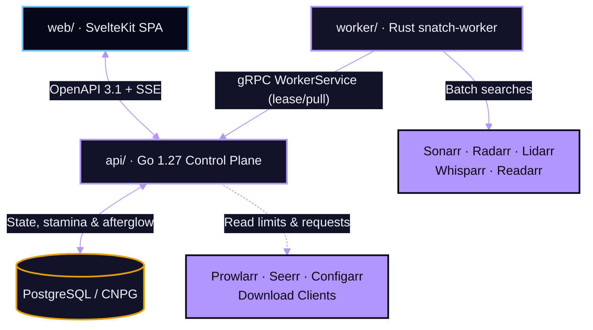

<!--
SPDX-FileCopyrightText: 2026 lusoris <lusoris@pm.me>

SPDX-License-Identifier: CC-BY-SA-4.0
-->
<!-- markdownlint-disable MD013 MD033 MD041 -->

<div align="center">


<!-- README-STANDARD badge block -->
<!-- 1 release/version -->
[](https://github.com/lusoris/SnatchArr/releases) <!-- x-release-please-version -->
<!-- 2 CI/build + 3 security/scorecard: added by engine-readme-badges-renderer-facet-20261118 -->
<!-- 4 standards -->
[](AGENTS.md)
[](CONTRIBUTING.md)
[](https://api.reuse.software/info/github.com/lusoris/SnatchArr)
[](docs/adr/0015-ui-design-system-and-layout.md)
<!-- 5 licence -->
[](LICENSES/)
<!-- 6 support -->
[](https://lusoris.github.io/SnatchArr/)
[](https://github.com/lusoris/SnatchArr/issues)
[](https://github.com/lusoris/SnatchArr/discussions)
[](SECURITY.md)

**Keeps your \*arr libraries complete without hammering your indexers.**

*Rate-capped missing and cutoff-unmet snatching across Sonarr, Radarr, Lidarr, Whisparr and Readarr.*

</div>

SnatchArr asks Sonarr, Radarr, Lidarr, Whisparr (v2 and v3) and Readarr ([legacy](https://lusoris.github.io/SnatchArr/readarr/)) to search for **missing** items and **cutoff-unmet upgrades** in small batches. Every search is a *snatch*: it remembers what it already snatched (the *afterglow*), never exceeds an instance's hourly *stamina*, and slows down (*foreplay*) while your download client is busy, paused or gone. Yes, the name means what you think it means.

**Docs: <https://lusoris.github.io/SnatchArr/>**

## 🏷️ The name

- **Meaning:** To *snatch* is to acquire a missing or cutoff-unmet item, and “Arr” refers to the family of \*arr applications ([ADR-0020](docs/adr/0020-snatch-policy-defaults-and-presets.md), [ADR-0049](docs/adr/0049-metadata-proxy.md)).
- **Origin:** Combines *snatch* with the **\*arr** suite naming convention from Sonarr and Radarr, following the Huntarr ([newtarr](https://github.com/elfhosted/newtarr)) lineage.
- **Double meaning:** The innuendo is intended across the pacing vocabulary (*snatch*, *afterglow*, *stamina*, *foreplay*, *quickie*) and the anatomical brand mark ([ADR-0017](docs/adr/0017-anatomical-brand-mark.md)).
- **Pronunciation:** "snatch-arr" ([ADR-0020](docs/adr/0020-snatch-policy-defaults-and-presets.md), [ADR-0049](docs/adr/0049-metadata-proxy.md)).

## 🎯 Why SnatchArr

| Huntarr / newtarr | SnatchArr |
| :--- | :--- |
| One setting set per app, shared by all instances | A snatch policy **per instance** |
| Hourly cap checked once per cycle | Stamina debited **for granted targets before dispatch** in a rolling 60-minute window, shared across workers |
| Processed items never expire | Afterglow with an exponential-backoff TTL per item, separate for missing and upgrades |
| Looks at the *arr queue size only | Watches qBittorrent, Transmission, Deluge, rTorrent, SABnzbd and NZBGet for backpressure |
| Python, single process, JSON files | Go control plane, Rust worker, Postgres, Helm, OpenAPI 3.1 |

- **Prowlarr indexer awareness:** Reads [Prowlarr](https://lusoris.github.io/SnatchArr/prowlarr/) query limits in read-only mode and defers snatches when all automatic-search indexers on an instance are exhausted.
- **Seerr request priority:** Syncs approved [Seerr](https://lusoris.github.io/SnatchArr/seerr/) requests and searches requested movies and series ahead of the backlog within normal stamina caps.
- **Observe-first queue management:** Classifies stalled, slow, failed, import-blocked and unwanted items through the \*arr queue API ([Queue management](https://lusoris.github.io/SnatchArr/queue-management/)), starting every rule in `observe` mode before any removal or force-import.
- **Deterministic dry-run previews:** Evaluates candidate filtering, selection and stamina quotes without dispatching searches or writing afterglow memory ([Concepts](https://lusoris.github.io/SnatchArr/concepts/#preview-and-dry-run)).

## 🚀 Get started

Deploy on Kubernetes with the signed OCI Helm chart:

```sh
helm install snatcharr oci://ghcr.io/lusoris/charts/snatcharr --namespace snatcharr --create-namespace
```

The default install needs the CloudNativePG operator. For an external Postgres instead, set `postgres.cnpg.enabled=false` and point `postgres.external.dsnSecretRef` at a Secret that holds the DSN. Details, ArgoCD and a kind recipe: [Deployment](https://lusoris.github.io/SnatchArr/deployment/).

For a single Docker host, use the homelab Docker Compose bundle (`deploy/homelab/`): [Install with Docker Compose](https://lusoris.github.io/SnatchArr/install-compose/).

### Instances from Configarr

If you already run [Configarr](https://github.com/raydak-labs/configarr), point SnatchArr at its `config.yml` and `secrets.yml` and every instance is imported (and kept in sync) instead of being configured twice.

## 🧩 Architecture at a glance



It is a from-scratch, cloud-native rewrite of the Huntarr lineage ([newtarr](https://github.com/elfhosted/newtarr)), built on the lusoris stack:

| Component | Stack |
| :--- | :--- |
| `api/` | Go 1.27 control plane on [golusoris](https://github.com/golusoris/golusoris) with [goenvoy](https://github.com/golusoris/goenvoy) *arr clients, OpenAPI 3.1, RFC 9457, SSE |
| `worker/` | Rust snatch-worker (tokio + tonic) that leases snatch runs from the API over gRPC |
| `web/` | SvelteKit SPA on [sveltesentio](https://github.com/golusoris/sveltesentio), WCAG 2.2 AA / EN 301 549, en + de |
| `deploy/` | Distroless OCI images, Helm chart, CloudNativePG, ArgoCD |

## 📚 Guides and reference

| Guide | What it covers |
| :--- | :--- |
| [Concepts](https://lusoris.github.io/SnatchArr/concepts/) | Snatches, per-cycle selection, afterglow, stamina, foreplay, circuit breaker, quickies, schedules, dry-run previews, live SSE events |
| [Configuration](https://lusoris.github.io/SnatchArr/configuration/) | `APP_*` and `SNATCH_*` environment variables, runtime settings, profiles, OIDC and proxy-header SSO, Configarr linked mode |
| [Deployment](https://lusoris.github.io/SnatchArr/deployment/) | Signed OCI images, Helm chart, cosign and SLSA verification, CloudNativePG backup/restore and major upgrades, KEDA autoscaling, NetworkPolicy, ArgoCD, kind in incus VM, [Docker Compose](https://lusoris.github.io/SnatchArr/install-compose/) |
| [Queue management](https://lusoris.github.io/SnatchArr/queue-management/) | Observe-first strike rules, status-line classifier, ID-matched force-import, and [Download clients](https://lusoris.github.io/SnatchArr/download-clients/) backpressure |
| [Prowlarr](https://lusoris.github.io/SnatchArr/prowlarr/) | Read-only indexer stamina monitoring and query-limit gate semantics |
| [Seerr](https://lusoris.github.io/SnatchArr/seerr/) | Priority snatching for approved requests, request dashboard, and instance import |
| [Readarr (legacy)](https://lusoris.github.io/SnatchArr/readarr/) | Frozen legacy Readarr support and tested forks (Bookshelf, Chaptarr, Faustvii Readarr) |
| [API](https://lusoris.github.io/SnatchArr/api/) | OpenAPI 3.1 HTTP contract, RFC 9457 problem details, authentication, and gRPC `WorkerService` |
| [Metrics](https://lusoris.github.io/SnatchArr/metrics/) | Prometheus endpoints on API and worker, leader-only domain state gauges, ServiceMonitor, PodMonitor, and Grafana dashboard |
| [Roadmap](https://lusoris.github.io/SnatchArr/roadmap/) | Open version milestones (`0.9`–`0.15` and metadata provider tracks) generated from GitHub milestones |
| [ADRs](https://lusoris.github.io/SnatchArr/adr/) | Architectural Decision Records documenting control/data-plane split, pacing, UI, security, and integrations |

## 🤝 Contribute

Contributions follow the [Contributing Guide](CONTRIBUTING.md) and the canonical agent operating harness in [AGENTS.md](AGENTS.md):

- **Local setup:** `make setup` installs git hooks and initializes local state; `make dev` starts Postgres via Docker Compose alongside the API, worker, and web dev servers.
- **Verification gate:** Run `make verify-all` before opening a pull request. Every public interface requires positive, negative, and boundary tests (`HISS-15`), every route must pass Playwright + `axe-core` with zero WCAG 2.2 AA violations (`make web-e2e`), and commit subjects follow [Conventional Commits](CONTRIBUTING.md) and every commit carries a [`Signed-off-by` line](.github/workflows/commit-policy.yml).

## 💬 Support

- **Documentation:** <https://lusoris.github.io/SnatchArr/>
- **Bug reports and feature requests:** [GitHub Issues](https://github.com/lusoris/SnatchArr/issues)
- **Questions and community discussion:** [GitHub Discussions](https://github.com/lusoris/SnatchArr/discussions)
- **Security vulnerabilities:** Report privately under [SECURITY.md](SECURITY.md) rather than opening a public issue.

## 📈 Roadmap and releases

Pre-alpha, released: versions and their notes are on the [releases page](https://github.com/lusoris/SnatchArr/releases). Open version milestones (`0.9` through `0.15` and the `Metadata:*` tracks) are tracked on the [Roadmap](https://lusoris.github.io/SnatchArr/roadmap/) (`docs/roadmap.md`) and [GitHub Milestones](https://github.com/lusoris/SnatchArr/milestones).

Releases are cut by Release Please (`.github/workflows/release-please.yml`) and gated by `.github/workflows/release.yml` on a live cluster MCP dogfood status (`snatcharr/dogfood=success`, `.github/workflows/release-dogfood-gate.yml`) and end-to-end `amd64`/`arm64` image smoke checks. Each release publishes `ghcr.io/lusoris/snatcharr-api`, `ghcr.io/lusoris/snatcharr-worker` and the chart `oci://ghcr.io/lusoris/charts/snatcharr` (semver tags only, no `latest`), all cosign-signed with SLSA build provenance attestations, built in `.github/workflows/release-build.yml` at SLSA Build Level 3 for every release after v0.2.1; both images come with an SPDX SBOM, and the release page stays a draft until `verify` confirms every signature, checksum (`SHA256SUMS`), and provenance bundle (`provenance.sigstore.json`).

## ⚖️ Upstream and licence


SnatchArr is a from-scratch, cloud-native rewrite of the Huntarr lineage ([newtarr](https://github.com/elfhosted/newtarr)), built on [golusoris](https://github.com/golusoris/golusoris), [goenvoy](https://github.com/golusoris/goenvoy) and [sveltesentio](https://github.com/golusoris/sveltesentio).

Code: [EUPL-1.2](LICENSES/EUPL-1.2.txt). Documentation: [CC BY-SA 4.0](LICENSES/CC-BY-SA-4.0.txt). REUSE-compliant.

The brand mark is derived from ["Female vulva.svg"](https://commons.wikimedia.org/wiki/File:Female_vulva.svg) by T. Kebert, Wikimedia Commons, [CC BY-SA 4.0](LICENSES/CC-BY-SA-4.0.txt), modified: cropped to the vulva, clitoral glans enlarged, vaginal opening shaded, recoloured ([ADR-0017](docs/adr/0017-anatomical-brand-mark.md)).

## Standards & Governance

Governance: [praetor](https://github.com/cordanaLLM/praetor) (HISS invariants, canonical `AGENTS.md`).

<!-- praetor:readme-governance:start -->
[![HISS Adopted][praetor-hiss-badge]][praetor-hiss-agents]

Praetor manages this repository's declared governance policy. This managed
block records adoption state; it is not a verification certificate.

**Verification**: `make verify-all` runs the repository's configured
verification cascade.

**HISS Audit**: `praetorctl audit` enforces policy, generated-surface
integrity, and the debt ratchet.

**Context Sync**: `praetorctl compile-context --verify` verifies every
generated agent context against `AGENTS.md`.

**Debt Baseline**: `.standards-baseline.json` anchors the debt ratchet at
0 recorded infractions; audit forbids growth.

[praetor-hiss-badge]: https://img.shields.io/badge/Standards-HISS%20Adopted-blue
[praetor-hiss-agents]: https://github.com/lusoris/SnatchArr/blob/HEAD/AGENTS.md
<!-- praetor:readme-governance:end -->
