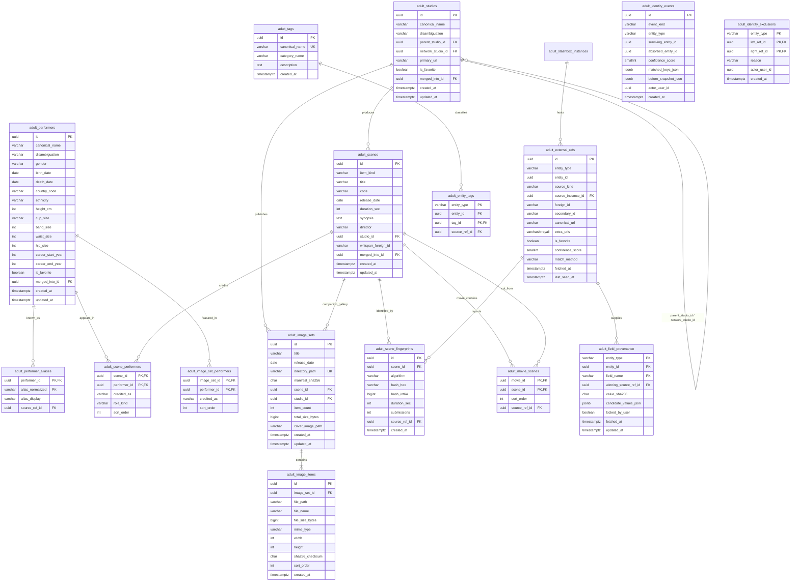

<!-- markdownlint-disable MD013 -->
<!--
SPDX-FileCopyrightText: 2026 lusoris <lusoris@pm.me>
SPDX-License-Identifier: CC-BY-SA-4.0
-->

# ADR-0033: Adult identity resolution and normalized data model

- Status: Accepted (2026-10-26); scope questions `OQ-0033-1` to `OQ-0033-6` answered
- Date: 2026-10-26
- Related: [ADR-0018](0018-product-front-door.md), [ADR-0025](0025-module-switches.md), [ADR-0026](0026-accounts-and-roles.md), [ADR-0027](0027-adult-module.md), [ADR-0028](0028-jellyfin-plugin.md), [ADR-0031](0031-creator-content-fansdb.md), [ADR-0032](0032-stash-own-or-integrate.md)

## Context

`SnatchArr` (from "snatch" and the `*arr` media-management family, pronounced "snatch-arr") serves as the front door of the media stack ([ADR-0018](0018-product-front-door.md)). Within that architecture, the `adult` module ([ADR-0027](0027-adult-module.md)) federates discovery across multiple `stash-box` instances (the open-source GraphQL metadata indexer server developed by the `Stash` project, from "stash" and "box", pronounced "stash-box"), dispatches scene requests to `Whisparr` (the adult video manager forked from `Sonarr` in v2 and `Radarr` in v3, from "whisper" and `*arr`, pronounced "whisper-arr"), indexes local image-set galleries, and serves metadata and galleries to `Jellyfin` (the free-software media server, from "jellyfish" and "fin", pronounced "jelly-fin") through the companion plugin defined in [ADR-0028](0028-jellyfin-plugin.md).

Two sibling architectural decisions are concurrently in work:

- **ADR-0031** (reserved, draft in work): Discovery and search for catalogued independent-creator content.
- **ADR-0032** (reserved, draft in work): Evaluation of linking to an external `Stash` instance (the self-hosted adult media organizer, pronounced "stash") versus building native indexing in `SnatchArr`.

To prevent schema divergence across [ADR-0027](0027-adult-module.md), [ADR-0028](0028-jellyfin-plugin.md), ADR-0031, and ADR-0032, this ADR (numbered `0033`, the next free slot after those reserved drafts) defines the **single canonical normalized adult data model**, cross-source identity resolution engine, per-field source precedence and provenance rules, upstream client extension contract in `goenvoy` (the shared Go HTTP client library for external media and metadata APIs, from "Go" and "envoy", pronounced "go-en-voy"), and the `Jellyfin` virtual library entity mapping. All sibling ADRs reference the model specified here rather than defining source-specific schemas.

### Current implementation baseline

Inspection of `/home/kilian/dev/worktrees/SnatchArr-adultidentity` on `2026-10-26` establishes the existing implementation state:

1. **Database schema (`000036` and `000038`)**:
   - `api/internal/store/migrations/postgres/000036_adult_module.up.sql` defines `adult_stashbox_instances`, `adult_favorite_performers`, `adult_performer_links`, `adult_favorite_studios`, `adult_studio_links`, `adult_image_sets`, and `adult_image_items`.
   - `api/internal/store/migrations/postgres/000038_adult_favorite_urls.up.sql` adds `adult_performer_urls` and `adult_studio_urls` (`favorite_id`, `url`, `site_name`) so cross-instance URL matching survives restarts.
2. **Current merge baseline (`api/internal/adult/merge.go`)**:
   - `api/internal/adult/merge.go` (`MatchEntity`) implements a stateless three-step deterministic matcher used during favourite synchronization (`api/internal/adult/sync.go`) and live federated search (`api/internal/adult/search.go`):
     1. `matchByEndpointURL` (`merge.go`): Inspects `incoming.URLs` for any URL whose normalized host matches a configured `StashboxEndpoint` and whose path ends in `/<kind>/<foreign_id>` matching an existing `EntityLink{InstanceID, ForeignID}`.
     2. `matchByExternalURL` (`merge.go`): Compares `NormalizeExternalURL(u)` (`merge.go`, stripping scheme, `www.`, and trailing slash while preserving query parameters) against existing entity URLs.
     3. `matchByName` (`merge.go`): Compares `NormalizeName` (`merge.go`, lowercase with collapsed whitespace) when and only when `Disambiguation` is empty on both the incoming and existing entities.
3. **Limitations of the ADR-0027 baseline**:
   - **Favourite-only persistence**: Only favourited performers and studios are persisted (`adult_favorite_performers`, `adult_favorite_studios`). No normalized tables exist for scenes, studio parent/network hierarchies, tags, scene fingerprints, or non-`stash-box` sources such as `ThePornDB` (the community and scraper-driven adult metadata service, pronounced "the-porn-d-b").
   - **Last-writer-wins field overwrite**: `UpsertAdultFavoritePerformer` (`api/internal/store/queries/adult.sql`) and `UpsertAdultFavoriteStudio` (`adult.sql`) unconditionally overwrite `canonical_name` and `disambiguation` on every sync pass (`api/internal/adult/sync.go`), ignoring instance priority (`adult_stashbox_instances.priority`) and losing per-field provenance.
   - **Binary matching without confidence or conflict handling**: `MatchEntity` makes an immediate irreversible merge or creates a new row. It cannot represent medium-confidence match candidates for operator review, detect hard conflicts (such as two distinct active UUIDs on the same `stash-box` instance), follow upstream `merged_ids` / `merged_into_id` redirects, or split a false-positive merge with an audit trail.

### Upstream metadata sources survey

#### 1. Public `stash-box` instances

Per the upstream `Stash` documentation at [Metadata Sources: Stash-Box Instances](https://docs.stashapp.cc/metadata-sources/stash-box-instances/) (read `2026-10-26`) and the upstream `stashapp/stash-box` repository ([github.com/stashapp/stash-box](https://github.com/stashapp/stash-box), release tag `v0.10.3`, commit `5eb3551e19fd494e93be410d8149adc785cffd6a`, licence `MIT`, read `2026-10-26`), five production `stash-box` GraphQL endpoints are documented:

| Instance name | GraphQL endpoint | Documented scope and characteristics | Protocol implementation |
| :--- | :--- | :--- | :--- |
| **StashDB** | `https://stashdb.org/graphql` | Canonical community-driven metadata database focused on studio digital scenes across all orientations. Curated via moderated edits (`Edit` voting workflow). | Upstream `stashapp/stash-box` (`v0.10.3`). |
| **FansDB** | `https://fansdb.cc/graphql` | Community-driven metadata database focused on independent creator platforms where self-published creators are the primary focus (referenced by ADR-0031). | Upstream `stashapp/stash-box` (`v0.10.3`). |
| **JAVStash** | `https://javstash.org/graphql` | Metadata database focused on Japanese Adult Video (JAV) releases with original Japanese titles, catalog codes, and performer names; primarily populated via automated scrapers. | Upstream `stashapp/stash-box` (`v0.10.3`). |
| **PMV Stash** | `https://pmvstash.org/graphql` | Community-driven metadata database focused on remixed adult video art (music videos, rhythm edits, and compilations). | Upstream `stashapp/stash-box` (`v0.10.3`). |
| **ThePornDB** | `https://theporndb.net/graphql` | Metadata database covering studio digital scenes, full-length movies, and JAV, populated primarily by automated scrapers. Requires profile setting `GraphQL Manager Scene Type = Any` to expose movies and JAV alongside scenes. | Proprietary GraphQL compatibility layer backed by `ThePornDB` data store. |

#### 2. `ThePornDB` API surface (REST versus GraphQL)

Live inspection on `2026-10-26` of the `ThePornDB` OpenAPI 3.0.0 specification at [https://api.theporndb.net/specs?openapi.json](https://api.theporndb.net/specs?openapi.json) (version `v3.24.767`) and the GraphQL endpoint at `https://theporndb.net/graphql` shows two distinct interfaces:

| Dimension | REST API (`https://api.theporndb.net`) | GraphQL compatibility API (`https://theporndb.net/graphql`) |
| :--- | :--- | :--- |
| **Specification** | OpenAPI 3.0.0 (`v3.24.767`, read `2026-10-26`). | Proprietary subset of `stash-box` GraphQL schema. |
| **Authentication** | HTTP header `Authorization: Bearer <token>` (Laravel Sanctum token, `securitySchemes.sanctum`). Unauthenticated calls to protected routes (`/performers`, `/auth/user`) return `401 {"message":"Unauthenticated."}`. | HTTP header `Apikey: <token>` or `Authorization: Bearer <token>`. |
| **Entity coverage** | Separate typed endpoints for `Scene` (`/scenes`, `/scenes/{identifier}`, `/scenes/hash/{hash}`, `/scenes/similar`), `Movie` (`/movies`, `/movies/{identifier}`, `/movies/hash/{hash}`), `Jav` (`/jav`, `/jav/{identifier}`, `/jav/hash/{hash}`), `Performer` (`/performers`, `/performers/{identifier}`, `/performers/{identifier}/{scenes\|movies\|jav\|similar}`), `PerformerSite` (`/performer-sites`, `/performer-sites/{identifier}` linking site-specific profiles to canonical `parent` `PerformerResource`), `Site` (`/sites`, `/sites/{identifier}`, `/sites/{identifier}/{scenes\|movies\|jav}` with `parent_id` and `network_id`), `Tag` (`/tags`), `Director` (`/directors`), `Favourites` (`GET/POST /favourites?type={performer\|site}&value={id}`), and `Changes` (`GET /changes/{movies\|scenes\|jav\|performers}?from={RFC3339}`). | Collapses `Scene`, `Movie`, and `Jav` into the single `stash-box` `Scene` type, controlled by a server-side web profile flag (`GraphQL Manager Scene Type`) that the client cannot override per request. Does not expose `PerformerSite` parent links or `/changes/*` incremental sync feeds. |
| **Identifiers** | Dual IDs on `Scene`, `Movie`, `Jav`, and `Performer`: `"id"` is a UUID string (e.g., `"019a0000-..."`) and `"_id"` is a positive integer primary key. `Site` uses integer `id`, `parent_id`, `network_id`, and string `uuid`. | Maps entities to `stash-box` `ID!` strings. |
| **Cross-references** | `links` field on `Scene`, `Movie`, `Jav`, `Performer.extra.links`, and `PerformerSite.extra.links` contains cross-source URLs keyed by source name (`StashDB`, `IAFD`, `TMDB`, `IMDb`, `Indice`). | Exposes `urls { url site { id name url } }`. |
| **Caching and rate limits** | Fronted by Cloudflare (`cf-cache-status`, `cache-control: public, max-age=43200` on public read paths) with Laravel Sanctum per-token rate limiting returning `HTTP 429 Too Many Requests` (`Retry-After`, `X-RateLimit-Limit`, `X-RateLimit-Remaining`). | Same account-level token limits without REST edge caching on `POST /graphql`. |

#### 3. Upstream `goenvoy` client coverage and gaps

Inspection of `github.com/golusoris/goenvoy` (`main` commit `ac12960bb042cf3b582fbe2421150fe85b321593`, licence `MIT`, read `2026-10-26`) verifies the two relevant packages:

1. **`github.com/golusoris/goenvoy/metadata/adult/tpdb`** (latest release tag `metadata/adult/tpdb/v1.3.6`, commit `392968f04f0287825d2010d5f38f3a1d4bbe137d`, released `2026-10-25`):
   - Uses the **`ThePornDB` REST API** (`defaultBaseURL = "https://api.theporndb.net"`, Bearer token authentication in `metadata/adult/tpdb/tpdb.go`).
   - Currently exports (`tpdb.go`): `New`, `SearchScenes`, `GetScene`, `FindSceneByHash`, `GetSimilarScenes`, `SearchPerformers`, `GetPerformer`, `GetSimilarPerformers`, `GetPerformerScenes`, `GetPerformerMovies`, `SearchSites`, `GetSite`, `ListTags`, `GetTag`, `ListDirectors`, `GetDirector`, `SearchMovies`, `GetMovie`, `SearchJav`, `GetJav`, `LookupByHash`, and `GetChanges`.
   - Comparison against live `ThePornDB` OpenAPI `v3.24.767` and `https://api.theporndb.net/scenes?per_page=1` (`2026-10-26`) reveals concrete schema drifts (`id`/`_id` type inversion, `posters`/`backgrounds` object maps vs slice, PHP `links` empty-array vs object map, `/changes/{type}` path) and missing endpoints (`PerformerSite`, `Favourites`, typed hash lookups for movies/JAV, site filmography) detailed in Section 5.
2. **`github.com/golusoris/goenvoy/metadata/adult/stashbox/v2`** (latest release tag `metadata/adult/stashbox/v2.0.4`, commit `392968f04f0287825d2010d5f38f3a1d4bbe137d`, released `2026-10-25`, pinned in `SnatchArr` `go.mod`):
   - Uses the **`stash-box` GraphQL API** (`metadata/adult/stashbox/stashbox.go`, `metadata/adult/stashbox/types.go`).
   - Currently exports (`stashbox.go`): `New`, `Query`, `FindPerformer`, `QueryPerformers`, `SearchPerformers`, `FindScene`, `QueryScenes`, `SearchScenes`, `FindScenesByFingerprints`, `FindStudio`, `QueryStudios`, `SearchStudios`, `FindTag`, `QueryTags`, `SearchTags`, `ListSites`, and `GetConfig`.
   - Comparison against `stashapp/stash-box` `v0.10.3` (`graphql/schema/types/performer.graphql`, `studio.graphql`, `scene.graphql`) reveals missing typed filter inputs (`PerformerQueryInput`, `SceneQueryInput`, `StudioQueryInput`), deprecated `birthdate`/`measurements` fields in `performerFields` (`stashbox.go`), missing `merged_ids` / `merged_into_id` fields, and missing `FavoritePerformer` / `FavoriteStudio` mutations detailed in Section 5.

## Decision

### 1. Cross-source identity resolution and match keys

Every adult metadata record ingested from `stash-box` instances, `ThePornDB` REST, `Whisparr` (v2 and v3), or local filesystem scanners resolves into `SnatchArr`'s canonical entity graph (`Performer`, `Studio`, `Scene`, `Movie`, `ImageSet`, and `Tag`). `Whisparr` v3 carries both full-length movies and scenes in one resource, told apart by `ItemType` (`Movie`, `Scene`; `src/NzbDrone.Core/Movies/MovieMetadata.cs` at `v3.1.0.2116`), and `ThePornDB` serves them on separate `/movies` and `/scenes` endpoints. A scene and a full-length movie are rows of `adult_scenes` with `item_kind IN ('scene', 'movie')`; `adult_movie_scenes` links a full movie to the scenes cut from it. Two rows of different `item_kind` never auto-merge.

#### Match keys table

The resolution engine evaluates incoming records against existing canonical entities using the match keys below (strengths: `strong` = deterministic or cryptographic identifier capable of contributing to automatic merge; `medium` = corroborated attribute requiring a second independent signal or routing to operator review; `weak` = tie-breaker or search ranking signal that never merges entities on its own):

| Entity | Key | Source | Strength | Notes |
| :--- | :--- | :--- | :--- | :--- |
| **Performer** | `(source_instance_id, foreign_id)` exact match | `stash-box` (`Performer.id`), `ThePornDB` (`Performer.id` UUID / `Performer._id` int) | `strong` | Primary idempotent lookup on `adult_external_refs`. Exact hit updates the linked canonical performer in place (`score = 100`). |
| **Performer** | `stash-box` `merged_ids` / `merged_into_id` | `stash-box` `v0.10.3` (`types/performer.graphql`) | `strong` | When an upstream moderator merges duplicate performer entries, `merged_ids` lists retired UUIDs and `merged_into_id` points to the surviving UUID on the same instance (`score = 95`). |
| **Performer** | Cross-reference `stash-box` endpoint URL in `urls` / `links` | `stash-box` `Performer.urls`, `ThePornDB` `Performer.extra.links["StashDB"]` | `strong` | Matches `api/internal/adult/merge.go` (`matchByEndpointURL`). Links a performer on instance B or `ThePornDB` directly to the UUID on instance A (`score = 95`). |
| **Performer** | `ThePornDB` `PerformerSite.parent` canonical performer reference | `ThePornDB` REST (`GET /performer-sites/{id}`, `PerformerSiteResource.parent`) | `strong` | Resolves site-specific performer profiles (`performer-sites`) to their parent canonical `PerformerResource` UUID (`score = 90`). |
| **Performer** | Normalized authoritative external profile URL (`IAFD`, `IMDb`, `TMDB`, official personal domain, verified social handle) | `stash-box` `Performer.urls`, `ThePornDB` `Performer.extra.links` | `strong` | Matches `api/internal/adult/merge.go` (`NormalizeExternalURL`). Excludes generic studio/network homepages (`score = 90`). |
| **Performer** | Normalized name or alias + exact `birth_date` (`YYYY-MM-DD`) + matching `country` / `gender` | `stash-box` (`name`, `aliases`, `birth_date`, `country`, `gender`), `ThePornDB` (`name`, `aliases`, `extra.birthday`, `extra.nationality`, `extra.gender`) | `medium` | Corroborates identity when cross-reference URLs are absent (`score = 75`). Routes to review unless paired with shared scene overlap or physical measurements. |
| **Performer** | Normalized name + physical measurements (`height_cm` $\pm 2\text{ cm}$, `cup_size`, `band_size`, `waist_size`, `hip_size`) | `stash-box` `v0.10.3` (`height`, `cup_size`, `band_size`, `waist_size`, `hip_size`), `ThePornDB` (`extra.height`, `extra.cupsize`, `extra.waist`, `extra.hips`) | `medium` | Adds `+15` corroboration to a medium name/birthdate or filmography match; never merges without a name/alias match. |
| **Performer** | Exact normalized name (`NormalizeName`) with empty `disambiguation` on both records | All sources (`api/internal/adult/merge.go`) | `weak` | High collision risk for common mononyms (e.g., `"Performer Alpha"`). Assigned `score = 50` (review suggestion or search grouping only, replacing ADR-0027's unconditional auto-merge unless backed by a `medium`/`strong` signal). |
| **Studio** | `(source_instance_id, foreign_id)` or `stash-box` cross-ref URL in `urls` | `stash-box` (`Studio.id`, `Studio.urls`), `ThePornDB` (`Site.id`, `Site.uuid`) | `strong` | Exact foreign reference or cross-instance `/studios/<uuid>` link (`score = 100` / `95`). |
| **Studio** | Normalized canonical studio domain URL (`NormalizeExternalURL`) | `stash-box` `Studio.urls`, `ThePornDB` `Site.url` | `strong` | Matches when the URL path is the site root or dedicated sub-site path and parent network matches (`score = 90`). |
| **Studio** | Normalized studio name + resolved parent/network studio identity | `stash-box` (`Studio.name`, `Studio.parent.id`), `ThePornDB` (`Site.name`, `Site.parent_id`, `Site.network_id`) | `medium` | Disambiguates sub-brands under a parent network (e.g., `"Studio Nova"` under `"Network Apex"`, `score = 80`). |
| **Studio** | Normalized studio name alone (`NormalizeName`) | All sources | `weak` | Assigned `score = 55`; requires matching domain URL or parent network to auto-merge. |
| **Scene** | `(source_instance_id, foreign_id)` or `Whisparr` `StashId` | `stash-box` (`Scene.id`), `ThePornDB` (`Scene.id` / `Scene._id`), `Whisparr` v3 (`MovieResource.StashId`) | `strong` | Direct foreign key identity (`score = 100`). |
| **Scene** | Cross-reference scene URL (`stash-box` `Scene.urls`, `ThePornDB` `Scene.links`, or studio scene permalink) | `stash-box`, `ThePornDB` (`links["StashDB"]`, `Scene.url`), `Whisparr` | `strong` | Exact match on `NormalizeExternalURL` pointing to a specific scene path (`score = 95`). |
| **Scene** | File fingerprint `OSHASH` (64-bit OpenSubtitles hash) + file duration ($\pm 2\text{ s}$) | `stash-box` `Scene.fingerprints` (`OSHASH`), `ThePornDB` `Scene.hashes` (`OSHASH`), local media scanner | `strong` | Deterministic 64-bit byte-sample hash supported by both `stash-box` (`internal/service/scene/service.go`) and `ThePornDB` (`GET /scenes/hash/{hash}?type=OSHASH`) (`score = 95`). |
| **Scene** | File fingerprint `MD5` (128-bit full-file digest) | Local media scanner, `ThePornDB` (`GET /scenes/hash/{hash}?type=MD5`), external `Stash` | `strong` | Exact byte identity (`score = 100`). Note: `stash-box` `v0.10.3` defines `MD5` in `types/scene.graphql` but removes `MD5` fingerprints from query and edit inputs (`filterMD5FingerprintInputs` in `internal/api/fingerprint_filter.go`), so `MD5` matching runs only against local and ThePornDB data. |
| **Scene** | Perceptual video fingerprint `PHASH` (64-bit DCT hash) with Hamming distance $d = 0$ (exact) or $1 \le d \le 4$ + duration $\pm 5\text{ s}$ | `stash-box` (`FindScenesBySceneFingerprints`), `ThePornDB` (`PHASH`), local scanner | `strong` | Survives re-encoding across resolutions (`score = 92` at $d = 0$; `score = 86` at $1 \le d \le 4$ when `submissions >= 2` or duration matches within $\pm 5\text{ s}$). |
| **Scene** | Perceptual video fingerprint `PHASH` with Hamming distance $5 \le d \le 8$ | `stash-box` (`distanceModerator = 8` in `internal/api/resolver_query_fingerprint_cluster.go`), local scanner | `medium` | Matches `stash-box` moderator cluster boundary (`distanceMin = 2`, `distanceModerator = 8`, `distanceMax = 16`). Assigned `score = 70` (candidate review queue; requires studio + date or performer overlap to reach `>= 85`). Distance $d > 8$ is `weak` (`score = 0`, never merged). |
| **Scene** | Resolved `studio_id` + studio catalog `code` / `sku` (including standardized JAV catalog code) | `stash-box` (`Scene.code`), `ThePornDB` (`Scene.external_id`, `Scene.sku`, `Jav.code`) | `strong` | Studio-assigned release codes are unique per studio (`score = 90` when `code` has $\ge 3$ alphanumeric characters). |
| **Scene** | Resolved `studio_id` + exact `release_date` (`YYYY-MM-DD`) + normalized `title` | `stash-box`, `ThePornDB`, `Whisparr` | `medium` | Assigned `score = 80`; reaches auto-merge (`>= 85`) when corroborated by $\ge 1$ shared resolved performer (`+10`) or duration within $\pm 10\text{ s}$ (`+10`). |
| **Scene** | Normalized `title` + `release_date` ($\pm 1\text{ day}$) without resolved studio | All sources | `weak` | Assigned `score = 45`; used only for search candidate ranking. |
| **ImageSet** | Directory or archive manifest digest (`sha256` of sorted item `sha256_checksum` values) | Local filesystem scanner (`adult_image_items.sha256_checksum` in `000036_adult_module.up.sql`) | `strong` | Exact content identity across moved directories or unpacked `.zip`/`.cbz` archives (`score = 100`). |
| **ImageSet** | Explicit `whisparr_scene_foreign_id` or sidecar `.nfo` / JSON `stash_id` / `tpdb_id` | Local filesystem scanner, `Whisparr` scene folder co-location | `strong` | Deterministically links the `ImageSet` to its parent canonical `Scene` (`score = 95`). |
| **ImageSet** | Resolved `studio_id` + `release_date` + normalized `title` + $\ge 1$ shared performer | Local folder naming parser + canonical `Scene` / `Performer` index | `medium` | Links an image set to a canonical `Scene` (`score = 75` review suggestion; `score = 85` auto-link when folder resides inside the studio/performer hierarchy). |

#### Confidence scoring model and thresholds

For any candidate pair $(E_{\text{existing}}, E_{\text{incoming}})$ of the same entity type, the resolver computes a bounded confidence score $S \in [0, 100]$:

$$S = \min\left(100, \max_{k \in K_{\text{matched}}}(s_k) + \sum_{c \in K_{\text{corroborating}}} b_c - \sum_{p \in P_{\text{conflicts}}} c_p\right)$$

where $\max(s_k)$ is the highest base score among matched keys in the table above, $b_c \in [5, 15]$ are additive corroboration bonuses from independent attribute families (e.g., matching `birth_date` `+10`, matching performer overlap `+10`, matching duration `+10`), and $c_p$ are conflict penalties.

| Score range | Decision tier | System action |
| :--- | :--- | :--- |
| $S \ge 85$ and zero hard conflicts | **Auto-merge** | Links `adult_external_refs` to the existing canonical entity, records an `auto_merge` row in `adult_identity_events`, and recomputes field values according to source precedence. |
| $60 \le S \le 84$ (or $S \ge 85$ with a soft conflict) | **Suggest (Review queue)** | Creates a separate canonical entity for the incoming record (preserving data isolation) and inserts a `pending_review` candidate pair in `adult_identity_suggestions` with the matched key breakdown for operator approval or rejection. |
| $S < 60$ | **Never merge** | Keeps entities distinct with no suggestion entry. |

The review queue is the matching audit queue named in ADR-0031: no low-confidence match is applied silently. Per-attribute reconciliation across sources, model-assisted judgement, the audit UI and the feedback of audit decisions into source trust and thresholds are defined in a follow-up ADR on matching; the scores and thresholds here are its starting values.

#### Hard conflict rules (auto-merge blockers)

Even when a key produces $S \ge 85$, automatic merging is blocked and downgraded to `pending_review` (or rejected outright) if any of the following invariants hold:

1. **Same-instance distinct identity**: Both entities already carry active (non-retired, not in `merged_ids`) `adult_external_refs` on the **same** `source_instance_id` with different `foreign_id` values. Two distinct records on the same `stash-box` instance are separate entities by definition unless one lists the other in `merged_ids`.
2. **Explicit exclusion rule**: The pair $(E_1, E_2)$ or their underlying `(source_instance_id, foreign_id)` links appear in `adult_identity_exclusions` (created when an operator splits a merge or rejects a suggestion).
3. **Disambiguation clash**: Both records specify non-empty `disambiguation` strings on the same source family that normalize to different values (e.g., `"Performer Alpha (1995)"` vs `"Performer Alpha (2001)"`).
4. **Biographical contradiction**: Performer `birth_date` values on both records have year precision or better and differ by more than 365 days, or scene durations differ by more than 20 % when neither scene is flagged as a trailer/clip.
5. **Item kind mismatch**: A `scene` row and a full-length `movie` row never merge, even on a shared fingerprint, because a scene cut from a movie shares its frames; the pair becomes an `adult_movie_scenes` suggestion in the audit queue instead.

#### Manual merge, split, and undo lifecycle

To make every identity operation reversible:

1. **Immutable event ledger (`adult_identity_events`)**: Every `auto_merge`, `manual_merge`, `manual_split`, and `upstream_redirect` writes an append-only event row capturing `event_id`, `entity_type`, `surviving_entity_id`, `absorbed_entity_id`, `confidence_score`, `matched_keys_json`, `before_snapshot_json` (serialized `adult_external_refs`, `adult_field_provenance`, and entity attributes prior to mutation), `actor_user_id` (`NULL` for system loop), and `created_at`.
2. **Manual merge (`MergeEntities`)**: Moves all `adult_external_refs`, `adult_scene_performers`, `adult_entity_tags`, and `adult_field_provenance` rows from `absorbed_entity_id` to `surviving_entity_id`, marks `absorbed_entity_id` with `merged_into_id = surviving_entity_id`, and re-evaluates canonical columns using the per-field precedence table.
3. **Deterministic split / undo (`SplitEntity`)**: Given a `merge_event_id` or a subset of `external_ref_id` values to detach:
   - Restores or creates the target canonical entity ID (`absorbed_entity_id` from `before_snapshot_json`).
   - Reattaches the selected `adult_external_refs` and their associated `adult_field_provenance` rows.
   - Recomputes every field on both the surviving and detached entities strictly from each entity's remaining `adult_field_provenance` rows—never leaving stale merged fields behind.
   - Inserts a permanent pair in `adult_identity_exclusions` so subsequent background sync sweeps never re-merge the detached references automatically.

#### How this extends ADR-0027

`api/internal/adult/merge.go` in ADR-0027 remains the fast in-memory pre-filter for steps 1 and 2 (`matchByEndpointURL` and `matchByExternalURL`, which map to $S = 95$ and $S = 90$), while step 3 (`matchByName` with empty disambiguation) is tightened from an unconditional auto-merge ($S = 100$) to a weak signal ($S = 50$) that requires corroboration (`birth_date`, measurements, or shared scene links) before mutating persistent state. All existing unit tests in `api/internal/adult/merge_test.go` extend to assert confidence scores and conflict flags.

---

### 2. Normalized data model, source precedence, and provenance

#### Entity-Relationship diagram

#### Entity and relationship invariants

1. **`adult_studios` two-level hierarchy**: Models both immediate parent sub-brands (`parent_studio_id`) and top-level umbrella networks (`network_studio_id`), matching `ThePornDB` `SiteResource` (`parent_id`, `network_id`) and `stash-box` recursive `Studio.parent` chains (`graphql/schema/types/studio.graphql`). Cycle prevention is enforced at write time (depth bounded at 4 levels per HISS-01/HISS-02).
2. **`adult_external_refs` polymorphism**: Generalizes `adult_performer_links` and `adult_studio_links` across `entity_type IN ('performer', 'studio', 'scene', 'image_set', 'tag')` and `source_kind IN ('stashbox', 'tpdb_rest', 'whisparr_v3', 'whisparr_v2', 'stash_local', 'local_fs')`. For `ThePornDB`, `foreign_id` stores the UUID (`id`) and `secondary_id` stores the integer `_id` as text so both REST identifier formats resolve in $O(1)$ via unique index `(source_kind, COALESCE(source_instance_id, '00000000-0000-0000-0000-000000000000'), entity_type, foreign_id)`.
3. **Full movies and scenes**: `adult_scenes.item_kind` is `scene` or `movie`, mapped from `Whisparr` v3 `ItemType` and from the `ThePornDB` endpoint the record came from. `adult_movie_scenes` rows always point from an `item_kind = 'movie'` row to an `item_kind = 'scene'` row; the write path refuses any other pair, and a hard conflict blocks merging rows of different `item_kind`.
4. **`adult_scene_fingerprints` dual representation**: Stores both `hash_hex` (`VARCHAR(64)`, supporting 128-bit `MD5`, 64-bit `OSHASH`, and 64-bit `PHASH`) and `hash_int64` (`BIGINT`, nullable, populated for 64-bit `OSHASH` and `PHASH` so PostgreSQL `bit_count(hash_int64 # $1::bigint) <= $2` executes indexed or bounded Hamming-distance scans directly in SQL without decoding hex in Go).

#### Per-field source precedence and provenance

Different metadata sources excel at different fields: `StashDB` has community-moderated performer biographies and studio hierarchies, `JAVStash` has authoritative Japanese catalog codes (`code`), `FansDB` has independent-creator scene metadata, and `ThePornDB` has broad automated scene synopses and poster sets.

1. **Configurable precedence chain**: Module configuration stores an ordered source priority list alongside per-field-group overrides. The default precedence order is:

   | Rank | Source tier | Identifier | Rationale |
   | ---: | :--- | :--- | :--- |
   | `1` | **User manual lock** | `user_override` (`locked_by_user = true`) | Operator edits or field locks in `SnatchArr` UI never get overwritten by background syncs. |
   | `2` | **Configured `stash-box` instances** | `stashbox:<instance_id>` ordered by `adult_stashbox_instances.priority ASC, created_at ASC` | Moderated community databases (`StashDB` priority 10, `FansDB` priority 20, `JAVStash` priority 30, `PMV Stash` priority 40 by default) carry peer-reviewed edits. |
   | `3` | **`ThePornDB` REST API** | `tpdb_rest` | High-coverage scraper metadata (`Scene.description`, `posters`, `Movie`, `Jav`) filling gaps absent from `stash-box`. |
   | `4` | **`Whisparr` instance metadata** | `whisparr_v3` / `whisparr_v2` | Local library state and SkyHook cache already present in the `*arr` instance. |
   | `5` | **Local filesystem / NFO sidecar** | `local_fs` | Fallback filenames, embedded container tags, and local `.nfo` files. |

2. **Field-group override rules**:
   - **Null/empty fallback**: A higher-priority source with a `NULL` or empty value for a scalar field (`synopsis`, `code`, `birth_date`, `cup_size`) never blanks out a non-empty value supplied by a lower-priority source.
   - **Union fields**: Multi-valued sets (`adult_performer_aliases`, `adult_entity_tags`, `adult_scene_fingerprints`, `adult_external_refs.extra_urls`) take the deduplicated union across all linked sources, tagging each element with its `source_ref_id`.
   - **Per-field provenance (`adult_field_provenance`)**: Every canonical scalar field on `adult_performers`, `adult_studios`, `adult_scenes`, and `adult_image_sets` tracks `winning_source_ref_id`, `value_sha256`, `fetched_at`, `locked_by_user`, and `candidate_values_json` (a map of `{source_ref_id: {value, fetched_at}}` across all linked sources). When an entity is split (`SplitEntity`) or an instance priority changes, `SnatchArr` deterministically recomputes the winning value for every unlocked field from `candidate_values_json` without re-fetching remote APIs.

---

### 3. `Jellyfin` virtual library presentation through the ADR-0028 plugin

#### Pinned `Jellyfin` `v12.3` source verification

To evaluate how `SnatchArr`'s normalized adult entities map into `Jellyfin`, the upstream `jellyfin/jellyfin` repository was inspected at its latest release tag `v12.3` (commit `06de749d435e2d0be0c5119a41f2300fdd7143e5`, published `2026-10-23`, licence `GPL-2.0-only`, read `2026-10-26`):

1. **`MediaBrowser.Controller/Providers/IRemoteMetadataProvider.cs` and `IHasLookupInfo.cs`**:
   - `IRemoteMetadataProvider<TItemType, in TLookupInfoType> : IMetadataProvider<TItemType>` (`IRemoteMetadataProvider.cs`) enforces the generic constraint `where TItemType : BaseItem, IHasLookupInfo<TLookupInfoType>` and `where TLookupInfoType : ItemLookupInfo, new()`.
   - `ItemLookupInfo` (`ItemLookupInfo.cs`) passes `Name`, `OriginalTitle`, `Path`, `MetadataLanguage`, `MetadataCountryCode`, `ProviderIds` (`Dictionary<string, string>`), `Year` (`int?`), `IndexNumber` (`int?`), `ParentIndexNumber` (`int?`), `PremiereDate` (`DateTime?`), and `IsAutomated` (`bool`).
2. **`MediaBrowser.Controller/Entities/TV/Series.cs`, `Season.cs`, and `Episode.cs`**:
   - `Series` (`Series.cs`) implements `IHasLookupInfo<SeriesInfo>`, `ISupportsBoxSetGrouping`, `SupportsPeople => true` (`Series.cs`), primary image aspect ratio `2.0 / 3.0` (`Series.cs`), and `DisplayOrder` (`"airdate"`, `"dvd"`, `"absolute"`, `Series.cs`). Its children are strictly `Season` (`GetSeasons`, `Series.cs`) and `Episode` (`GetSeasonEpisodes`, `Series.cs`).
   - `Season` (`Season.cs`) implements `IHasLookupInfo<SeasonInfo>` and keys seasons by integer `IndexNumber` (`Season.cs`, formatted as `"0000"` in `CreateSortName`).
   - `Episode` (`Episode.cs`) implements `IHasLookupInfo<EpisodeInfo>`, primary image aspect ratio `16.0 / 9.0` (`Episode.cs`), `ParentIndexNumber` (season number), `IndexNumber` (episode number), and `PremiereDate`. Critically, `Series.FilterEpisodesBySeason` (`Series.cs`) sorts episodes in numbered seasons by `ItemSortBy.AiredEpisodeOrder` (`IndexNumber`), and `Episode.GetUserDataKeys` (`Episode.cs`) requires both `ParentIndexNumber.HasValue` and `IndexNumber.HasValue` to construct stable watched-state keys (`000` + `000`). Furthermore, `LibraryManager.FillMissingEpisodeNumbersFromPath` (`Episode.cs`) parses `SxxExx` or date patterns from file paths and overwrites episode numbering unless locked.
3. **`MediaBrowser.Controller/Entities/Movies/Movie.cs` and `BoxSet.cs`**:
   - `Movie` (`Movie.cs`) implements `IHasLookupInfo<MovieInfo>` and `ISupportsBoxSetGrouping`. It accepts `PremiereDate`, `ProductionYear`, `Studios` (`string[]` on `BaseItem`), `Tags`, `Genres`, `Overview`, `OfficialRating`, `ProviderIds` (`Dictionary<string, string>`), `CollectionName` (`Movie.cs`), `People` (via `MetadataResult<Movie>.People`), and `SpecialFeatureIds` (`Video` items only, `Movie.cs`).
   - `BoxSet` (`BoxSet.cs`) implements `IHasLookupInfo<BoxSetInfo>` and `IHasDisplayOrder` (default `"PremiereDate"`, `BoxSet.cs`). It aggregates arbitrary `LinkedChildren` across libraries (`FlattenItems`, `BoxSet.cs`) and enforces per-user parental visibility in `BoxSet.IsVisible(User user)` (`BoxSet.cs`), hiding the `BoxSet` automatically when all linked items are blocked for that user.
4. **`MediaBrowser.Controller/Entities/Person.cs` and `PersonInfo.cs`**:
   - `Person` (`Person.cs`) implements `IHasLookupInfo<PersonLookupInfo>`, storing `Overview` (biography), `PremiereDate` (`birth_date`), `EndDate` (`death_date`), `ProductionLocations` (`country_code`), `ProviderIds`, and `2.0 / 3.0` primary headshots (`Person.cs`). `Person.GetTaggedItems` (`Person.cs`) queries all library items matching `PersonIds`.
   - `PersonInfo` (`PersonInfo.cs`) attaches a credit to a media item with `Name`, `Role` (`string`, usable for `"as <credited_as>"`), `Type` (`PersonKind` enum: `Actor`, `Director`, `Producer`, `Creator`), `SortOrder` (`int?`), `ImageUrl`, and `ProviderIds`.
   - **Parental control caveat in `Person.cs`**: `Person.IsVisible(User user)` calls `base.IsVisible(user, skipAllowedTagsCheck: true)` with the upstream comment `"Skip the allowed tags check because people most likely don't have tags"`. While `Jellyfin`'s `PersonsController` scopes person listings by `libraryId` when browsed inside a specific library, global search or unfiltered `/Persons` calls do not filter `Person` rows by media tag restrictions.
5. **`MediaBrowser.Controller/Entities/PhotoAlbum.cs` and `Photo.cs`**:
   - `PhotoAlbum : Folder` (`PhotoAlbum.cs`) and `Photo : BaseItem` (`Photo.cs`, with `SupportsLocalMetadata => false` on line 14) **do not implement `IHasLookupInfo<T>`**.
   - Because `IRemoteMetadataProvider<TItemType, TLookupInfoType>` requires `TItemType : BaseItem, IHasLookupInfo<TLookupInfoType>`, a `Jellyfin` plugin **cannot** register an `IRemoteMetadataProvider` for `PhotoAlbum` or `Photo`. Enriching `PhotoAlbum` items with `SnatchArr` metadata requires either `ILocalMetadataProvider<PhotoAlbum>` / `ICustomMetadataProvider<PhotoAlbum>` or a scheduled task (`IScheduledTask`) updating `BaseItem` properties (`Name`, `Overview`, `PremiereDate`, `Studios`, `Tags`, `People`, `ProviderIds`) in `ILibraryManager`.

#### `Jellyfin` virtual library options evaluation

| Option | `Jellyfin` item types used | What fits | What breaks | Effort |
| :--- | :--- | :--- | :--- | :--- |
| **(a) Studio as Series (`Series` / `Season` / `Episode`)** | `Studio` = `Series` (`SeriesInfo`), release year = `Season` (`SeasonInfo`, `IndexNumber = YYYY`), `Scene` = `Episode` (`EpisodeInfo`). | Native `16:9` episode thumbnails (`Episode.cs`); hierarchical drill-down (`Studio -> Year -> Scene`) matches `Whisparr` v2 (Sonarr-style) folder layouts; `Series` header groups all scenes of a studio cleanly. | 1. Adult scenes lack sequential integer episode numbers; `Episode.GetUserDataKeys` (`Episode.cs`) and `FilterEpisodesBySeason` (`Series.cs`) require `IndexNumber`, forcing synthetic `MMDD` or sequence integers that collide when a studio releases two scenes on the same date. 2. `LibraryManager.FillMissingEpisodeNumbersFromPath` (`Episode.cs`) misparses catalog codes (e.g., `NOVA-102`) or resolutions (`1080p`) as `IndexNumber`. 3. Full-length multi-scene movies and standalone creator scenes without a traditional studio require dummy `Series` wrappers. 4. Incompatible with `Whisparr` v3 (Eros) flat movie-folder layout without virtual library shims. | Medium-High |
| **(b) Movies library with Studio/Network as Collections (`Movie` + `BoxSet`)** | `Scene` and full-length releases = `Movie` (`MovieInfo`), `Studio` / `Network` = `BaseItem.Studios` + auto-generated `BoxSet` (`BoxSetInfo`). | 1. Matches `Whisparr` v3 (`MovieResource`) 1:1 without synthetic season/episode numbers. 2. Every scene has independent `PremiereDate`, `ProductionYear`, `ProviderIds` (`StashId`, `TpdbId`, `SnatchArrSceneId`), `Studios`, `Tags`, and `People`. 3. `BoxSet` defaults to `DisplayOrder = "PremiereDate"` (`BoxSet.cs`) and enforces per-user parental visibility across `LinkedChildren` (`BoxSet.cs`). | 1. `Movie.GetDefaultPrimaryImageAspectRatio()` returns `2.0 / 3.0` (`Movie.cs`), so landscape `16:9` scene screenshots either letterbox/crop in poster grids unless the provider supplies vertical posters (available on `ThePornDB` `posters` and movies) or sets both `ImageType.Primary` and `ImageType.Thumb` (`16:9`). 2. Creating a `BoxSet` for every small studio clutters the global Collections tab if not threshold-gated. | Low-Medium |
| **(c) Performers as `Person` (`PersonInfo` / `Person`) versus `BoxSet` collections** | **Sub-option c1 (`Person`)**: `PersonInfo` (`PersonKind.Actor`) on scenes + `IRemoteMetadataProvider<Person, PersonLookupInfo>`. **Sub-option c2 (`BoxSet`)**: One `BoxSet` per favourite performer. | **c1 (`Person`)**: Native cast ribbon on every scene detail page, role/alias subtitle (`Role = "as Performer Alpha"`), `2:3` headshots (`Person.cs`), biography and birthdate on the person page, cross-library filmography via `GetTaggedItems` (`Person.cs`). **c2 (`BoxSet`)**: Appears in Collections grid and inherits strict `BoxSet.IsVisible` child parental gating (`BoxSet.cs`). | **c1 (`Person`)**: `Person.IsVisible` passes `skipAllowedTagsCheck: true` (`Person.cs`), so `Person` entries are not filtered by `AllowedTags` if a restricted user queries global `/Persons` without a `libraryId` filter. **c2 (`BoxSet`)**: Loses the cast ribbon on scene pages if used *instead* of `PersonInfo`, and creating hundreds of performer `BoxSet` items floods the Collections view. | Low |
| **(d) Image sets as Photo Albums (`PhotoAlbum` / `Photo`)** | Local image-set folder indexed by a `Jellyfin` `Photos` library (`PhotoAlbum` / `Photo`), enriched by `ICustomMetadataProvider<PhotoAlbum>` + [ADR-0028](0028-jellyfin-plugin.md) companion web lightbox. | Works natively across smart TV, mobile, and web photo viewers via `Emby.Photos/PhotoProvider.cs` ([ADR-0028](0028-jellyfin-plugin.md) Section 4); zero video transcoding overhead; preserves `adult_image_sets` folder hierarchy on disk. | 1. Neither `PhotoAlbum` (`PhotoAlbum.cs`) nor `Photo` (`Photo.cs`) implements `IHasLookupInfo<T>`, so `IRemoteMetadataProvider` cannot be registered for them. 2. `Movie.SpecialFeatureIds` (`Movie.cs`) and `ExtraType` accept `Video` items only, so native TV/mobile clients cannot open a `PhotoAlbum` directly from a `Movie`/`Episode` extras row without navigating to the `Photos` library or clicking a linked `Person` / `Studio`. | Medium |

#### Recommendation for `Jellyfin` virtual library mapping

`SnatchArr` and `jellysin/plugin-snatcharr` ([ADR-0028](0028-jellyfin-plugin.md)) adopt a **hybrid composition of (b) + (c1 + opt-in c2 for favourites) + (d)**, with optional **(a)** support only for legacy `Whisparr` v2 series libraries. Video goes into two libraries, one for full-length movies and one for scenes, both holding `Movie` items:

1. **Two video libraries (`Option b` primary)**: an adult movies library holds `item_kind = 'movie'` rows and an adult scenes library holds `item_kind = 'scene'` rows. A `BoxSet` links each full movie to the scenes cut from it (`adult_movie_scenes`, ordered by `sort_order`), so a viewer moves from a movie to its scenes and back. Both libraries use `Jellyfin`'s `Movies` (or `Mixed` / `MusicVideos`) library type backed by `IRemoteMetadataProvider<Movie, MovieInfo>` and `IRemoteImageProvider`. For 16:9 scenes lacking a 2:3 poster, `SnatchArrAdultImageProvider` serves the 16:9 frame as both `ImageType.Thumb` and `ImageType.Backdrop`, and serves `ThePornDB` 2:3 `posters` (when available in `adult_external_refs`) or a non-cropped 16:9 `ImageType.Primary` according to plugin setting `PreferLandscapeSceneThumbs`.
2. **Studios and networks**: Populated on `BaseItem.Studios` (both the sub-studio `canonical_name` and parent `network_studio_id` name) so native studio filtering works on all clients. `BoxSet` creation is restricted to parent networks or studios marked `is_favorite = true` in `SnatchArr`.
3. **Performers (`Option c1` + optional `c2` for favourites)**: Every scene populates `MetadataResult<Movie>.People` with `PersonInfo` (`Type = PersonKind.Actor`, `Name = canonical_name`, `Role = credited_as != canonical_name ? "as " + credited_as : ""`, `ProviderIds = {"SnatchArrPerformer": id}`). `SnatchArrPersonProvider : IRemoteMetadataProvider<Person, PersonLookupInfo>` enriches biographies, birthdates, and headshots. To mitigate `Person.cs` (`skipAllowedTagsCheck: true`) on multi-user servers where restricted household accounts exist, the plugin configuration includes `PopulateGlobalPersonEntities` (default `true` when all `Jellyfin` users have adult access or library access is isolated; when `false`, performer names are written to `Tags` as `performer:<canonical_name>` and favourite performers are exposed as `BoxSet` collections covered by `BoxSet.IsVisible`).
4. **Image sets (`Option d`)**: Indexed as `PhotoAlbum` / `Photo` inside a dedicated `Jellyfin` `Photos` library pointed at `image_set_dir` ([ADR-0027](0027-adult-module.md) open question 2). Because `PhotoAlbum` lacks `IHasLookupInfo`, the plugin implements `ICustomMetadataProvider<PhotoAlbum>` (`MediaBrowser.Controller/Providers/ICustomMetadataProvider.cs`) and an `IScheduledTask` that matches `PhotoAlbum.Path` against `GET /api/v1/adult/jellyfin/image-sets` and writes `Name`, `PremiereDate`, `Overview`, `Studios`, `Tags`, `People`, and `ProviderIds["SnatchArrImageSet"]` directly onto the `PhotoAlbum` entity. On `Jellyfin` Web, the optional companion script from [ADR-0028](0028-jellyfin-plugin.md) Section 4 renders the inline scene gallery lightbox via `GET /api/v1/adult/scenes/{id}/gallery`.

---

### 4. Upstream `goenvoy` extension list (HISS-19 compliance)

In strict compliance with HISS-19 ("reuse before writing: one behavior = one implementation; extend or call existing code"), `SnatchArr` never implements a parallel `ThePornDB` or `stash-box` HTTP client inside `api/internal/adult`. Instead, the following extensions and schema fixes are contributed upstream to `github.com/golusoris/goenvoy` (`main` at `ac12960bb042cf3b582fbe2421150fe85b321593`, MIT licence) and consumed via a tagged release:

#### A. Package `github.com/golusoris/goenvoy/metadata/adult/tpdb` (base `v1.3.6`)

| # | File | Function or type symbol | Required upstream change (verified against `ThePornDB` OpenAPI `v3.24.767` on `2026-10-26`) |
| ---: | :--- | :--- | :--- |
| 1 | `metadata/adult/tpdb/types.go` | `Scene`, `Performer`, `PerformerRef`, `Movie`, `Jav` | Fix `id` / `_id` type inversion: live `ThePornDB` returns `"id"` as UUID `string` and `"_id"` as numeric `int` (`types.go` currently has `ID int json:"id"` and `PID string json:"_id"`). Introduce `UUID string json:"id"` and `NumericID int json:"_id"` (or a dual-format identifier type). |
| 2 | `metadata/adult/tpdb/types.go` | `Scene.Posters`, `Scene.Backgrounds`, `Performer.Posters`, `Movie.Posters`, `Jav.Posters` | Fix JSON shape: `Scene.posters` and `Scene.background` (`types.go`) are returned as size-keyed objects (`MediaSizeMap{Full, Large, Medium, Small string}`) on `Scene`, whereas `Performer.posters` is a slice of `MediaEntry` objects. |
| 3 | `metadata/adult/tpdb/types.go` | `LinksMap` (`Scene.Links`, `Movie.Links`, `Jav.Links`, `ExtraData.Links`) | Live `ThePornDB` serializes `links` as a JSON object `map[string]*string` when non-empty (e.g., `{"StashDB": "https://...", "IAFD": null}`) and as an empty JSON array `[]` when empty (PHP associative array encoding). Replace `[]Link` with a custom `LinksMap` type implementing `json.Unmarshaler` that accepts both `{...}` and `[]`. |
| 4 | `metadata/adult/tpdb/types.go` | `Hash` (`types.go`) | Align with `SceneHashBasicResponse`: fields are `Hash string json:"hash"`, `Type HashType json:"type"` (`"OSHASH"`, `"PHASH"`, `"MD5"`), `Duration *int json:"duration"`, `Submissions int json:"submissions"`, `CreatedAt string json:"created_at"`, `UpdatedAt string json:"updated_at"` (replacing `Algorithm string json:"algorithm"`). |
| 5 | `metadata/adult/tpdb/types.go` | `ExtraData` (`types.go`) and `Scene` timestamps (`types.go`) | Add `Deathday *string json:"deathday"`, `CareerStartYear *int json:"career_start_year"`, `CareerEndYear *int json:"career_end_year"`, `Waist *string json:"waist"`, `Hips *string json:"hips"`, `FakeBoobs bool json:"fake_boobs"`, and `Links LinksMap json:"links"` to `ExtraData`. Update `Scene` timestamp tags to `created` and `last_updated`. |
| 6 | `metadata/adult/tpdb/tpdb.go` | `FindSceneByHashType(ctx, hash string, hashType HashType) (*Scene, error)` | Extend `FindSceneByHash` (`tpdb.go`) with optional `?type=` query parameter (`OSHASH`, `PHASH`, `MD5`), and add `FindMovieByHash(ctx, hash string, hashType HashType) (*Movie, error)` (`GET /movies/hash/{hash}`) and `FindJavByHash(ctx, hash string, hashType HashType) (*Jav, error)` (`GET /jav/hash/{hash}`). |
| 7 | `metadata/adult/tpdb/tpdb.go` | `SceneSearchParams` (`tpdb.go`), `MovieSearchParams`, `JavSearchParams` | Add query parameters supported by `/scenes`, `/movies`, and `/jav`: `Parse string` (`parse` filename/release parser), `HashType HashType` (`hash_type`), `ExternalID string` (`external_id`), `URL string` (`url`), `SKU string` (`sku`), `PerformerID int` (`performer_id`), `SiteID int` (`site_id`), `IsFavourite *bool` (`is_favourite`). |
| 8 | `metadata/adult/tpdb/tpdb.go` | `PerformerSearchParams` (`tpdb.go`) | Add `URL string` (`url`), `IsFavourite *bool` (`is_favourite`), `Nationality string` (`nationality`), `BirthplaceCode string` (`birthplace_code`), `Waist string` (`waist`), `Hip string` (`hip`), and `Band string` (`band`). |
| 9 | `metadata/adult/tpdb/tpdb.go` | `SearchPerformerSites(ctx, params *PerformerSiteSearchParams) ([]PerformerSite, *Pagination, error)` and `GetPerformerSite(ctx, id string) (*PerformerSite, error)` | Add client methods for `GET /performer-sites` and `GET /performer-sites/{identifier}`, returning `PerformerSite` (including `parent *Performer` for canonical identity linking). |
| 10 | `metadata/adult/tpdb/tpdb.go` | `SearchSites(ctx, params *SiteSearchParams)`, `GetSiteScenes`, `GetSiteMovies`, `GetSiteJav`, `GetPerformerJav` | Add `SiteSearchParams` (`ParentID`, `NetworkID`, `IsFavourite`, `OrderBy`) and pagination helpers for `GET /sites/{identifier}/{scenes\|movies\|jav}` and `GET /performers/{identifier}/jav`. |
| 11 | `metadata/adult/tpdb/tpdb.go` | `ListFavourites(ctx, entityType FavouriteType) ([]int, error)` and `ToggleFavourite(ctx, entityType FavouriteType, id int) (bool, error)` | Wrap `GET /favourites?type={performer\|site}` and `POST /favourites?type={performer\|site}&value={id}`. |
| 12 | `metadata/adult/tpdb/tpdb.go` | `GetChanges(ctx, entityType ChangeEntityType, from time.Time, page, perPage int) ([]ChangeRecord, *Pagination, error)` | Fix `GetChanges` (`tpdb.go`, which currently hits a non-existent `/changelog` endpoint) to call `GET /changes/{movies\|scenes\|jav\|performers}?from={RFC3339}&page={page}&per_page={perPage}` and decode `ChangeRecord{ID int, UUID string}`. Deprecate `GetTag` (`/tags/{id}`) and `GetDirector` (`/directors/{id}`), which are absent from `v3.24.767`. |

#### B. Package `github.com/golusoris/goenvoy/metadata/adult/stashbox/v2` (base `v2.0.4`)

| # | File | Function or type symbol | Required upstream change (verified against `stashapp/stash-box` `v0.10.3` on `2026-10-26`) |
| ---: | :--- | :--- | :--- |
| 1 | `metadata/adult/stashbox/types.go`, `stashbox.go` | `PerformerQueryInput`, `StudioQueryInput`, `SceneQueryInput`, `TagQueryInput` | Replace the generic four-field `QueryInput` (`Page`, `PerPage`, `Sort`, `Dir` in `types.go`) on `QueryPerformers`, `QueryStudios`, `QueryScenes`, and `QueryTags` with typed filter inputs matching `stash-box` `v0.10.3` (`is_favorite *bool`, `names *string`, `disambiguation *string`, `url *string`, `studios *MultiIDCriterionInput`, `parentStudio * string`, `performers *MultiIDCriterionInput`, `tags *MultiIDCriterionInput`, `code *string`, `fingerprints *FingerprintCriterionInput`). Eliminates the raw `Client.Query` workaround in `api/internal/adult/sync.go`. |
| 2 | `metadata/adult/stashbox/types.go`, `stashbox.go` | `Performer` (`types.go`) and `performerFields` (`stashbox.go`) | Migrate off deprecated `birthdate { date accuracy }` and `measurements { cup_size band_size waist hip }` (`graphql/schema/types/performer.graphql`) to `birth_date`, `death_date`, `cup_size`, `band_size`, `waist_size`, `hip_size`, and add `merged_ids`, `merged_into_id`, `is_favorite`, and `scene_count`. |
| 3 | `metadata/adult/stashbox/types.go`, `stashbox.go` | `Studio` (`types.go`) and `studioFields` (`stashbox.go`) | Add `is_favorite` and `parent { id name urls { url site { id name url } } }` so parent network cross-references resolve in a single query. |
| 4 | `metadata/adult/stashbox/stashbox.go` | `SearchPerformers` (`stashbox.go`) and `SearchScenes` (`stashbox.go`) | Update from deprecated `searchPerformer(term, limit)` / `searchScene(term, limit)` (`graphql/schema/schema.graphql`) to paginated `searchPerformers(term, limit, page, per_page, filter)` and `searchScenes(term, limit, page, per_page)` returning `QueryPerformersResultType` / `QueryScenesResultType`. |
| 5 | `metadata/adult/stashbox/stashbox.go` | `FavoritePerformer(ctx, id string, favorite bool) error` and `FavoriteStudio(ctx, id string, favorite bool) error` | Add typed GraphQL mutation helpers for `favoritePerformer(id: ID!, favorite: Boolean!): Boolean!` and `favoriteStudio(id: ID!, favorite: Boolean!): Boolean!` (`graphql/schema/schema.graphql`, tracked in [ADR-0027](0027-adult-module.md) follow-up 1). |

---

### 5. Verification and live test plan (plan only)

In accordance with HISS-15 (3D testing: positive, negative, boundary) and HISS-20 (replayable evidence), verification is split into deterministic unit/integration suites (running in CI and `make api-verify` with zero external network calls) and opt-in live contract suites gated by environment variables.

#### 1. Deterministic CI test matrix (no external keys required)

- **Positive cases**:
  - `TestResolvePerformer_CrossInstanceURLAndTPDBParent`: Merges a performer across two `stash-box` fixtures and a `ThePornDB` `PerformerSite.parent` fixture ($S = 95$), verifying that `adult_external_refs` holds all three links and `adult_field_provenance` selects `StashDB` (priority 10) for `birth_date` and `ThePornDB` for a non-empty `synopsis` missing on `StashDB`.
  - `TestResolveScene_PHashHammingThreshold`: Verifies that two scenes with `PHASH` Hamming distance $d = 2$ and duration delta $1\text{ s}$ auto-merge ($S = 86$), whereas $d = 6$ routes to `adult_identity_suggestions` ($S = 70$).
  - `TestSplitEntity_RestoresProvenanceAndBlocksReMerge`: Performs an auto-merge, executes `SplitEntity`, asserts that both entities restore their pre-merge scalar fields from `adult_field_provenance`, and confirms a subsequent sync sweep skips merging them due to `adult_identity_exclusions`.
- **Negative cases**:
  - `TestResolvePerformer_SameInstanceDistinctIDConflict`: Two performers sharing an external social URL and normalized name but carrying distinct active UUIDs on the same `stash-box` instance trigger the hard conflict blocker and route to `pending_review` instead of merging.
  - `TestResolveScene_MD5StrippedOnStashBoxQuery`: Asserts that `stash-box` fingerprint batch lookups only transmit `OSHASH` and `PHASH` hashes (`stash-box` `internal/api/fingerprint_filter.go`), keeping `MD5` for local and `ThePornDB` lookups.
- **Boundary cases**:
  - `PHASH` Hamming distance at exact boundaries: $d = 0$ (`score = 92`), $d = 4$ (`score = 86`, auto-merge), $d = 5$ (`score = 70`, suggest), $d = 8$ (`score = 70`, suggest), $d = 9$ (`score = 0`, never merge).
  - Studio hierarchy depth at exactly 4 levels succeeds; a cyclic 5-level parent chain is rejected with `domain.ErrInvalid`.
- **Planted negative case**:
  - Removing the same-instance distinct-UUID conflict guard in `ResolveIdentity` causes `TestResolvePerformer_SameInstanceDistinctIDConflict` to fail (red) by auto-merging two distinct performers on the same instance; restoring the guard turns the test green.

#### 2. Opt-in live contract tests (plan only; gated by instance credentials)

Live contract tests live in `goenvoy` (`metadata/adult/tpdb` and `metadata/adult/stashbox/v2` with `-tags=live`) and in `SnatchArr` (`api/internal/adult/live_contract_test.go`, skipped unless `SNATCHARR_ADULT_LIVE_TEST=1` and the corresponding key environment variable is set). No credentials or account identifiers are stored in the repository:

| Planned live test | Target upstream endpoint | Required credential env var | What the test verifies (read-only) |
| :--- | :--- | :--- | :--- |
| `TestLiveStashDB_SchemaAndMergedIDs` | `https://stashdb.org/graphql` | `STASHDB_API_KEY` | Verifies `queryPerformers` / `queryScenes` / `queryStudios` with `v0.10.3` fields (`birth_date`, `cup_size`, `merged_ids`, `merged_into_id`, `is_favorite`) and `findScenesBySceneFingerprints` (`OSHASH` / `PHASH`). |
| `TestLiveFansDB_CreatorCatalogQuery` | `https://fansdb.cc/graphql` | `FANSDB_API_KEY` | Verifies `stash-box` `v0.10.3` compatibility on `FansDB` (`searchPerformers`, `searchScenes`, studio parent URLs) for ADR-0031 integration. |
| `TestLiveJAVStash_CodeAndJapaneseLocale` | `https://javstash.org/graphql` | `JAVSTASH_API_KEY` | Verifies scene lookup by studio catalog `code`, UTF-8 Japanese title/alias normalization, and `Studio.parent` resolution. |
| `TestLivePMVStash_CompilationTagsAndScenes` | `https://pmvstash.org/graphql` | `PMVSTASH_API_KEY` | Verifies `queryScenes` and tag category resolution on `PMV Stash`. |
| `TestLiveTPDB_RESTContractAndLinksMap` | `https://api.theporndb.net` | `TPDB_API_TOKEN` | Verifies Sanctum Bearer auth (`GET /auth/user`), dual `id` (UUID) / `_id` (int) decoding on `/scenes`, `/movies`, `/jav`, `/performers`, `LinksMap` unmarshaling for both `{}` and `[]`, `/performer-sites/{id}` parent resolution, `/scenes/hash/{hash}?type=OSHASH`, and `/changes/scenes?from=...`. |
| `TestLiveTPDB_GraphQLCompatibility` | `https://theporndb.net/graphql` | `TPDB_API_TOKEN` | Verifies whether `ThePornDB`'s GraphQL adapter accepts `goenvoy/metadata/adult/stashbox/v2` `performerFields` and `sceneFields` without GraphQL validation errors when an adopter configures `ThePornDB` as a `stash-box` endpoint instead of native REST. |

---

## Consequences

### Positive

- **Single source of truth across ADRs**: [ADR-0027](0027-adult-module.md), [ADR-0028](0028-jellyfin-plugin.md), ADR-0031, and ADR-0032 share one relational schema and one identity resolution contract.
- **Reversible identity merges**: Confidence tiers ($S \ge 85$ auto-merge, $60 \le S \le 84$ suggest, $< 60$ never), hard conflict blockers, and `adult_identity_events` + `adult_field_provenance` allow any false-positive merge to be split cleanly without data loss or re-merge loops.
- **Deterministic multi-source precedence**: Field-level provenance prevents lower-priority scrapers from overwriting curated `stash-box` or user-locked metadata while still filling missing synopses, posters, and catalog codes from `ThePornDB`.
- **Verified `Jellyfin` `v12.3` compatibility**: Selecting `Movie` + `Person` + `BoxSet` + `ICustomMetadataProvider<PhotoAlbum>` works around `Episode` integer numbering bugs (`Episode.cs`) and `PhotoAlbum`'s lack of `IHasLookupInfo` (`PhotoAlbum.cs`).
- **Strict HISS-19 adherence**: All `ThePornDB` and `stash-box` protocol fixes land in `github.com/golusoris/goenvoy` rather than fragmenting client code inside `SnatchArr`.

### Negative and neutral

- **Additional storage metadata**: Storing `adult_field_provenance` and `adult_identity_events` adds relational rows per entity, bounded by the number of linked metadata sources (typically 1 to 5 per entity).
- **Upstream `goenvoy` release coordination**: `SnatchArr` must land and tag the `goenvoy` `metadata/adult/tpdb` (`v1.4.0`) and `metadata/adult/stashbox/v2` (`v2.1.0`) updates before wiring the `ThePornDB` REST sync loop.

## Open scope questions

The public pain research in `.workingdir/evidence/stash-pain-research-20261026.md` (sha256 `1a2c4df2f45b`) assessed six themes that feed this ADR. The assessment is not a decision: each assignment stays open until the decision ledger records an answer under the id `snatcharr-oq-0033-<n>`. The answers change the follow-up slice list, not the accepted decision above.

- `OQ-0033-1 | Scope owner for the research theme "Multi-version and edition release grouping" (weight 1021, 8 rows): who covers it? | a) split: Jellyfin owns general movie and episode version grouping; SnatchArr covers only the adult scene and movie edition model (risk: two version models side by side) b) SnatchArr covers all version grouping (risk: duplicates a Jellyfin feature) c) Jellyfin and Stash own it all; no SnatchArr edition model (risk: adult editions stay duplicate scenes) | recommended: a`
- `OQ-0033-2 | Scope owner for the research theme "Tag sprawl, taxonomy normalization and tag hierarchy" (weight 450, 30 rows): who covers it? | a) SnatchArr covers it in ADR-0033 scope (normalized tag taxonomy with aliases) (risk: build and maintenance cost; overlap with upstream work) b) upstream (Stash, stash-box) owns it; SnatchArr only reads its result (risk: the pain stays for adopters who run SnatchArr) c) out of scope, no SnatchArr work (risk: theme stays unaddressed; research weight 450) | recommended: a`
- `OQ-0033-3 | Scope owner for the research theme "Duplicate release detection and library deduplication" (weight 280, 9 rows): who covers it? | a) SnatchArr covers it in ADR-0033 scope (cross-instance candidate dedupe before dispatch) (risk: build and maintenance cost; overlap with upstream work) b) upstream (Stash duplicate checker, Jellyfin) owns it; SnatchArr only reads its result (risk: the pain stays for adopters who run SnatchArr) c) out of scope, no SnatchArr work (risk: theme stays unaddressed; research weight 280) | recommended: a`
- `OQ-0033-4 | Scope owner for the research theme "Gallery and image-set identification and matching" (weight 137, 6 rows): who covers it? | a) SnatchArr covers it in ADR-0033 scope (local image-set discovery and matching) (risk: build and maintenance cost; overlap with upstream work) b) upstream (Stash) owns it; SnatchArr only reads its result (risk: the pain stays for adopters who run SnatchArr) c) out of scope, no SnatchArr work (risk: theme stays unaddressed; research weight 137) | recommended: a`
- `OQ-0033-5 | Scope owner for the research theme "Perceptual hash false matches and fingerprint poisoning" (weight 81, 13 rows): who covers it? | a) SnatchArr covers it in ADR-0033 scope (distance confidence bands with audit undo) (risk: build and maintenance cost; overlap with upstream work) b) upstream (stash-box) owns it; SnatchArr only reads its result (risk: the pain stays for adopters who run SnatchArr) c) out of scope, no SnatchArr work (risk: theme stays unaddressed; research weight 81) | recommended: a`
- `OQ-0033-6 | Scope owner for the research theme "Studio hierarchy, parent-child inheritance and studio codes" (weight 41, 3 rows): who covers it? | a) SnatchArr covers it in ADR-0033 scope (parent-child studio networks and codes) (risk: build and maintenance cost; overlap with upstream work) b) upstream (Stash, Whisparr) owns it; SnatchArr only reads its result (risk: the pain stays for adopters who run SnatchArr) c) out of scope, no SnatchArr work (risk: theme stays unaddressed; research weight 41) | recommended: a`

Answers recorded (2026-10-26, maintainer decision, wording paraphrased):

- `OQ-0033-1`: option a (ledger `snatcharr-oq-0033-1`). Jellyfin keeps general movie and episode version grouping; SnatchArr adds an edition model for adult scenes and movies only.
- `OQ-0033-2`: option a (ledger `snatcharr-oq-0033-2`). SnatchArr covers tag normalization and the tag hierarchy in this ADR's scope.
- `OQ-0033-3`: option a (ledger `snatcharr-oq-0033-3`). SnatchArr covers release and file duplicate detection: it checks before hand-off and lists existing duplicates, and it deletes nothing.
- `OQ-0033-4`: option a (ledger `snatcharr-oq-0033-4`). SnatchArr covers gallery and image-set matching to scenes and people.
- `OQ-0033-5`: option a (ledger `snatcharr-oq-0033-5`). SnatchArr covers perceptual hash false matches: a fingerprint alone is never trusted, duration and other signals are cross-checked, and conflicts are flagged.
- `OQ-0033-6`: option a (ledger `snatcharr-oq-0033-6`). SnatchArr covers the studio parent and child hierarchy and studio codes, built on the tag hierarchy of `OQ-0033-2`.

---

## Resolved questions

Answered on 2026-10-26; each answer is recorded in the maintainer's decision ledger under the id named.

### 1. `adult-tpdb-integration-transport`

Decision: option a. `ThePornDB` is read through its REST API with `goenvoy/metadata/adult/tpdb` and its `/changes/{type}` feed; the `stash-box` GraphQL endpoint stays a read-only fallback. The client fixes in section 4 land in `goenvoy` first; `SnatchArr` enables `ThePornDB` once they are released.

### 2. `adult-phash-auto-merge-distance`

Decision: option a. Auto-merge at $d \le 4$ with duration within $\pm 5\text{ s}$, audit queue at $5 \le d \le 8$, reject at $d > 8$. These are start values; the matching follow-up ADR's learning loop tunes them from audit decisions.

### 3. `adult-jellyfin-library-presentation`

Decision: option a, extended to two video libraries. The option set offered first did not cover full-length movies, which `Whisparr` v3 carries alongside scenes. Full movies and scenes go into separate libraries, both as `Movie` items; a `BoxSet` links each full movie to its scenes; studios and favourites are `BoxSet` collections; performers are `Person` cast with the tag fallback on shared servers; image sets are `PhotoAlbum` items. Section 3 and the data model above carry this.

### 4. `adult-favorite-schema-migration`

Decision: option a. Migration `000040_adult_normalized_model` promotes the favourite tables in place into the normalized tables with `adult_external_refs` and `adult_field_provenance`. Check: an up and down round trip, and favourites keep their links.

## Options considered for the resolved questions

### 1. Options for `adult-tpdb-integration-transport`

How `SnatchArr` should integrate with `ThePornDB` given that `ThePornDB` exposes both a native REST API (`https://api.theporndb.net`, OpenAPI `v3.24.767`) and a proprietary `stash-box` GraphQL compatibility endpoint (`https://theporndb.net/graphql`):

- **Options**:
  - a) **Native REST via `goenvoy/metadata/adult/tpdb` as primary, while allowing `https://theporndb.net/graphql` only as a read-only `stash-box` fallback**: Uses REST for `/scenes`, `/movies`, `/jav`, `/performer-sites` parent resolution, `/changes/{type}` incremental sync, and 2:3 `posters`.
    - *Risk*: Requires landing the 12 schema fixes and endpoint additions in `goenvoy/metadata/adult/tpdb` before enabling `ThePornDB` in `SnatchArr`.
  - b) **GraphQL compatibility endpoint (`https://theporndb.net/graphql`) only via `goenvoy/metadata/adult/stashbox/v2`**: Treats `ThePornDB` solely as another `adult_stashbox_instances` row.
    - *Risk*: Depends on the user's remote web profile flag (`GraphQL Manager Scene Type = Any`), loses `PerformerSite` canonical parent links, loses `/changes/{type}` incremental feeds, and hits proprietary GraphQL schema divergences from upstream `stash-box` `v0.10.3`.
  - c) **Support both transports simultaneously for the same `ThePornDB` account**: Polls both REST and GraphQL for `ThePornDB`.
    - *Risk*: Doubles token rate-limit consumption against `ThePornDB`'s Laravel Sanctum limiter and creates redundant self-merges.
- **Chosen**: **Option a** (Native REST via `goenvoy/metadata/adult/tpdb` for `ThePornDB`, with `source_kind = 'tpdb_rest'`).

### 2. Options for `adult-phash-auto-merge-distance`

What maximum `PHASH` Hamming distance $d$ (out of 64 bits) should qualify a scene fingerprint match for **automatic merge** ($S \ge 85$) when scene durations agree within $\pm 5\text{ s}$:

- **Options**:
  - a) **Auto-merge at $d \le 4$, suggest in review queue at $5 \le d \le 8$, ignore at $d > 8$**: Aligns auto-merge with tight re-encode tolerances while using `stash-box` `v0.10.3`'s moderator cluster bound (`distanceModerator = 8` in `resolver_query_fingerprint_cluster.go`) for review suggestions.
    - *Risk*: Heavily watermarked or cropped transcodes with $5 \le d \le 8$ require operator confirmation (or a corroborating studio + date match) rather than merging silently.
  - b) **Auto-merge only on exact match ($d = 0$, matching `stash-box` default `phash_distance: 0`), suggest at $1 \le d \le 8$**: Mirrors `stash-box` `internal/config/config.go`.
    - *Risk*: Fails to auto-merge 1080p vs 4K encodes of the same scene whose `PHASH` values commonly differ by 1 to 4 bits, inflating the operator review queue.
  - c) **Auto-merge up to $d \le 8$ without additional corroboration**: Matches the full `stash-box` moderator cluster radius automatically.
    - *Risk*: Scenes sharing identical long studio intros/outros or static camera angles can fall within $6 \le d \le 8$, causing false-positive automatic scene merges.
- **Chosen**: **Option a** (Auto-merge at $d \le 4$ with duration $\pm 5\text{ s}$; suggest at $5 \le d \le 8$; reject at $d > 8$).

### 3. Options for `adult-jellyfin-library-presentation`

How the `Jellyfin` companion plugin ([ADR-0028](0028-jellyfin-plugin.md)) should model adult scenes, studios, performers, and image sets in `Jellyfin` `v12.3`:

- **Options**:
  - a) **Hybrid `Movie` + `Person` + `ICustomMetadataProvider<PhotoAlbum>`, with `BoxSet` collections restricted to parent networks and favourited studios/performers**: Models scenes and movies as `Movie` items (matching `Whisparr` v3), credits performers via `PersonInfo` (`PersonKind.Actor`, with a config toggle to fall back to `performer:<name>` tags + `BoxSet` on shared servers due to `Person.cs`), and enriches `PhotoAlbum` galleries via `ICustomMetadataProvider<PhotoAlbum>`.
    - *Risk*: Landscape `16:9` scene thumbnails in a `Movies` library require serving `Thumb`/`Primary` artwork consistently when a `2:3` poster is absent.
  - b) **Studio-as-Series hierarchy (`Series` = Studio, `Season` = Year, `Episode` = Scene)**: Models every studio as a TV series and every scene as an episode.
    - *Risk*: Breaks on `Episode.GetUserDataKeys` (`Episode.cs`) and `FillMissingEpisodeNumbersFromPath` (`Episode.cs`) without synthetic integer episode numbers, and misfits standalone creator scenes and full-length movies.
  - c) **`Movie` items with `BoxSet` collections generated for every studio and every performer instead of `Person` entities**: Avoids `Person.IsVisible` (`skipAllowedTagsCheck: true`) entirely by never creating `Person` rows.
    - *Risk*: Removes the interactive cast ribbon with performer headshots and roles from every scene detail page and floods `Jellyfin`'s Collections view with thousands of `BoxSet` folders.
- **Chosen**: **Option a** (Hybrid `Movie` + `Person` + `ICustomMetadataProvider<PhotoAlbum>` + favourite-scoped `BoxSet` collections).

### 4. Options for `adult-favorite-schema-migration`

How existing `000036_adult_module` and `000038_adult_favorite_urls` tables (`adult_favorite_performers`, `adult_performer_links`, `adult_performer_urls`, `adult_favorite_studios`, `adult_studio_links`, `adult_studio_urls`) should transition to the normalized schema (`adult_performers`, `adult_studios`, `adult_external_refs`, `adult_field_provenance`):

- **Options**:
  - a) **In-place promotion via SQL migration (`000040_adult_normalized_model` (`000039` belongs to the image-set slice))**: Evolves `adult_favorite_performers` -> `adult_performers` (with `is_favorite BOOLEAN NOT NULL DEFAULT FALSE`) and `adult_favorite_studios` -> `adult_studios`, migrates existing rows from `adult_performer_links`/`adult_studio_links` and `*_urls` into `adult_external_refs` and `adult_field_provenance`, and drops the redundant link tables in the same migration (safe because `adult` has no external database consumers and is pre-release).
    - *Risk*: Requires updating `api/internal/store/queries/adult.sql` and `api/internal/adult/{sync,search,service}.go` in one atomic slice with the migration.
  - b) **Keep `adult_favorite_*` tables alongside `adult_performers` / `adult_studios` and synchronize between them**: Maintains two sets of performer and studio tables.
    - *Risk*: Violates HISS-19 and the single-normalized-model mandate of this ADR by duplicating identity and URL state across two schemas.
  - c) **Replace `adult_favorite_*` with compatibility SQL views over `adult_performers` and `adult_studios` (`WHERE is_favorite = TRUE`)**: Promotes the base tables and leaves read-only SQL views under the old names during transition.
    - *Risk*: `sqlc` code generation and write queries still need updating to target the new tables, so the view layer adds schema surface without avoiding the Go query update.
- **Chosen**: **Option a** (In-place SQL migration promoting `adult_favorite_*` into `adult_performers`, `adult_studios`, `adult_external_refs`, and `adult_field_provenance` in one atomic slice).

## References

- [ADR-0018: Product front door of the media stack](0018-product-front-door.md)
- [ADR-0025: Architecture and mechanism of optional module switches](0025-module-switches.md)
- [ADR-0026: Accounts, roles and Jellyfin sign-in](0026-accounts-and-roles.md)
- [ADR-0027: Adult module: stash-box sources, Whisparr requests and image sets](0027-adult-module.md)
- [ADR-0028: Jellyfin companion plugin and its contract](0028-jellyfin-plugin.md)
- [ADR-0029: Task-flow navigation, one activity view, desktop-first density and context help](0029-task-flow-ui.md)
- [Stash Documentation — Metadata Sources: Stash-Box Instances](https://docs.stashapp.cc/metadata-sources/stash-box-instances/) (read `2026-10-26`, licence `CC-BY-NC-SA-4.0`).
- [stashapp/stash-box](https://github.com/stashapp/stash-box): release tag `v0.10.3` (commit `5eb3551e19fd494e93be410d8149adc785cffd6a`, licence `MIT`, read `2026-10-26`), specifically `graphql/schema/schema.graphql`, `graphql/schema/types/performer.graphql`, `graphql/schema/types/studio.graphql`, `graphql/schema/types/scene.graphql`, `graphql/schema/types/fingerprint_cluster.graphql`, `internal/api/fingerprint_filter.go`, `internal/api/resolver_query_fingerprint_cluster.go`, `internal/service/scene/service.go`, and `internal/config/config.go`.
- [stashapp/stash](https://github.com/stashapp/stash): release tag `v0.31.1` (published `2026-04-13`, licence `AGPL-3.0-only`, read `2026-10-26`).
- [ThePornDB REST API OpenAPI 3.0.0 Specification](https://api.theporndb.net/specs?openapi.json): version `v3.24.767` (`https://api.theporndb.net`, read `2026-10-26`) and GraphQL endpoint `https://theporndb.net/graphql` (read `2026-10-26`).
- [golusoris/goenvoy](https://github.com/golusoris/goenvoy): `main` commit `ac12960bb042cf3b582fbe2421150fe85b321593` (licence `MIT`, read `2026-10-26`), release tags `metadata/adult/tpdb/v1.3.6` and `metadata/adult/stashbox/v2.0.4` (commit `392968f04f0287825d2010d5f38f3a1d4bbe137d`, released `2026-10-25`).
- [jellyfin/jellyfin](https://github.com/jellyfin/jellyfin): release tag `v12.3` (commit `06de749d435e2d0be0c5119a41f2300fdd7143e5`, published `2026-10-23`, licence `GPL-2.0-only`, read `2026-10-26`), specifically `MediaBrowser.Controller/Entities/TV/{Series,Season,Episode}.cs`, `MediaBrowser.Controller/Entities/Movies/{Movie,BoxSet}.cs`, `MediaBrowser.Controller/Entities/{Person,PersonInfo,PhotoAlbum,Photo}.cs`, and `MediaBrowser.Controller/Providers/{IRemoteMetadataProvider,ICustomMetadataProvider,IHasLookupInfo,ItemLookupInfo}.cs`.
- Repository implementation files: `api/internal/adult/{merge,sync,search,service,pool,module,ticker}.go`, `api/internal/store/migrations/postgres/{000036_adult_module,000038_adult_favorite_urls}.up.sql`, and `api/internal/store/queries/adult.sql`.
