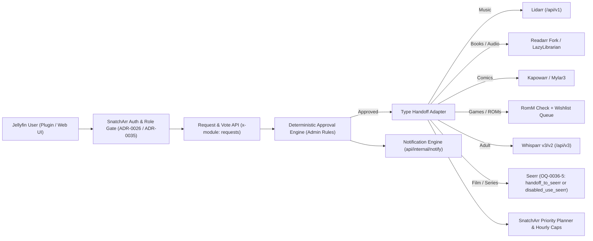
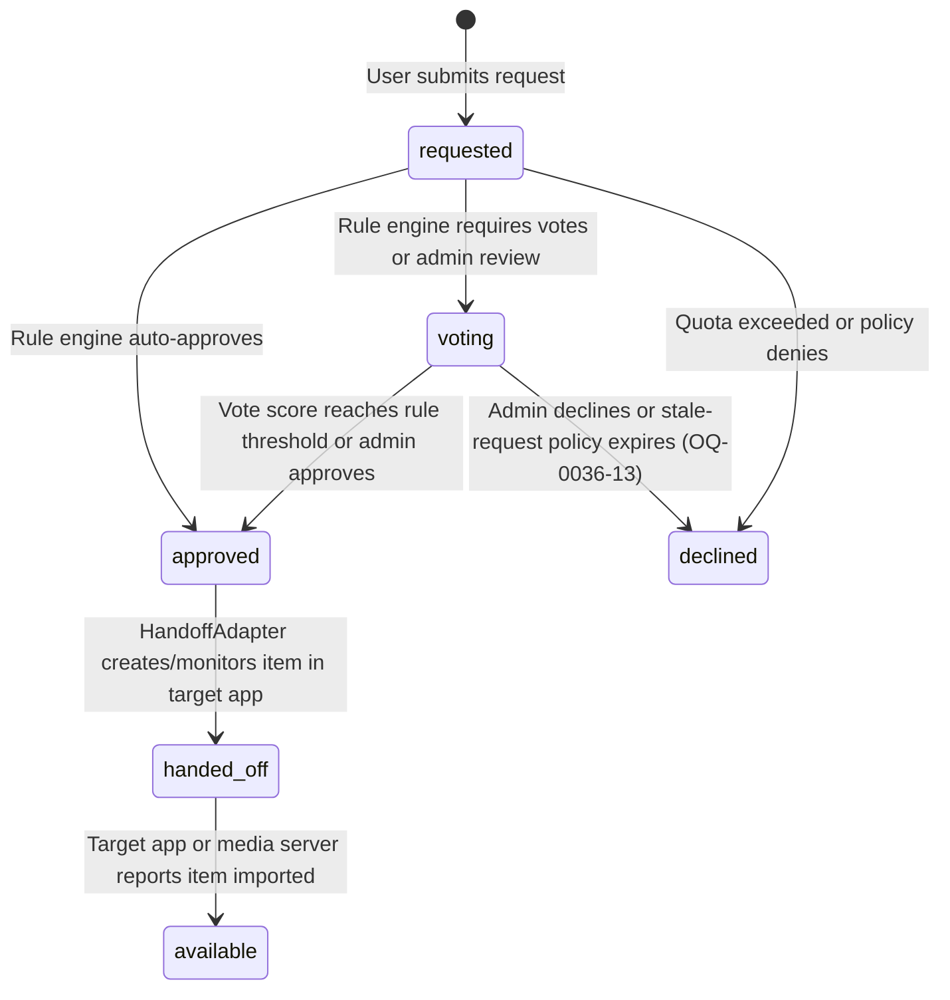

<!-- markdownlint-disable MD013 -->
<!--
SPDX-FileCopyrightText: 2026 lusoris <lusoris@pm.me>
SPDX-License-Identifier: CC-BY-SA-4.0
-->

# ADR-0036: Community requests and voting across media types

- Status: Accepted (operator answers recorded 2026-10-26, ledger ids `snatcharr-oq-0036-1` to `snatcharr-oq-0036-13`)
- Date: 2026-10-26
- Related: [ADR-0006](0006-download-client-backpressure.md), [ADR-0008](0008-readarr-frozen-legacy-target.md), [ADR-0012](0012-queue-management-replaces-cleanuparr-link.md), [ADR-0018](0018-product-front-door.md), [ADR-0022](0022-instance-priority.md), [ADR-0023](0023-sso-viewer-role.md), [ADR-0025](0025-module-switches.md), [ADR-0026](0026-accounts-and-roles.md), [ADR-0027](0027-adult-module.md), [ADR-0028](0028-jellyfin-plugin.md), [ADR-0029](0029-task-flow-ui.md), [ADR-0032](0032-stash-own-or-integrate.md), [ADR-0033](0033-adult-identity-and-model.md), ADR-0035 (draft, Jellyfin integration)

## Context

**SnatchArr** (meaning: automated media search-and-snatch coordinator across `*arr` instances; origin: English *snatch* + the `*arr` suffix of the Servarr ecosystem; pronunciation: `/ˈsnætʃ.ɑːr/`) acts as the unified front door of the self-hosted media stack ([ADR-0018](0018-product-front-door.md)). It coordinates search cycles, indexer rate caps, queue hygiene ([ADR-0012](0012-queue-management-replaces-cleanuparr-link.md)), and multi-user access ([ADR-0023](0023-sso-viewer-role.md), [ADR-0026](0026-accounts-and-roles.md)).

### 1. The functional gap across media types and community prioritisation

Today, SnatchArr links to **Seerr** (meaning: media request and discovery manager; origin: shortening of *Overseerr* and *Jellyseerr*, from English *overseer* with the `*rr` ecosystem suffix; pronunciation: `/ˈsɪər/`) to ingest approved movie and television requests (`docs/seerr.md`, `api/internal/seerr/service.go`). Two structural gaps remain for shared household and community servers:

1. **Non-video and specialized media types have no request portal**: Seerr (`seerr-team/seerr` at tag `v3.5.1`, commit `564bfb08b54c`) supports only movies via **Radarr** (meaning: automated movie collection manager; origin: *radar* + `*arr`; pronunciation: `/ˈreɪ.dɑːr/`) and television series via **Sonarr** (meaning: automated television series manager; origin: *sonar* + `*arr`; pronunciation: `/ˈsoʊ.nɑːr/`). Household and community members have no unified way to request:
   - **Music** (artists, albums, release groups),
   - **Books and audiobooks** (authors, editions, spoken-word releases),
   - **Comics and manga** (volumes, series, issues),
   - **Games and ROMs** (platform titles and retro game packages), or
   - **Adult content** (scenes, performers, and studios; [ADR-0027](0027-adult-module.md), [ADR-0033](0033-adult-identity-and-model.md)).
2. **No community voting or shared prioritisation**: When multiple users share finite storage and hourly indexer search budgets (`api/internal/planner`), administrators need community signal to prioritise which requested items are approved and searched first. Seerr defines a reserved bitmask constant `Permission.VOTE = 64` in `server/lib/permissions.ts:8` (`v3.5.1`, commit `564bfb08b54c`), but implements no vote entity, database table, or API endpoint.

Issue `#565` (`lusoris/SnatchArr`, milestone `0.9` in `docs/roadmap.md:27-37`) tracks the request portal module for media types that Seerr does not cover, gated behind an optional module switch ([ADR-0025](0025-module-switches.md)) and integrated with SnatchArr's role model ([ADR-0023](0023-sso-viewer-role.md), [ADR-0026](0026-accounts-and-roles.md)).

### 2. Current implementation baseline in SnatchArr

Inspection of the repository establishes the existing building blocks:

- **Seerr read-only polling and priority boost**: `api/internal/seerr/service.go:100-189` polls configured Seerr links (`GET /api/v1/request?filter=processing`) every 5 minutes on the elected leader replica (`leader_loops`), matches requests by TMDb/TVDb ID against library items in SnatchArr's PostgreSQL store, elevates their search priority via `PriorityFor` (`api/internal/seerr/service.go:240-264`), and exposes `POST /api/v1/seerr/requests/{linkId}/{requestId}/snatch` for immediate focused search dispatch (`docs/seerr.md:31-43`).
- **Accounts, roles, and Jellyfin sign-in**: [ADR-0026](0026-accounts-and-roles.md) and `api/internal/domain/user.go:20-44` define three roles (`RoleAdmin = "admin"`, `RoleRequester = "requester"`, `RoleViewer = "viewer"`), the helper `Role.CanRequest()` (`r == RoleAdmin || r == RoleRequester`), and native authentication against **Jellyfin** (meaning: open-source media system; origin: *jellyfish* + *fin*, referring to streaming fins; pronunciation: `/ˈdʒɛl.i.fɪn/`) via `POST /api/v1/auth/jellyfin` and Quick Connect (`api/internal/httpapi/handlers_jellyfin.go`), plus periodic policy revalidation (`api/internal/jellyfin/revalidator.go`).
- **Pre-allocated OpenAPI scopes**: `api/openapi/openapi.yaml:1863-1879` already reserves the `requests:read` and `requests:write` API key and session scopes alongside `core`, `notifications`, `admin`, and `adult`.
- **Optional module switches**: `api/internal/domain/module.go:13-17` and `api/internal/modules/registry.go:23-62` register `adult`, `llm`, and `watchaware` under the `modules` table (`000028_modules.up.sql`) with `ModuleGateMiddleware` returning RFC 9457 `404 Not Found` (`application/problem+json`) when a module is disabled ([ADR-0025](0025-module-switches.md)).
- **Notification engine**: `api/internal/notify/engine.go:30-95` and `api/internal/domain/notification.go:13-48` provide a bounded worker queue delivering events (`run_failure_streak`, `circuit_opened`, `instance_unreachable`, `stamina_exhausted`, `seerr_request_snatched`, `watchaware_gate_decided`) across eight encrypted channel kinds (`discord`, `slack`, `telegram`, `ntfy`, `gotify`, `teams`, `webhook`, `apprise`).

### 3. Binding architectural constraints

Three invariants govern this design:

1. **Search and handoff only**: SnatchArr downloads nothing ([ADR-0006](0006-download-client-backpressure.md)). When a community request is approved, SnatchArr hands the item off to the configured target management application for that media type (creating or monitoring the wanted item via its API) and schedules search dispatches within SnatchArr's per-instance hourly indexer caps and instance priority rules ([ADR-0022](0022-instance-priority.md)).
2. **Any-adopter Jellyfin usability without external identity infrastructure**: Every adopter running Jellyfin and SnatchArr on a single host or home network must be able to browse, request, and vote from inside Jellyfin using their existing Jellyfin account ([ADR-0026](0026-accounts-and-roles.md), [ADR-0028](0028-jellyfin-plugin.md), ADR-0035 (draft, Jellyfin integration)). No external single sign-on (SSO) identity provider, reverse-proxy header injection, or container cluster is required.
3. **Administrator-defined rules in configuration**: Every approval rule, vote threshold, user quota, role permission, and target routing mapping is configured by the administrator; no hard-coded approval policy is imposed. Product and user-experience choices with multiple viable designs are recorded as explicit open questions (`OQ-0036-1` through `OQ-0036-13`) rather than prematurely fixed in the structural decision.

---

## Survey of Request Tools and Handoff Targets

### 1. Project terminology reference

In addition to **SnatchArr**, **Jellyfin**, **Seerr**, **Radarr**, and **Sonarr** defined above, this survey and architecture reference the following upstream projects:

- **Overseerr** (meaning: Plex media request management UI; origin: *overseer* + `*rr`; pronunciation: `/ˌoʊ.vərˈsɪər/`) and **Jellyseerr** (meaning: Jellyfin and Emby fork of Overseerr; origin: *Jellyfin* + *Overseerr*; pronunciation: `/ˈdʒɛl.i.sɪər/`), now merged into **Seerr**.
- **Ombi** (meaning: self-hosted media request and user management portal; origin: coined short name replacing *Plex Requests.Net*; pronunciation: `/ˈɒm.bi/`).
- **Requestrr** (meaning: chat bot for media requests; origin: *request* + `*rr`; pronunciation: `/rɪˈkwɛst.ɑːr/`).
- **Doplarr** (meaning: Discord media request bot; origin: *Doppler* + `*arr`; pronunciation: `/ˈdɒp.lɑːr/`).
- **Petio** (meaning: Plex companion request and review portal; origin: Latin *petitio*, "a request or petition"; pronunciation: `/ˈpɛt.i.oʊ/`).
- **Pulsarr** (meaning: Plex watchlist-to-`*arr` bridge; origin: *pulsar* + `*arr`; pronunciation: `/ˈpʌl.sɑːr/`).
- **Searcharr** (meaning: Telegram request bot for Sonarr, Radarr, and Readarr; origin: *search* + `*arr`; pronunciation: `/ˈsɜːrtʃ.ɑːr/`).
- **Lidarr** (meaning: automated music collection manager; origin: *LIDAR* + `*arr`; pronunciation: `/ˈlaɪ.dɑːr/`).
- **Headphones** (meaning: automated music indexer search server for Python; origin: English *headphones*; pronunciation: `/ˈhɛd.foʊnz/`).
- **Readarr** (meaning: automated book and audiobook manager; origin: *reader* + `*arr`; pronunciation: `/ˈriː.dɑːr/`).
- **Chaptarr** (meaning: community fork of Readarr v1 for ebooks and audiobooks; origin: *chapter* + `*arr`; pronunciation: `/ˈtʃæp.tɑːr/`).
- **Bookshelf** (meaning: Hardcover-backed community fork of Readarr v1; origin: English *bookshelf*; pronunciation: `/ˈbʊk.ʃɛlf/`).
- **LazyLibrarian** (meaning: automated book, audiobook, and magazine manager; origin: English *lazy librarian*; pronunciation: `/ˈleɪ.zi laɪˈbrɛər.i.ən/`).
- **Audiobookshelf** (meaning: self-hosted audiobook and podcast streaming server; origin: *audiobook* + *bookshelf*; pronunciation: `/ˈɔː.di.oʊ.bʊk.ʃɛlf/`).
- **Kapowarr** (meaning: automated comic book volume manager; origin: comic onomatopoeia *kapow* + `*arr`; pronunciation: `/kəˈpaʊ.ɑːr/`).
- **Mylar3** (meaning: Python 3 automated comic book manager; origin: *Mylar* archival comic bags + Python *3*; pronunciation: `/ˈmaɪ.lɑːr θriː/`).
- **Kavita** (meaning: self-hosted digital reading server for comics, manga, and books; origin: Sanskrit *kavitā*, "poem/literature"; pronunciation: `/kəˈviː.tɑː/`).
- **Komga** (meaning: comic, manga, and magazine media server; origin: blend of *komiks* and *manga*; pronunciation: `/ˈkɒm.ɡə/`).
- **RomM** (meaning: ROM Manager for retro gaming libraries; origin: acronym for *ROM Manager*; pronunciation: `/ˈrɒm.ɛm/`).
- **Whisparr** (meaning: automated adult video manager in the Servarr stack; origin: *whisper* + `*arr`; pronunciation: `/ˈwɪs.pɑːr/`).
- **Stash** (meaning: self-hosted organizer and GraphQL server for adult video and image sets; origin: English *stash*; pronunciation: `/stæʃ/`) and **stash-box** (meaning: federated GraphQL metadata directory for scenes, performers, and studios; origin: *Stash* + *box*; pronunciation: `/ˈstæʃ.bɒks/`).
- **Prowlarr** (meaning: indexer manager and proxy for `*arr` applications; origin: *prowler* + `*arr`; pronunciation: `/ˈpraʊ.lɑːr/`).
- **golusoris** (meaning: shared Go foundation library for the lusoris fleet; origin: *Go* + Latin *lusoris*, "of the player"; pronunciation: `/ˌɡoʊ.luːˈsɔːr.ɪs/`) and **goenvoy** (meaning: typed Go client SDK for `*arr` and media servers; origin: *Go* + *envoy*; pronunciation: `/ˈɡoʊ.ɛn.vɔɪ/`).

### 2. Survey of existing media request tools

All repositories, licences, tags, commits, and source files below were verified on `2026-10-26`.

| Tool | Licence | Last release & maintenance status (checked 2026-10-26) | Voting model | Auto-approval model | Quota model | Per-type handling | Notifications | Jellyfin integration |
| :--- | :--- | :--- | :--- | :--- | :--- | :--- | :--- | :--- |
| **Ombi** (`Ombi-app/Ombi`) | `GPL-2.0` | `v4.60.17` (commit `3e0126b695ae`; `develop` at `697d35647bf8`, pushed `2026-09-29`). Active. | Built-in `VoteEngine` (`src/Ombi.Core/Engine/VoteEngine.cs`, `Votes.cs`). One vote per user per request (`Upvote = 0`, `Downvote = 1`). Upvoting subscribes the voter to request notifications; net score (`upVotes - downVotes`) triggers auto-approval at configurable `MovieVoteMax`, `TvShowVoteMax`, `MusicVoteMax` (`VoteSettings.cs`). | Per-type role claims (`AutoApproveMovie`, `AutoApproveTv`, `AutoApproveMusic`, `AutoApprove4KMovie`, `Admin`, `PowerUser` in `OmbiRoles.cs`) plus vote-threshold auto-approval. | Per-user limits (`MovieRequestLimit`, `EpisodeRequestLimit`, `MusicRequestLimit` on `OmbiUser.cs`) over a global window (`RequestLimitType`: `Day = 0`, `Week = 1`, `Month = 2`). | Movies (Radarr + separate 4K Radarr), TV (Sonarr), Music albums (Lidarr). No books, comics, games, or adult content. | 17 `NotificationType` triggers (`NewRequest`, `RequestApproved`, `RequestAvailable`, `RequestDeclined`, etc.) over Discord, Slack, Telegram, Gotify, Email, Pushover, Webhook, Apprise. | Jellyfin user import, credential sign-in, and library availability sync. Standalone web UI only (no embedded Jellyfin plugin). |
| **Seerr** (`seerr-team/seerr`, unifying **Jellyseerr** and archived **Overseerr** `sct/overseerr` `v1.35.0`) | `MIT` | `v3.5.1` (commit `564bfb08b54c`; `develop` at `d09072ae4190`, pushed `2026-10-26`). Active (`sct/overseerr` archived `2026-02-15`). | **None**. `Permission.VOTE = 64` exists in `server/lib/permissions.ts:8`, but no vote entity, database table, or API endpoint is implemented. | Bitmask permissions per user or default (`AUTO_APPROVE`, `AUTO_APPROVE_MOVIE`, `AUTO_APPROVE_TV`, `AUTO_APPROVE_4K`, `AUTO_APPROVE_4K_MOVIE`, `AUTO_APPROVE_4K_TV`, `AUTO_REQUEST*`). `OverrideRule` (`server/lib/overrideRules.ts`) routes requests by user, TMDb genre, language, or keyword (anime `210024`) to target server/profile/root folder/tags. | Rolling-window quotas per user (`movieQuotaLimit` / `movieQuotaDays`, `tvQuotaLimit` / `tvQuotaDays` in `server/entity/User.ts:183-240`) with global defaults; counts non-declined requests within `now - quotaDays`; `MANAGE_USERS` bypasses quotas. | Movies (Radarr, standard + 4K) and TV series/seasons (Sonarr, standard + 4K, anime override). No music, books, comics, games, or adult content. | Bitmask `Notification` (`MEDIA_PENDING`, `MEDIA_APPROVED`, `MEDIA_AVAILABLE`, `MEDIA_FAILED`, `MEDIA_DECLINED`, `MEDIA_AUTO_APPROVED`, `ISSUE_*`) via Discord, Slack, Telegram, Gotify, ntfy, Pushover, Pushbullet, Email, WebPush, Webhook. | Jellyfin password login (`POST /api/v1/auth/jellyfin`) and Quick Connect (`server/routes/auth.ts`), plus Jellyfin library scan. Standalone web UI only. |
| **Requestrr** (`darkalfx/requestrr` & `thomst08/requestrr`) | `MIT` | Upstream `darkalfx/requestrr` archived `2024-01-06` (`V2.1.3`, `473a645362de`). Fork `thomst08/requestrr` at `V2.1.10` (`50e863b108db`, pushed `2026-06-23`). | None. | Discord role restrictions per media category, or delegates approval to linked Overseerr / Ombi instance. | None natively; delegates to Overseerr or Ombi when linked. | Movies (Radarr, Overseerr, Ombi), TV (Sonarr, Overseerr, Ombi), Music (Lidarr V1–V2). | Discord direct message or channel alerts on request completion. | None (Discord slash-command bot only). |
| **Doplarr** (`kiranshila/Doplarr`) | `MIT` | `v3.8.0` (commit `48b2815dc6f3`, last push `2026-06-15`). **Archived / unmaintained**. | None. | Discord role restrictions or delegation to Overseerr backend. | None natively (delegates to Overseerr). | Movies (Radarr / Overseerr) and TV (Sonarr / Overseerr). | Discord bot responses only. | None (Discord bot only). |
| **Petio** (`petio-team/petio`) | `MIT` | `v0.5.7` (commit `77c3a70a1893`, `master` at `abda13502a89`, last push `2025-01-17`). **Dormant / unmaintained**. | User ratings and reviews on library items; no request-approval voting. | Role/profile-based auto-approval per user for Movies and TV. | Per-user request quotas on Movies and TV. | Movies (Radarr) and TV (Sonarr). | Email, Discord, Telegram, Webhook. | **None** (Plex-only authentication and library sync). |
| **Pulsarr** (`jamcalli/Pulsarr`) | `AGPL-3.0` | `v1.0.0-beta.1` (commit `cac6b1d76a1c`, `master` at `7af0905a5722`, pushed `2026-10-26`). Active. | None (watchlist sync). | Automatic forwarding of Plex watchlists per user permission and routing rule. | Optional per-user rate limits on watchlist sync. | Movies (Radarr) and TV (Sonarr). | Discord, Pushover, Tautulli, Apprise, Webhook. | **None** (polls Plex user and friend watchlists only). |
| **Searcharr** (`toddrob99/searcharr`) | `MIT` | `v3.4.0` (commit `f1aee09c2ffd`, last push `2026-04-08`). Low activity. | None. | Shared-password group access (`/start <password>`) and Telegram admin flags; all authenticated users auto-submit to targets. | None. | Movies (Radarr), TV (Sonarr), Books (Readarr). | Telegram bot chat replies. | None (Telegram bot only). |

### 3. Survey of handoff targets per media type

All target repositories, APIs, licences, and `golusoris/goenvoy` client packages were verified on `2026-10-26`.

| Media type | Target application | Licence | Last release & maintenance status (checked 2026-10-26) | API for adding wanted item & triggering search | `goenvoy` / SnatchArr status |
| :--- | :--- | :--- | :--- | :--- | :--- |
| **Music** (artists, albums) | **Lidarr** (`Lidarr/Lidarr`) | `GPL-3.0` | Latest tag `v3.2.0.5144` (`982bb9f7ed9f`); pinned in `tools/upstreamspec/specs.yaml:59-72` at `v3.1.0.4875` (`350860e52402`, pushed `2026-10-24`). Active. | Lookup via `GET /api/v1/artist/lookup?term=lidarr:<mbid>` or `GET /api/v1/album/lookup?term=lidarr:<mbid>`. Add wanted via `POST /api/v1/artist` (`foreignArtistId`, `qualityProfileId`, `metadataProfileId`, `rootFolderPath`, `monitored`, `addOptions.searchForMissingAlbums`) or `POST /api/v1/album`. Search via `POST /api/v1/command` (`ArtistSearch`, `AlbumSearch`). | Supported (`golusoris/goenvoy/arr/lidarr v1.6.1` in `go.mod`; `domain.KindLidarr`). |
| **Music** (artists, albums) | **Headphones** (`rembo10/headphones`) | `GPL-3.0` | Tag `v0.6.4` (`62757c0fcf3f`, last push `2025-08-08`). Legacy maintenance. | Query-string HTTP API `/api?apikey=<key>&cmd=addArtist&id=<mbid>`, `cmd=addAlbum&id=<rgid>`, `cmd=queueAlbum&id=<rgid>`. | Not integrated; superseded by Lidarr in `*arr` stacks. |
| **Books & audiobooks** | **Readarr** (`Readarr/Readarr`) and active Readarr v1 forks: **Chaptarr** (`Chaptarr/chaptarr`), **Bookshelf** (`pennydreadful/bookshelf`), **Faustvii Readarr** (`Faustvii/Readarr`) | `GPL-3.0` | Upstream `Readarr/Readarr` archived `2025-06-27` (`0b79d3000d4e`, tag `v0.4.18.2805` `7cc02f95afaa`; frozen per [ADR-0008](0008-readarr-frozen-legacy-target.md)). Tested forks (`docs/readarr.md:39-44`): `Chaptarr/chaptarr` `v0.9.965` (`e67374f4b3fe`, pushed `2026-10-11`, ebook + audiobook profiles); `pennydreadful/bookshelf` `develop` (`3ac41f7e3142`, pushed `2026-09-11`); `Faustvii/Readarr` `v0.10.0` (`7f02ffa52997`, pushed `2026-09-02`). *(Note: `readarr-rresurrected` named in ADR-0018 has no matching public repository on `2026-10-26` — unverified).* | Readarr v1 contract (`tools/upstreamspec/specs.yaml:81-122`): lookup via `GET /api/v1/author/lookup?term=...` or `GET /api/v1/book/lookup?term=...`; add wanted via `POST /api/v1/author` or `POST /api/v1/book` (`foreignAuthorId`, `foreignBookId`, `qualityProfileId`, `metadataProfileId`, `rootFolderPath`, `monitored`, `addOptions`); search via `POST /api/v1/command` (`AuthorSearch`, `BookSearch`). | Supported (`golusoris/goenvoy/arr/readarr v1.5.1` in `go.mod`; `domain.KindReadarr`). Note: `goenvoy/arr/readarr` currently wraps read/queue/command paths and needs `AddBook` / `AddAuthor` helpers or raw OpenAPI call. |
| **Books & audiobooks** | **LazyLibrarian** (`gitlab.com/LazyLibrarian/LazyLibrarian`) | `GPL-3.0-or-later` | Active on GitLab (`master` commit `a51069d6d435`, pushed `2026-10-26`; GitHub mirror `LazyLibrarian/LazyLibrarian` stale since `2022-12-09`). | Query-string REST API (`lazylibrarian/api.py`): `GET /api?apikey=<key>&cmd=findBook&name=<q>`, `cmd=addBook&id=<bookid>`, `cmd=addAuthorID&id=<id>`, `cmd=queueBook&id=<id>&type=eBook\|AudioBook`, `cmd=searchBook&id=<id>`. | No `goenvoy` client yet; candidate adapter for adopters not running a Readarr v1 fork. |
| **Books & audiobooks** (library server) | **Audiobookshelf** (`advplyr/audiobookshelf`) | `GPL-3.0` | Tag `v2.37.2` (`bb8355b3996a`, pushed `2026-10-23`). Active. | **Library and streaming server only** (`/api/libraries`, `/api/items`, `/api/search/books`). Has **no wanted list and no indexer search API**; cannot act as an acquisition handoff target (used only to verify local audiobook availability). | `golusoris/goenvoy/mediaserver/audiobookshelf` exists for library inspection. |
| **Comics & manga** | **Kapowarr** (`Casvt/Kapowarr`) | `GPL-3.0` | Tag `V1.3.2` (`d0d71168b3ab`, `main` at `c191dda66179`, pushed `2026-10-20`). Active. | Flask JSON REST API (`backend/api/volumes`): `POST /api/volumes/search` (`{"query": "..."}` via ComicVine), `POST /api/volumes` (`{"comicvine_id": <int>, "root_folder_id": <int>, "monitor": true, "auto_search": true}`), `POST /api/volumes/<id>/tasks` (`{"cmd": "auto_search"}`). | No `goenvoy` client yet; primary modern REST handoff target for comics. |
| **Comics & manga** | **Mylar3** (`mylar3/mylar3`) | `GPL-3.0` | Tag `v0.8.3` (`cdc94a44425b`, last push `2026-03-25`). Active. | Query-string API (`mylar/webserve.py`, `/api?apikey=<key>&cmd=...`): `cmd=findComic&name=<q>`, `cmd=addComic&id=<comicid>`, `cmd=queueIssue&id=<issueid>`. | `golusoris/goenvoy/arr/mylar` exists in `goenvoy` (`docs/roadmap.md:31`). |
| **Comics & manga** (library servers) | **Kavita** (`Kareadita/Kavita`) & **Komga** (`gotson/komga`) | `GPL-3.0` (Kavita), `MIT` (Komga) | Kavita `v0.9.1.4` (`879b8b73eb41`, pushed `2026-10-25`); Komga `1.29.1` (`a9b59dbee734`, pushed `2026-10-25`). Both active. *(Note: `Comicarr` mentioned in ADR-0018 has no maintained public repository on `2026-10-26` — unverified).* | **Library readers only**. Expose library scan and reading progression APIs (`goenvoy/mediaserver/kavita`, `goenvoy/mediaserver/komga`), but **no wanted list or indexer search handoff** (used only for availability checks). | Supported in `goenvoy/mediaserver/*` for availability checks. |
| **Games & ROMs** | **RomM** (`rommapp/romm`) | `AGPL-3.0` | Tag `5.4.1` (`9c74d0143fbb`, `master` at `78290878193b`, pushed `2026-10-26`). Active. | **Library and metadata manager only**. FastAPI backend (`/api/roms`, `/api/platforms`, `/api/collections`) indexes local ROM files with IGDB, ScreenScraper, and MobyGames metadata and supports manual browser file uploads, but provides **no wanted-item endpoint and no automated indexer search**. **No maintained `*arr` acquisition target exists for games/ROMs**. | `goenvoy/metadata/game/*` provides IGDB, MobyGames, ScreenScraper, SteamGridDB, RetroAchievements, and LaunchBox clients (`docs/roadmap.md:33`). |
| **Adult content** (scenes, performers, studios) | **Whisparr v3 (Eros)** (`Whisparr/Whisparr`, branch `eros`) | `GPL-3.0` | Tag `v3.1.0.2116` (`94480761ec41`, `eros` at `cc3fb2abcf60`, `eros-api-docs` at `0f81d8d0787b`, pushed `2026-10-11`). Active. | Radarr-forked `/api/v3` contract ([ADR-0027](0027-adult-module.md), [ADR-0033](0033-adult-identity-and-model.md)): lookup via `GET /api/v3/movie/lookup?term=stash:<uuid>` (plus `/api/v3/performer`, `/api/v3/studio`); add wanted scene/release via `POST /api/v3/movie` (`stashId`/`foreignId`, `qualityProfileId`, `rootFolderPath`, `monitored: true`, `addOptions.searchForMovie`) or performer/studio monitoring; search via `POST /api/v3/command` (`MoviesSearch`, `RefreshPerformers`, `RefreshStudios`). | Supported (`golusoris/goenvoy/arr/whisparr v1.5.1` in `go.mod`; `domain.KindWhisparr`, `domain.APIVersionWhisparrV3`). |
| **Adult content** (scenes, performers, studios) | **Whisparr v2** (`Whisparr/Whisparr`, branch `v2-develop`) | `GPL-3.0` | Tag `v2.2.0-develop.404` (`a2598749aef8`) / `v2.2.0-release.231` (`face3be8956e`, `v2-develop` at `c55fdc66a410`). Legacy maintenance alongside v3 Eros. | Sonarr-forked `/api/v3` contract: models studios/sites as `series` and scenes as `episodes` (`POST /api/v3/series`, `PUT /api/v3/episode/monitor`, `POST /api/v3/command` with `EpisodeSearch` or `SeriesSearch`). | Supported (`domain.APIVersionWhisparrV2` in `api/internal/domain/domain.go:34-43`). |
| **Adult content** (library organizer) | **Stash** (`stashapp/stash`) | `AGPL-3.0-only` | Tag `v0.31.1` (`4de2351e7cc9`, pushed `2026-10-25`). Active. | **Library organizer only** ([ADR-0032](0032-stash-own-or-integrate.md)): GraphQL API (`POST /graphql`, `FindScenes`, `FindPerformers`, `FindStudios`) checks whether a requested scene, performer, or studio is already present locally; has **no wanted list or indexer search handoff**. | Supported (`golusoris/goenvoy/mediaserver/stash/v2 v2.0.3` in `go.mod`). |
| **Film & series** | **Seerr** (`seerr-team/seerr`), **Radarr** (`Radarr/Radarr`), **Sonarr** (`Sonarr/Sonarr`) | `MIT` (Seerr), `GPL-3.0` (Radarr, Sonarr) | Seerr `v3.5.1` (`564bfb08b54c`); Radarr stable `v6.4.4.10685` (`a96bf7c3ecb2`, pre-release `v7.0.0.10815` `4d9bd475caba`); Sonarr `v4.7.5.7809` (`e8e54fdf9977`, pinned in `specs.yaml` at `v4.0.20.3014` `cab419ade8ac`). All active. | Seerr: `POST /api/v1/request` (`CreateRequest`), `POST /api/v1/request/{requestId}/approve`. Radarr: `POST /api/v3/movie`, `POST /api/v3/command` (`MoviesSearch`). Sonarr: `POST /api/v3/series`, `POST /api/v3/command` (`SeriesSearch`, `SeasonSearch`, `EpisodeSearch`). | Supported (`goenvoy/arr/seerr v1.5.3`, `goenvoy/arr/radarr v1.5.4`, `goenvoy/arr/sonarr v1.5.4` in `go.mod`). |

---

## Decision

This section defines the structural architecture required by the direction. Policy defaults, vote semantics, quota windows, film/series ownership vs Seerr, surface placement, and visibility rules were open questions (`OQ-0036-1` through `OQ-0036-13`); the operator answered all of them on 2026-10-26, and the [Answered questions](#answered-questions) section records each answer with its ledger id. Where an answer differs from the recommendation in the question table, the answer binds.



### 1. Module boundary and switch (`ADR-0025`)

1. **Module identifier**: Register `ModuleRequests ModuleID = "requests"` in `api/internal/domain/module.go` and `DefaultDescriptors()` in `api/internal/modules/registry.go` with `DefaultEnabled: false` ([ADR-0025](0025-module-switches.md), issue `#565`).
2. **HTTP and OpenAPI gate**: All community request and voting endpoints carry `x-module: requests` in `api/openapi/openapi.yaml`. When `requests` is disabled in the `modules` table, `ModuleGateMiddleware` returns an RFC 9457 `404 Not Found` (`application/problem+json`) response.
3. **Two-barrier gate for adult request kinds**: Any request operation where `media_type` is an adult kind (`adult_scene`, `adult_performer`, `adult_studio`) requires **both** `ModuleRequests` (`requests`) and `ModuleAdult` (`adult`) enabled, **plus** `user.AdultAllowed == true` on the authenticated principal ([ADR-0026](0026-accounts-and-roles.md), [ADR-0027](0027-adult-module.md)). Failure on any barrier returns RFC 9457 `404 Not Found` so the existence of adult requests is never disclosed to unauthorized accounts.
4. **Leader reconciliation loop**: A periodic availability and handoff-retry loop registers in the `leader_loops` Fx group via `gate.Provide[*T]()` (`AGENTS.md`, [ADR-0025](0025-module-switches.md)) and performs a no-op tick when `ModuleRequests` is disabled.

### 2. Request entity per media type

Requests are persisted in PostgreSQL (`requests` table, `sqlc`-generated queries under `api/internal/store/sqlcgen`) with a unified envelope and a typed per-kind metadata payload:

- `id` (`UUID`, primary key).
- `media_type` (`TEXT NOT NULL`): discriminator covering:
  - Music: `music_artist`, `music_album`,
  - Books and audiobooks: `book`, `audiobook`,
  - Comics and manga: `comic_volume`,
  - Games and ROMs: `game`,
  - Adult content: `adult_scene`, `adult_performer`, `adult_studio`,
  - Film and series (subject to `OQ-0036-5`): `movie`, `series`.
- `external_source` (`TEXT NOT NULL`): canonical metadata registry name (`musicbrainz`, `openlibrary`, `hardcover`, `comicvine`, `igdb`, `stashbox`, `tmdb`, `tvdb`).
- `external_id` (`TEXT NOT NULL`): upstream identifier within `external_source` (for example MusicBrainz UUID, ComicVine volume ID, IGDB ID, Stash-box UUID + endpoint fingerprint per [ADR-0033](0033-adult-identity-and-model.md), TMDb ID). A partial unique index on `(media_type, external_source, external_id)` where `status NOT IN ('declined')` prevents duplicate active requests for the same work and redirects subsequent requesters to cast a vote on the existing request.
- `title` (`TEXT NOT NULL`), `subtitle_or_creator` (`TEXT NOT NULL DEFAULT ''`), `release_year` (`INT NULL`), `poster_ref` (`TEXT NULL`).
- `metadata_payload` (`JSONB NOT NULL DEFAULT '{}'`): validated against a per-`media_type` schema (for example requested season numbers for `series`, edition/format preference `ebook` vs `audiobook` for `book`, platform slug for `game`, or studio/performer references for `adult_scene`).
- `requested_by_user_id` (`UUID NOT NULL REFERENCES users(id) ON DELETE CASCADE`).
- `target_instance_id` (`UUID NULL REFERENCES instances(id) ON DELETE SET NULL`), `target_library_id` (`TEXT NULL`), `target_entity_id` (`TEXT NULL`): resolved handoff destination and the remote entity ID created or matched in the target application.
- `status` (`TEXT NOT NULL`): lifecycle state (`requested`, `voting`, `approved`, `declined`, `handed_off`, `available`).
- `status_reason` (`TEXT NOT NULL DEFAULT ''`): machine- and human-readable explanation (rule ID that auto-approved the request, admin decline note, or last handoff error).
- `vote_score` (`INT NOT NULL DEFAULT 0`), `upvote_count` (`INT NOT NULL DEFAULT 0`), `downvote_count` (`INT NOT NULL DEFAULT 0`): denormalized counters maintained transactionally with `request_votes`.
- `approved_by_user_id` (`UUID NULL REFERENCES users(id) ON DELETE SET NULL`): `NULL` when approved automatically by the rule engine; set to the acting admin's user ID on manual approval.
- Timestamps (`TIMESTAMPTZ`, sourced exclusively through `golusoris/core/clock`): `created_at`, `updated_at`, `approved_at`, `declined_at`, `handed_off_at`, `available_at`.

### 3. Request lifecycle state machine



1. **`requested`**: Initial state upon submission after passing authentication, role check, duplicate-request coalescing, and local availability pre-check.
2. **`voting`**: Entered immediately when no auto-approval rule matches on submission. Community members cast votes while the request awaits either a vote-threshold rule match or manual admin action.
3. **`approved`**: Entered either directly from `requested` (when an auto-approval rule matches at submission) or from `voting` (when a new vote causes a threshold rule to match, or when an `admin` approves manually).
4. **`declined`**: Terminal state entered when an `admin` declines a request (or when an optional expiration rule fires per `OQ-0036-13`).
5. **`handed_off`**: Entered when the media-type `HandoffAdapter` registers the wanted item in the target application (or records it on the internal wishlist when no external acquisition target exists for that media type per `OQ-0036-9`) and schedules priority snatching in SnatchArr.
6. **`available`**: Terminal state entered when the leader reconciliation loop observes that the target application (`hasFile: true` / imported status) or media server (Jellyfin, Stash, Kavita, Komga, Audiobookshelf, RomM) has imported the requested item.

### 4. Voting model

1. **One vote per user per request**: Votes are stored in `request_votes` with composite primary key `PRIMARY KEY (request_id, user_id)`:
   - `request_id` (`UUID NOT NULL REFERENCES requests(id) ON DELETE CASCADE`),
   - `user_id` (`UUID NOT NULL REFERENCES users(id) ON DELETE CASCADE`),
   - `value` (`SMALLINT NOT NULL CHECK (value IN (-1, 1))`), where `1` is an upvote and `-1` is a downvote (whether `-1` is exposed is governed by `OQ-0036-2`),
   - `created_at`, `updated_at` (`TIMESTAMPTZ NOT NULL`).
2. **Idempotent upsert and retraction**: `PUT /api/v1/requests/{id}/vote` upserts the caller's vote and recomputes `upvote_count`, `downvote_count`, and `vote_score` inside a single PostgreSQL transaction; `DELETE /api/v1/requests/{id}/vote` retracts the caller's vote.
3. **Immediate rule re-evaluation**: Every vote mutation on a request in `voting` status invokes the approval engine inside the same unit of work. If the updated vote counters satisfy an admin-configured approval rule, the request transitions atomically from `voting` to `approved` and enqueues handoff.

### 5. Deterministic approval engine evaluating admin rules

All approval and quota policies live in administrator configuration (`modules.config` JSONB for `requests`, validated via `Descriptor.ValidateConfig` per [ADR-0025](0025-module-switches.md)) and are evaluated by a pure, deterministic Go engine in `api/internal/requests/engine.go` with zero I/O inside the evaluator:

- **Rule inputs**:
  1. `votes`: current `upvote_count`, `downvote_count`, and net `vote_score` on the request,
  2. `thresholds`: admin-configured vote threshold required for automatic promotion from `voting` to `approved`,
  3. `quotas`: requester's active/historical request count within the configured quota period (`OQ-0036-3`) for the specific `media_type` and across all types,
  4. `roles`: requester's SnatchArr role (`admin`, `requester`, `viewer` per [ADR-0026](0026-accounts-and-roles.md)) and Jellyfin group/policy attributes,
  5. `media_type`: the request's media type discriminator (`music_artist`, `book`, `comic_volume`, `game`, `adult_scene`, etc.),
  6. `target_library`: the resolved target instance, root folder, or quality profile (`OQ-0036-8`).
- **Rule outputs**:
  - `DecisionRejectQuota`: requester has exhausted their quota for the period (returns RFC 9457 `429 Too Many Requests` with quota reset timestamp),
  - `DecisionAutoApprove`: request transitions directly to `approved` and triggers handoff, with target routing (`target_instance_id`, quality profile, root folder, tags) attached,
  - `DecisionEnterVoting`: request transitions to (or remains in) `voting` until `thresholds` are met or an `admin` acts,
  - `DecisionRequireAdmin`: request is held for explicit `admin` approval regardless of vote count (for example when an admin configures manual gatekeeping for a specific library or media type).

### 6. Handoff adapters per media type and SnatchArr scheduler integration

Each media type dispatches through a typed Go interface `HandoffAdapter` in `api/internal/requests`:

```go
type HandoffAdapter interface {
    CheckAvailability(ctx context.Context, req domain.Request) (bool, error)
    Handoff(ctx context.Context, req domain.Request, target domain.HandoffTarget) (domain.HandoffResult, error)
}
```

Every outbound call in `HandoffAdapter` carries a bounded `context.Context` deadline (`HISS-02`):

1. **Music (`music_artist`, `music_album`)**: Dispatches to **Lidarr** via `golusoris/goenvoy/arr/lidarr` (`POST /api/v1/artist` or `POST /api/v1/album` with `monitored: true`), records the resulting Lidarr artist/album ID in `target_entity_id`, and elevates the item's priority in SnatchArr's planner so the next snatch cycle dispatches `ArtistSearch` or `AlbumSearch` within the instance's hourly cap (`#180`).
2. **Books and audiobooks (`book`, `audiobook`)**: Dispatches to a configured **Readarr**-compatible instance (**Chaptarr**, **Bookshelf**, **Faustvii Readarr**, or frozen **Readarr** per [ADR-0008](0008-readarr-frozen-legacy-target.md) and `docs/readarr.md`) via `POST /api/v1/book` or `POST /api/v1/author`, or to **LazyLibrarian** (`cmd=addBook` / `cmd=queueBook`), selecting the ebook or audiobook quality profile matching `media_type`. **Audiobookshelf** is queried only by `CheckAvailability`.
3. **Comics and manga (`comic_volume`)**: Dispatches to **Kapowarr** (`POST /api/volumes` with `comicvine_id`, `monitor: true`, `auto_search: true`) or **Mylar3** (`cmd=addComic` via `goenvoy/arr/mylar`). **Kavita** and **Komga** are queried only by `CheckAvailability`.
4. **Games and ROMs (`game`)**: Queries **RomM** (`/api/roms`) for local availability and enriches metadata via `goenvoy/metadata/game/*`. Because no maintained open-source `*arr` application provides an automated wanted-item and indexer-search API for games/ROMs, approved `game` requests transition to an administrator wishlist / manual fulfilment queue (or are hidden if unconfigured, per `OQ-0036-9`).
5. **Adult content (`adult_scene`, `adult_performer`, `adult_studio`)**: Queries **Stash** (`POST /graphql` per [ADR-0032](0032-stash-own-or-integrate.md)) for existing local scenes/performers/studios; if absent, dispatches to **Whisparr v3 (Eros)** (`POST /api/v3/movie`, `/api/v3/performer`, `/api/v3/studio`) or **Whisparr v2** (`POST /api/v3/series`, `PUT /api/v3/episode/monitor`) using Stash-box identity resolution ([ADR-0027](0027-adult-module.md), [ADR-0033](0033-adult-identity-and-model.md)), then schedules snatching under Whisparr's hourly indexer budget.
6. **Film and series (`movie`, `series`)**: Delegates approved requests to **Seerr** (`POST /api/v1/request`) when `film_series_mode` is `handoff_to_seerr` (default), or leaves film and series to Seerr alone when it is `disabled_use_seerr`. There is no direct Radarr/Sonarr mode (`OQ-0036-5`, ledger `snatcharr-oq-0036-5`, which follows `snatcharr-product-seerr-20261020`).

### 7. Notifications (`api/internal/notify`)

Rather than introducing a parallel notification subsystem, the `requests` module reuses `api/internal/notify/engine.go` and the eight existing encrypted channel adapters (`discord`, `slack`, `telegram`, `ntfy`, `gotify`, `teams`, `webhook`, `apprise` in `docs/notifications.md`):

- Extend `domain.RuleEventKind` (`api/internal/domain/notification.go:30-48`) with:
  - `request_submitted`,
  - `request_approved`,
  - `request_declined`,
  - `request_handed_off`,
  - `request_available`.
- Adult request events (`media_type` in `adult_*`) never emit to general household notification rules; they require an explicit adult-scoped notification rule or sanitized payload per [ADR-0027](0027-adult-module.md) and `OQ-0036-10`.

### 8. Jellyfin surface and any-adopter authentication (`ADR-0026`, `ADR-0028`, `ADR-0035`)

To satisfy the any-adopter constraint (zero SSO, zero reverse-proxy auth headers, zero cluster required):

1. **Inside Jellyfin**: The Jellyfin companion plugin ([ADR-0028](0028-jellyfin-plugin.md), ADR-0035 (draft, Jellyfin integration)) renders a community requests and voting surface inside Jellyfin. The plugin authenticates requests to SnatchArr using its scoped `X-Api-Key` (`requests:read`, `requests:write`) combined with the acting user's `X-Jellyfin-User-Token` header, which SnatchArr verifies directly against Jellyfin's `GET /Users/Me` (`ADR-0028:99-111`) and maps to the corresponding `users` row (`external_id = jellyfin:<uuid>`, [ADR-0026](0026-accounts-and-roles.md)).
2. **Direct SnatchArr web UI**: Users signing into SnatchArr's embedded SPA directly authenticate with their Jellyfin credentials (`POST /api/v1/auth/jellyfin`) or Jellyfin Quick Connect (`POST /api/v1/auth/jellyfin/quickconnect/*`, [ADR-0026](0026-accounts-and-roles.md)). Jellyfin's `EnableContentDeletion` / administrator flag and `MaxParentalRating` / folder access policy automatically govern SnatchArr role assignment (`RoleForJellyfinMember` in `api/internal/domain/user.go:39-44`) and `adult_allowed` gating.
3. **Request or wish button on every poster and item card** (`OQ-0036-6`, ledger `snatcharr-oq-0036-6`): the plugin adds a request or wish button to each poster and item card in jellyfin-web through web injection, following `snatcharr-jellyfin-plugin-web-injection-method`. The plugin ships an optional snippet for the JavaScript Injector plugin; every server-side feature (request API, voting, plugin pages) works with the injector absent, and the plugin writes a log line naming the missing injector so the absent button is never a silent fallback. Native clients (Android TV, Swiftfin, Findroid) get no button and use the plugin page or the SnatchArr web UI.

---

## Answered questions

The operator answered every open question on 2026-10-26. Each answer is recorded in the decision ledger under the id shown; the wording below is a paraphrase. Where an answer differs from the recommendation in the question table that follows, the answer binds.

| ID | Answer | Ledger id |
| :--- | :--- | :--- |
| `OQ-0036-1` | **a**: requests wait in `voting` until the vote threshold or an admin approval by default; the module activation screen offers one-click presets. | `snatcharr-oq-0036-1` |
| `OQ-0036-2` | **c**: admin-selectable `upvotes_only` or `net_score`, default `upvotes_only`. | `snatcharr-oq-0036-2` |
| `OQ-0036-3` | **c**: rolling window in days per media type, an optional global cap, and `votes_consume_quota` default `false`. | `snatcharr-oq-0036-3` |
| `OQ-0036-4` | **a** with a toggle: `admin` and `requester` vote; `allow_viewer_votes` default `false`. | `snatcharr-oq-0036-4` |
| `OQ-0036-5` | **b**, narrowed to two modes of the admin setting `film_series_mode`: `handoff_to_seerr` (default; film and series use SnatchArr voting and rules, approved requests go to Seerr) and `disabled_use_seerr` (Seerr alone). No `direct_arr` mode, per `snatcharr-product-seerr-20261020`. | `snatcharr-oq-0036-5` |
| `OQ-0036-6` | **a** plus: dual surface on one API (SnatchArr `/requests` page in `0.9`, Jellyfin plugin page in `0.12`), and a request or wish button on every poster and item card through web injection, using the optional JavaScript Injector snippet of `snatcharr-jellyfin-plugin-web-injection-method`; every server feature works without the injector, and the plugin logs when it is missing. | `snatcharr-oq-0036-6` |
| `OQ-0036-7` | **a**: a request type appears only when a matching target is connected or the admin enables wish-list mode for it. | `snatcharr-oq-0036-7` |
| `OQ-0036-8` | **a**: admin routing rules by media type, genre, language, format and user or role; requesters never see instance topology. | `snatcharr-oq-0036-8` |
| `OQ-0036-9` | **a**: `wishlist_only` mode for games and ROMs with metadata lookup, voting, an admin fulfilment queue and availability detection. | `snatcharr-oq-0036-9` |
| `OQ-0036-10` | **a**: admin-configured notification rules in `api/internal/notify`, with `allow_adult` channel fencing, in `0.9`; per-user endpoints later. | `snatcharr-oq-0036-10` |
| `OQ-0036-11` | **c**: admin setting `public_attributed`, `public_anonymous` or `private_to_requester_and_admin`, default `public_anonymous`. | `snatcharr-oq-0036-11` |
| `OQ-0036-12` | **b**: users without adult access get `404` behind two independent checks; among adult-allowed users the adult request board is shared and votable by default. | `snatcharr-oq-0036-12` |
| `OQ-0036-13` | **a**: `voting_ttl_days`, default `0` (never expire), reconciled on the leader loop. | `snatcharr-oq-0036-13` |

## Open Questions

The question table below is kept as the record of the options and risks the answers chose from.

Every product and UX fork with genuine trade-offs was catalogued below in FOR-DEC format (`OQ-0036-N | question | options with risks | recommended`) for operator resolution before implementation.

| ID | Question | Options & risks | Recommended |
| :--- | :--- | :--- | :--- |
| `OQ-0036-1` | What default approval rules apply when an admin enables the `requests` module before customizing rules? | a) Hold all non-admin requests in `voting` until a vote threshold (e.g. 3 upvotes) or manual admin approval is reached (`admin` auto-approved) (risk: single-user or two-person households see requests wait in `voting` until they lower the threshold). b) Auto-approve all `requester` submissions within quota by default (risk: immediate handoff to `*arr` targets before the admin tunes thresholds). c) Require explicit rule selection in the activation sheet before enabling `requests` (risk: adds one configuration step to module activation). | **a**, with a one-click preset selector in the module activation sheet ("Community voting", "Household auto-approve", "Admin review only") so multi-user servers are safe by default while small households can switch in one click. |
| `OQ-0036-2` | Which voting mechanics and threshold model should the approval engine support? | a) Upvotes only (`+1` per user, requester automatically counts as initial `+1` vote; threshold is total upvotes $N$) (risk: cannot express negative signal against unwanted requests). b) Upvotes (`+1`) and downvotes (`-1`) with net score `upvotes - downvotes >= N`, like Ombi `VoteEngine` (risk: household members can downvote each other's requests, causing social friction). c) Admin-selectable mode (`upvotes_only` vs `net_score`) per instance, with requester auto-upvoting their own submission (risk: two modes to test in the pure rule evaluator). | **c**, defaulting to `upvotes_only` (`+1` initial vote from requester) to avoid interpersonal friction in households while allowing larger communities to enable `net_score`. |
| `OQ-0036-3` | How should user request quotas and quota periods be calculated, and do votes consume quota? | a) Rolling window in days per media category (`quota_limit` over `quota_days`, matching Seerr `User.ts`), where submitting a new request costs 1 quota unit and voting on an existing request is free (risk: users can upvote unlimited existing requests). b) Fixed calendar window (`day`, `week`, `month`, matching Ombi `RequestLimitType`) where both new requests and upvotes consume quota (risk: charging quota for votes discourages community voting; fixed calendar resets cause midnight bursts). c) Rolling window in days per media category plus an optional global cap, with configurable toggle `votes_consume_quota` (default `false`) (risk: slightly broader config schema). | **c**, using rolling windows (no boundary bursts) and free voting by default so users coalesce around existing requests instead of hoarding quota. |
| `OQ-0036-4` | Which SnatchArr roles ([ADR-0026](0026-accounts-and-roles.md)) are permitted to vote on existing requests? | a) Only `admin` and `requester` (`Role.CanRequest() == true`); `viewer` is strictly read-only across all surfaces (risk: a `viewer` cannot even signal interest in a queued request). b) `admin` and `requester` can create requests and vote; `viewer` can vote on existing requests if enabled by an admin toggle `allow_viewer_votes` (default `false`) (risk: blurs the read-only invariant of `viewer` from ADR-0023/ADR-0026 when enabled). | **a** by default (preserving `viewer` as strictly read-only per ADR-0023 and ADR-0026), with an optional per-rule or global admin boolean `allow_viewer_votes: false` if an operator wants viewers to cast votes without creating requests. |
| `OQ-0036-5` | How should film (`movie`) and series (`series`) requests relate to Seerr? | a) Non-video only in `requests`: SnatchArr's `requests` module handles only media types Seerr does not cover (music, books, comics, games, adult), and Seerr remains the sole portal for film/series (risk: users see two separate request systems and film/series cannot use SnatchArr's voting engine). b) Unified intake with Seerr handoff: SnatchArr accepts `movie`/`series` requests and runs voting in SnatchArr, then hands approved requests to Seerr (`POST /api/v1/request`) when a Seerr link is configured, or directly to Radarr/Sonarr when Seerr is absent (risk: overlapping UI with Seerr if adopters expose both portals). c) Replace Seerr completely with direct Radarr/Sonarr handoff (risk: breaks ADR-0018/ADR-0032 precedent of integrating with deployed Seerr instances and duplicates Seerr's TMDb discovery UI). | **b**, governed by an admin setting `film_series_mode` (`disabled_use_seerr` \| `handoff_to_seerr` \| `direct_arr`): defaults to `disabled_use_seerr` when Seerr is linked unless the admin enables unified voting, and allows `direct_arr` for Jellyfin-only adopters who do not run Seerr. |
| `OQ-0036-6` | Where does the primary requester and voter UI live? | a) Dual surface: embedded Jellyfin plugin page ([ADR-0028](0028-jellyfin-plugin.md), ADR-0035) for everyday Jellyfin users **plus** a `/requests` task-flow page in SnatchArr's SvelteKit SPA ([ADR-0029](0029-task-flow-ui.md)) backed by the same OpenAPI endpoints (risk: maintaining two UI views over one API). b) Jellyfin plugin surface for requesters/voters, while SnatchArr's SPA provides only the admin approval/rule configuration view (risk: requesters who sign into SnatchArr's web UI via Jellyfin credentials per ADR-0026 have no request page there). c) SnatchArr SPA only, with Jellyfin plugin providing only deep links out to SnatchArr (risk: violates the any-adopter experience when SnatchArr's web port is not separately exposed to household devices). | **a**, shipping the SnatchArr SPA `/requests` view and OpenAPI contract in milestone `0.9` (#565) and the embedded Jellyfin plugin surface in milestone `0.12` (ADR-0028, ADR-0035) against the identical `/api/v1/requests` backend. |
| `OQ-0036-7` | What must an adopter install per media type for that request kind to appear? | a) Capability-driven activation: each request kind (`music_*`, `book`/`audiobook`, `comic_volume`, `adult_*`, `movie`/`series`) is automatically enabled only when at least one compatible target instance (or wishlist mode for `game`) is configured in SnatchArr (risk: admin must connect Lidarr/Chaptarr/Kapowarr/Whisparr before users see that tab). b) Show all media types unconditionally and hold requests in an unrouted queue until a target is added (risk: users submit requests for media types the admin never intends to host). | **a**, with an explicit per-type admin override so only media types backed by a configured target instance (or explicitly enabled wishlist mode) are offered to requesters. |
| `OQ-0036-8` | How are requests routed when an adopter has multiple libraries or instances for one media type (e.g. standard vs 4K, anime vs live-action, ebook vs audiobook)? | a) Admin routing rules (matching Seerr `OverrideRule`): rules match on `media_type`, metadata attributes (genre, language, keyword, format), and requester role/user to select `target_instance_id`, `root_folder`, `quality_profile_id`, and tags automatically (risk: admin must configure rules for multi-instance setups). b) Expose target library / quality profile dropdowns directly to the requester on submission (risk: non-technical Jellyfin users do not know internal `*arr` root folders or quality profile names). c) Single default target instance and profile per media type (risk: cannot split anime, kids' libraries, or audiobooks vs ebooks across separate root folders/instances). | **a**, letting the admin define human-friendly library presets (e.g. "Audiobooks", "eBooks", "Kids", "Anime") or automatic attribute rules while keeping raw `*arr` profile IDs hidden from requesters. |
| `OQ-0036-9` | How should SnatchArr handle media types that lack a maintained automated acquisition target (specifically `game`/ROMs with RomM, or setups running only Kavita/Komga/Audiobookshelf without Kapowarr/Mylar3/Chaptarr)? | a) Support `wishlist_only` handoff mode: users can search metadata (`goenvoy/metadata/game/*`, OpenLibrary, ComicVine), request, and vote; approved requests land in an admin fulfilment list and automatically flip to `available` when RomM/Kavita/Komga/Audiobookshelf later indexes the item (risk: requires manual admin acquisition outside SnatchArr). b) Defer and hide `game` (and any reader-only media type) completely until an automated acquisition target exists (risk: drops games/ROMs from community voting despite explicit user demand). | **a**, clearly badging `wishlist_only` types in the admin UI as "Community wishlist + library availability detection (manual admin fulfilment)" while keeping SnatchArr strictly out of downloading. |
| `OQ-0036-10` | How are notifications routed for request lifecycle transitions? | a) Admin-configured notification rules in `api/internal/notify` only (e.g. notify a shared Discord/Telegram/ntfy channel or admin webhook on `request_submitted`, `request_approved`, `request_available`), with adult request events restricted to channels explicitly marked `allow_adult: true` (risk: individual voters do not receive personal direct messages unless they subscribe to the shared channel). b) Add per-user notification endpoints (personal webhook/Apprise/ntfy URL per user profile) and auto-subscribe voters like Ombi (risk: expands user profile schema and credential storage per user). | **a** for milestone `0.9` (reusing `api/internal/notify` with zero new per-user secret storage and strict `allow_adult` channel fencing), plus in-UI/in-plugin status badges for the requester and voters. |
| `OQ-0036-11` | What is the visibility of non-adult requests and requester identity between household users? | a) Public board with attribution: all authenticated users see open/approved non-adult requests, vote counts, and the requester's username (risk: some household members may prefer not to broadcast their name on every book/music request). b) Public board with anonymous requester: all users see non-adult requests and vote counts so they can vote, while only `admin` and the requester see `requested_by_user_id` (risk: slightly less social context in trusted friend groups). c) Admin-configurable visibility (`public_attributed`, `public_anonymous`, `private_to_requester_and_admin`) (risk: three projection modes in API response serialization). | **c**, defaulting to `public_anonymous` (everyone can see and vote on non-adult requests without duplicate submissions, while requester identity is visible only to the requester and `admin` unless switched to `public_attributed`). |
| `OQ-0036-12` | What is the visibility and voting model for adult requests (`adult_scene`, `adult_performer`, `adult_studio`)? | a) Private by default among authorized users: even when a user has `adult_allowed = true` ([ADR-0026](0026-accounts-and-roles.md)), they see only their own adult requests (`admin` sees all), with an admin toggle `adult_community_voting: true` to enable shared voting among `adult_allowed` users (risk: community voting on adult items is off until toggled). b) Shared voting board among all `adult_allowed == true` users by default (risk: in a household where multiple adults have `adult_allowed`, users immediately see each other's adult requests unless they expect privacy). | **a**, enforcing the two-barrier `404` gate against non-`adult_allowed` accounts unconditionally and defaulting `adult_community_voting` to `false` (private to requester + admin, or auto-approved by quota rule) unless the admin explicitly enables shared voting among `adult_allowed` users. |
| `OQ-0036-13` | Should requests in `voting` that fail to reach their vote threshold expire automatically? | a) Configurable `voting_ttl_days` (default `0` = never expire; when $> 0$, the leader reconciliation loop transitions requests older than `voting_ttl_days` to `declined` with reason `expired_vote_ttl`) (risk: expired items require re-requesting if interest returns later). b) Never expire automatically; only manual admin decline closes a `voting` request (risk: long-lived communities accumulate hundreds of low-vote requests over time). | **a**, defaulting to `0` (no automatic expiry) so nothing disappears unexpectedly, while giving larger community operators a configurable `voting_ttl_days` cleanup window. |

---

## Consequences, Alternatives Considered, and Risks

### 1. Consequences

#### Positive

- **Complete media-stack coverage**: Household and community members can request and vote on music, books, audiobooks, comics, games/ROMs, and adult scenes/performers/studios through one consistent contract (`#565`, [ADR-0018](0018-product-front-door.md)).
- **Community signal drives finite indexer budgets**: Vote counts and admin-configured approval rules feed directly into SnatchArr's priority planner and per-instance hourly indexer caps (`api/internal/planner`, [ADR-0022](0022-instance-priority.md)).
- **Works for any Jellyfin adopter out of the box**: By building on Jellyfin sign-in ([ADR-0026](0026-accounts-and-roles.md)) and the Jellyfin companion plugin ([ADR-0028](0028-jellyfin-plugin.md), ADR-0035 (draft, Jellyfin integration)), adopters need no SSO provider, reverse proxy, or cluster.
- **Zero cost when disabled**: Gated behind `ModuleRequests` (`requests`, default off per [ADR-0025](0025-module-switches.md)).

#### Negative

- **Adapter maintenance surface**: Supporting non-video handoff targets requires maintaining adapter clients for Kapowarr, Mylar3, LazyLibrarian, and Readarr v1 forks alongside existing `goenvoy` clients.
- **Metadata lookup diversity**: Unlike film/series (where TMDb/TVDb dominate), multi-type requests span MusicBrainz, OpenLibrary/Hardcover, ComicVine, IGDB, and Stash-box (`goenvoy/metadata/*`).

### 2. Alternatives considered

1. **Extend Seerr upstream (`seerr-team/seerr`) with voting and non-video media types**:
   - *Evaluation*: Seerr's TypeScript codebase (`v3.5.1`) is tightly coupled to TMDb/TVDb metadata schemas and Radarr/Sonarr server entities. Adding MusicBrainz, OpenLibrary, ComicVine, IGDB, Stash-box, two-barrier adult isolation, and SnatchArr's hourly indexer stamina model into Seerr would require a permanent hard fork of a rapidly moving Node.js application and still require an external service alongside SnatchArr.
   - *Verdict*: Rejected. Keep Seerr integration for adopters who use it for film/series (`OQ-0036-5`), and own multi-type requests and voting in SnatchArr.
2. **Adopt Ombi (`Ombi-app/Ombi`) as the external request and voting portal**:
   - *Evaluation*: Ombi (`v4.60.17`, `GPL-2.0`) implements `VoteEngine` (`upVotes - downVotes`) and supports Radarr, Sonarr, and Lidarr, but lacks support for books/audiobooks (Readarr forks, LazyLibrarian), comics (Kapowarr, Mylar3), games/ROMs (RomM), and adult content (Whisparr, Stash-box), and offers no embedded Jellyfin plugin surface.
   - *Verdict*: Rejected as a replacement; Ombi's `VoteEngine` and `RequestLimitType` inform `OQ-0036-2` and `OQ-0036-3`.
3. **Build the `requests` module natively in SnatchArr with pluggable `HandoffAdapter` implementations**:
   - *Evaluation*: Reuses SnatchArr's PostgreSQL store, Jellyfin authentication ([ADR-0026](0026-accounts-and-roles.md)), module switch framework ([ADR-0025](0025-module-switches.md)), notification engine (`api/internal/notify`), `goenvoy` clients, and Jellyfin plugin channel ([ADR-0028](0028-jellyfin-plugin.md), ADR-0035).
   - *Verdict*: Selected.

### 3. Risks and mitigations

| Risk | Likelihood | Impact | Mitigation |
| :--- | :--- | :--- | :--- |
| **Fragmented book/audiobook `*arr` ecosystem** following upstream Readarr retirement ([ADR-0008](0008-readarr-frozen-legacy-target.md)) | High | Medium | Target the shared Readarr `/api/v1` contract verified across Chaptarr, Bookshelf, and Faustvii Readarr (`docs/readarr.md`, `tools/upstreamspec/specs.yaml:81-122`), and provide a LazyLibrarian adapter option. |
| **No automated `*arr` acquisition target exists for games/ROMs** | Certain | Low | Explicitly model `wishlist_only` fulfilment for `game` requests (`OQ-0036-9`) with RomM availability detection (`rommapp/romm`), preserving SnatchArr's search-and-handoff boundary ([ADR-0006](0006-download-client-backpressure.md)). |
| **Cross-user leakage of adult requests** on shared household servers | Low | Critical | Enforce two-barrier verification (`ModuleAdult` enabled + `user.AdultAllowed == true`) at both SQL query predicates and HTTP middleware, returning identical RFC 9457 `404` responses, and fence notifications behind `allow_adult` channel rules ([ADR-0026](0026-accounts-and-roles.md), [ADR-0027](0027-adult-module.md)). |
| **Concurrent request or vote submissions bypassing user quotas or double-handing off** | Medium | Medium | Enforce `PRIMARY KEY (request_id, user_id)` on `request_votes`, partial unique index on active `(media_type, external_source, external_id)`, and transactional row locking (`SELECT ... FOR UPDATE`) during quota check and `voting -> approved` state transition. |

---

## Verification Plan

Every component of this ADR will be verified under SnatchArr's 3D testing standard (`HISS-15`: positive, negative, boundary) and replayable planted negative cases (`HISS-20`):

1. **Pure approval and quota engine unit tests (`api/internal/requests/engine_test.go`)**:
   - *Positive*: Auto-approval by role (`admin`), auto-approval when `vote_score` crosses threshold $N$, per-library rule routing by `media_type` and genre/language.
   - *Negative*: Quota exhaustion returns `DecisionRejectQuota`; `viewer` role attempting request creation returns `403 Forbidden`; disabled media type returns `404 Not Found`.
   - *Boundary*: Vote score at $N - 1$ stays in `voting`, vote score at exactly $N$ transitions to `approved`; quota usage at `limit - 1` succeeds, at `limit` fails, and succeeds again at `clock.Now().Add(quotaWindow + 1*time.Second)` using deterministic `golusoris/core/clock` mock.
2. **Store and concurrency integration tests (`api/internal/store/requests_test.go`)**:
   - *Positive*: Upserting and retracting votes updates `upvote_count`, `downvote_count`, and `vote_score` atomically.
   - *Negative / Planted case 1 (duplicate vote bypass)*: Two concurrent `PUT /api/v1/requests/{id}/vote` calls from the same `user_id` must result in a single row in `request_votes` and `upvote_count == 1` (`go test -race ./api/internal/...`).
   - *Negative / Planted case 2 (concurrent quota bypass)*: Parallel request submissions from a user with remaining quota `1` serialize on the user's quota check so at most one request is accepted and the second receives RFC 9457 `429 Too Many Requests`.
3. **Module switch and two-barrier security tests (`api/internal/httpapi/handlers_requests_test.go`)**:
   - *Negative / Planted case 3 (module off gate)*: With `requests` disabled in `modules`, every `/api/v1/requests*` endpoint returns HTTP `404` with `Content-Type: application/problem+json`.
   - *Negative / Planted case 4 (adult request isolation)*: A valid `requester` token with `adult_allowed = false` calling `GET /api/v1/requests`, `GET /api/v1/requests/{adultRequestId}`, or `PUT /api/v1/requests/{adultRequestId}/vote` receives zero adult rows in list responses and HTTP `404` (`application/problem+json`) on direct ID access, indistinguishable from a non-existent UUID.
4. **Handoff adapter contract tests (`api/internal/requests/adapters_test.go`)**:
   - Replay recorded HTTP fixtures (`httptest.Server` with `context.Context` deadline verification) for Lidarr (`POST /api/v1/artist`, `POST /api/v1/album`), Readarr/Chaptarr (`POST /api/v1/book`), Kapowarr (`POST /api/volumes`), Mylar3 (`cmd=addComic`), Whisparr v3 (`POST /api/v3/movie`), and RomM (`GET /api/roms`).
5. **Web SPA and accessibility E2E gate (`web/e2e/requests.test.ts`)**:
   - Playwright + `@axe-core/playwright` audit across `/requests` (light and dark oklch themes, `en` and `de` Paraglide locales) asserting zero WCAG 2.2 AA / EN 301 549 violations.

---

## Milestone Placement Proposal

The work decomposes into ten implementation issues across milestones `0.9`, `0.10`, and `0.12` (also exported in `.workingdir/agy/reqvote-issues.tsv`):

| Milestone | Issue title | Summary |
| :--- | :--- | :--- |
| `0.9` | `feat(requests): register requests module switch and schema migrations` | Add `domain.ModuleRequests` (`"requests"`, default disabled per ADR-0025) and PostgreSQL migrations for `requests` and `request_votes` tables with one-vote-per-user primary key constraint (ADR-0036). |
| `0.9` | `feat(requests): implement deterministic approval rule and quota engine` | Build the pure rule evaluator in `api/internal/requests` for admin-configured auto-approval rules, vote score thresholds, rolling or calendar user quotas, role checks (ADR-0026), and per-library routing (ADR-0036). |
| `0.9` | `feat(requests): add OpenAPI endpoints for submitting, listing, and voting on requests` | Define `x-module: requests` OpenAPI 3.1 operations for request submission, lifecycle filtering, single-vote upsert/retraction, and admin approval/decline actions with RFC 9457 problem responses (ADR-0036). |
| `0.9` | `feat(requests): add handoff adapters for music, books, comics, and games wishlist` | Implement `HandoffAdapter` implementations for Lidarr, Readarr-compatible forks (Chaptarr, Bookshelf), LazyLibrarian, Kapowarr, Mylar3, and RomM availability checks with priority snatch scheduling and `leader_loops` reconciliation (ADR-0036). |
| `0.9` | `feat(notify): extend notification engine with community request lifecycle events` | Add `request_submitted`, `request_approved`, `request_declined`, `request_handed_off`, and `request_available` `RuleEventKind` triggers to `api/internal/notify` across existing encrypted notification channels (ADR-0036). |
| `0.9` | `feat(web): add community requests and voting view in SnatchArr SPA` | Add the `/requests` task-flow route (ADR-0029) and admin approval rule configuration sheet in `web/` with Svelte 5 runes, Paraglide `en`/`de` locales, and zero axe-core WCAG 2.2 AA violations (ADR-0036). |
| `0.10` | `feat(requests): add adult scene, performer, and studio request kinds and Whisparr handoff` | Extend the `requests` module with `adult_scene`, `adult_performer`, and `adult_studio` kinds gated by two-barrier adult access (`ModuleAdult` enabled plus `user.adult_allowed` per ADR-0026/ADR-0027), Stash availability checks (ADR-0032), and Whisparr v3/v2 handoff (ADR-0033, ADR-0036). |
| `0.10` | `feat(requests): isolate adult request visibility, voting, and sanitized notifications` | Enforce RFC 9457 `404` isolation for non-authorized accounts on adult requests, apply the shared adult request board among adult-allowed users (`OQ-0036-12`, ledger `snatcharr-oq-0036-12`), and fence adult request notifications to adult-authorized channels (ADR-0027, ADR-0036). |
| `0.12` | `feat(jellyfin-plugin): embed community request submission and voting surface in Jellyfin` | Expose multi-type catalog lookup, request submission, quota badge, and one-click voting inside the Jellyfin companion plugin using delegated Jellyfin user tokens without external SSO or reverse-proxy requirements (ADR-0028, ADR-0035, ADR-0036). |
| `0.12` | `feat(jellyfin-plugin): add a request or wish button to every poster and item card` | Ship the optional JavaScript Injector snippet that adds the button to posters and item cards, keep every server feature working without the injector, and log when the injector is missing (`OQ-0036-6`, ledger `snatcharr-oq-0036-6`, `snatcharr-jellyfin-plugin-web-injection-method`). |

---

## References

All external repositories, tags, commits, and files below were checked on `2026-10-26`:

1. **SnatchArr ADRs and repository documentation**:
   - [ADR-0006: Download clients observed for backpressure, never driven](0006-download-client-backpressure.md)
   - [ADR-0008: Readarr stays a supported target, frozen](0008-readarr-frozen-legacy-target.md) and `docs/readarr.md`
   - [ADR-0012: SnatchArr manages the download queue; the Cleanuparr link goes](0012-queue-management-replaces-cleanuparr-link.md)
   - [ADR-0018: Product front door of the media stack](0018-product-front-door.md)
   - [ADR-0022: Per-instance priority for searches and downloads](0022-instance-priority.md)
   - [ADR-0023: Roles from single sign-on groups](0023-sso-viewer-role.md)
   - [ADR-0025: Architecture and mechanism of optional module switches](0025-module-switches.md)
   - [ADR-0026: Accounts, roles and Jellyfin sign-in](0026-accounts-and-roles.md)
   - [ADR-0027: Adult module: stash-box sources, Whisparr requests and image sets](0027-adult-module.md)
   - [ADR-0028: Jellyfin companion plugin and its contract](0028-jellyfin-plugin.md)
   - [ADR-0029: Task-flow navigation, one activity view, desktop-first density and context help](0029-task-flow-ui.md)
   - [ADR-0032: Stash: own or integrate — adult library engine evaluation](0032-stash-own-or-integrate.md)
   - [ADR-0033: Adult identity resolution and normalized data model](0033-adult-identity-and-model.md)
   - ADR-0035 (draft, Jellyfin integration)
   - `docs/roadmap.md`, `docs/seerr.md`, `docs/notifications.md`, `tools/upstreamspec/specs.yaml`, and issue `#565` (`https://github.com/lusoris/SnatchArr/issues/565`, checked `2026-10-26`).
2. **Surveyed request tools (checked `2026-10-26`)**:
   - **Ombi**: `https://github.com/Ombi-app/Ombi` — Licence: `GPL-2.0`, tag `v4.60.17` (commit `3e0126b695ae`, `develop` at `697d35647bf8`), files `src/Ombi.Core/Engine/VoteEngine.cs`, `src/Ombi.Store/Entities/Votes.cs`, `src/Ombi.Settings/Settings/Models/VoteSettings.cs`, `src/Ombi.Helpers/OmbiRoles.cs`, `src/Ombi.Store/Entities/OmbiUser.cs`, `src/Ombi.Helpers/NotificationType.cs`.
   - **Seerr (Jellyseerr / Overseerr)**: `https://github.com/seerr-team/seerr` (redirected from `https://github.com/Fallenbagel/jellyseerr`) — Licence: `MIT`, tag `v3.5.1` (commit `564bfb08b54c`, `develop` at `d09072ae4190`), files `server/lib/permissions.ts`, `server/entity/User.ts`, `server/lib/overrideRules.ts`, `server/lib/notifications/index.ts`, `server/routes/auth.ts`. Archived upstream Overseerr: `https://github.com/sct/overseerr` — Licence: `MIT`, tag `v1.35.0` (commit `8aecb37cd460`).
   - **Requestrr**: `https://github.com/darkalfx/requestrr` (archived, `MIT`, tag `V2.1.3`, commit `473a645362de`) and fork `https://github.com/thomst08/requestrr` (`MIT`, tag `V2.1.10`, commit `50e863b108db`).
   - **Doplarr**: `https://github.com/kiranshila/Doplarr` (archived, `MIT`, tag `v3.8.0`, commit `48b2815dc6f3`).
   - **Petio**: `https://github.com/petio-team/petio` (dormant, `MIT`, tag `v0.5.7`, commit `77c3a70a1893`).
   - **Pulsarr**: `https://github.com/jamcalli/Pulsarr` (`AGPL-3.0`, tag `v1.0.0-beta.1`, commit `cac6b1d76a1c`).
   - **Searcharr**: `https://github.com/toddrob99/searcharr` (`MIT`, tag `v3.4.0`, commit `f1aee09c2ffd`).
3. **Surveyed handoff targets and library servers (checked `2026-10-26`)**:
   - **Lidarr**: `https://github.com/Lidarr/Lidarr` (`GPL-3.0`, tag `v3.2.0.5144` commit `982bb9f7ed9f`; pinned in `specs.yaml` at `v3.1.0.4875` commit `350860e52402`; `golusoris/goenvoy/arr/lidarr v1.6.1`).
   - **Headphones**: `https://github.com/rembo10/headphones` (`GPL-3.0`, tag `v0.6.4`, commit `62757c0fcf3f`).
   - **Readarr and v1 forks**: `https://github.com/Readarr/Readarr` (archived `2025-06-27`, `GPL-3.0`, tag `v0.4.18.2805` commit `7cc02f95afaa`); **Chaptarr** `https://github.com/Chaptarr/chaptarr` (`GPL-3.0`, tag `v0.9.965` commit `e67374f4b3fe`); **Bookshelf** `https://github.com/pennydreadful/bookshelf` (`GPL-3.0`, `develop` commit `3ac41f7e3142`); **Faustvii Readarr** `https://github.com/Faustvii/Readarr` (`GPL-3.0`, tag `v0.10.0` commit `7f02ffa52997`); `golusoris/goenvoy/arr/readarr v1.5.1`.
   - **LazyLibrarian**: `https://gitlab.com/LazyLibrarian/LazyLibrarian` (`GPL-3.0-or-later`, `master` commit `a51069d6d435`, file `lazylibrarian/api.py`).
   - **Audiobookshelf**: `https://github.com/advplyr/audiobookshelf` (`GPL-3.0`, tag `v2.37.2`, commit `bb8355b3996a`).
   - **Kapowarr**: `https://github.com/Casvt/Kapowarr` (`GPL-3.0`, tag `V1.3.2`, commit `d0d71168b3ab`, `main` at `c191dda66179`).
   - **Mylar3**: `https://github.com/mylar3/mylar3` (`GPL-3.0`, tag `v0.8.3`, commit `cdc94a44425b`).
   - **Kavita**: `https://github.com/Kareadita/Kavita` (`GPL-3.0`, tag `v0.9.1.4`, commit `879b8b73eb41`).
   - **Komga**: `https://github.com/gotson/komga` (`MIT`, tag `1.29.1`, commit `a9b59dbee734`).
   - **RomM**: `https://github.com/rommapp/romm` (`AGPL-3.0`, tag `5.4.1`, commit `9c74d0143fbb`, `master` at `78290878193b`).
   - **Whisparr**: `https://github.com/Whisparr/Whisparr` (`GPL-3.0`, v3 Eros tag `v3.1.0.2116` commit `94480761ec41`, branch `eros` at `cc3fb2abcf60`; v2 tag `v2.2.0-develop.404` commit `a2598749aef8`; `golusoris/goenvoy/arr/whisparr v1.5.1`).
   - **Stash**: `https://github.com/stashapp/stash` (`AGPL-3.0-only`, tag `v0.31.1`, commit `4de2351e7cc9`; `golusoris/goenvoy/mediaserver/stash/v2 v2.0.3`).
   - **Radarr**: `https://github.com/Radarr/Radarr` (`GPL-3.0`, tag `v6.4.4.10685`, commit `a96bf7c3ecb2`; `golusoris/goenvoy/arr/radarr v1.5.4`).
   - **Sonarr**: `https://github.com/Sonarr/Sonarr` (`GPL-3.0`, tag `v4.7.5.7809`, commit `e8e54fdf9977`; `golusoris/goenvoy/arr/sonarr v1.5.4`).
