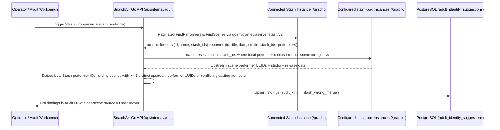

<!-- markdownlint-disable MD013 -->
<!--
SPDX-FileCopyrightText: 2026 lusoris <lusoris@pm.me>

SPDX-License-Identifier: CC-BY-SA-4.0
-->
# ADR-0037: Studio-scoped numbered performer names, scene-ownership conflict rules and Stash wrong-merge import check

- **Status:** Accepted (amends [ADR-0033](0033-adult-identity-and-model.md)); scope questions `OQ-0037-4` and `OQ-0037-5` open
- **Date:** 2026-10-26
- **Related:** [ADR-0027](0027-adult-module.md), [ADR-0029](0029-task-flow-ui.md), [ADR-0032](0032-stash-own-or-integrate.md), [ADR-0033](0033-adult-identity-and-model.md), [ADR-0034](0034-matching-engine-and-model-connection.md)

---

## Context

### 1.1 The Studio-Scoped Numbered Performer Name Failure Mode

Casting-style adult studios commonly credit performers using a given first name paired with an episode or casting sequence number (for example, `"Clara 12"` and `"Clara 47"` within `"Studio X"`), or credit those same performers under the bare first name (`"Clara"`) in scene titles, folder names, and unmoderated scraper feeds while another studio (`"Studio Y"`) independently releases scenes with a distinct performer also credited as `"Clara"` or `"Clara 12"`.

When a library engine resolves or deduplicates performers by normalized name equality alone, one performer record absorbs the external links and scene credits of every other performer sharing that first name (or sharing the same `first name + number` token in another studio's namespace). In practice, this causes a single merged performer entry to claim the scenes of multiple unrelated performers across casting episodes and studios, forcing manual scene-by-scene and link-by-link repair.

### 1.2 Verified Defect in `api/internal/adult/merge.go`

In `SnatchArr` (from "snatch" and the `*arr` media-management family, pronounced "snatch-arr"), `api/internal/adult/merge.go` implements cross-instance entity matching for favourite synchronization (`api/internal/adult/sync.go`) and federated search (`api/internal/adult/search.go`). Prior to this amendment:

1. `MatchEntity` (`api/internal/adult/merge.go:154-171`) evaluated three rules in sequence:
   - Step 1 (`matchByEndpointURL`, `api/internal/adult/merge.go:101-116`): URLs pointing at a configured `stash-box` endpoint (`stash-box`, the open-source GraphQL metadata indexer server developed by the `Stash` project, from "stash" and "box", pronounced "stash-box"; `Stash`, the self-hosted adult media organizer, from "stash", pronounced "stash") whose foreign ID is already linked.
   - Step 2 (`matchByExternalURL`, `api/internal/adult/merge.go:118-138`): Normalized external profile URL (`NormalizeExternalURL`, `api/internal/adult/merge.go:51-71`).
   - Step 3 (`matchByName`, `api/internal/adult/merge.go:140-147`): Exact normalized name (`NormalizeName`, `api/internal/adult/merge.go:45-47`) whenever `Disambiguation` is empty on both `incoming` and the candidate.
2. Because `MatchEntity` returned a matched `*Candidate` directly on Step 3 (`api/internal/adult/merge.go:165-169`), `DeduplicateEntities` (`api/internal/adult/merge.go:174-191`), `resolvePerformerMatch` (`api/internal/adult/sync.go:276-311`), `resolveStudioMatch` (`api/internal/adult/sync.go:363-396`), and `deduplicatePerformers` / `deduplicateStudios` (`api/internal/adult/search.go:38-94`) treated name equality with empty disambiguation as an unconditional automatic merge, appending the second entity's `Links` and `URLs` onto the first (`api/internal/adult/merge.go:184-185`, `api/internal/adult/sync.go:294-295`).

### 1.3 Relationship to ADR-0033 Match Keys and ADR-0034 Scoring

- **[ADR-0033](0033-adult-identity-and-model.md) Section 1 (Match keys table, `docs/adr/0033-adult-identity-and-model.md:90-100`):** Classified exact normalized name (`NormalizeName`) with empty `disambiguation` as a `weak` key (`score = 50`) intended only for review suggestions or search grouping (`docs/adr/0033-adult-identity-and-model.md:100,158`), and defined the auto-merge threshold at $S \ge 85$ with zero hard conflicts (`docs/adr/0033-adult-identity-and-model.md:126-131`). However, [ADR-0033](0033-adult-identity-and-model.md) did not explicitly model the studio-scoped `first name + number` pattern, did not define scene-ownership claim conflicts when a merge or source update would reassign scenes already linked to a distinct performer, and left `api/internal/adult/merge.go` executing the legacy Step 3 auto-merge.
- **[ADR-0034](0034-matching-engine-and-model-connection.md) Parts 2–4 (`docs/adr/0034-matching-engine-and-model-connection.md:126-320`):** Introduced Fellegi-Sunter probabilistic scoring (`api/internal/adult/weights/v1.json`), the human audit workbench (`GET /api/v1/adult/audit-items`, `accept`, `pick_value`, `merge`, `split`, `reject`, `undo` in `docs/adr/0034-matching-engine-and-model-connection.md:190-249`), and the CI regression battery (`docs/adr/0034-matching-engine-and-model-connection.md:274-280`). This ADR amends [ADR-0033](0033-adult-identity-and-model.md) and extends [ADR-0034](0034-matching-engine-and-model-connection.md) with explicit rules for studio-scoped numbered performer names, scene-ownership conflicts, source-ID-based scene splitting, and a read-only wrong-merge import scanner for connected `Stash` libraries.

---

## Decision

### 2.1 Studio-Scoped Name Rule and Prohibition of Name-Only Performer Resolution

1. **Never auto-resolve on name alone:** A performer record is **never** automatically merged with another performer record on the basis of normalized name equality (`NormalizeName`), alias equality, or case/whitespace normalization alone, even when `disambiguation` is empty on both records.
2. **Studio-scoped `name + number` pattern:** Any performer name or alias matching the lexical pattern `<given_name> [#]?<number>` (regular expression `^[\p{L}]+(?:\s+#?\d+)$`, such as `"Clara 12"` or `"Clara #47"`) is **studio-scoped**:
   - The casting number has meaning only within the issuing studio (`studio_id` or parent `network_studio_id` in `adult_studios`, `docs/adr/0033-adult-identity-and-model.md:214-225`).
   - `"Clara 12"` credited under `"Studio X"` and `"Clara 12"` credited under `"Studio Y"` are treated as distinct performers unless linked by Tiers 1–3 of the evidence ladder below.
   - `"Clara 12"` and `"Clara 47"` credited under the same `"Studio X"` carry distinct studio casting numbers, which constitutes a **hard disambiguation conflict** blocking automatic merge even if a secondary scraper strips the number to bare `"Clara"` on one of the records.

### 2.2 Performer and Scene Identity Evidence Ladder

Performer identity across scenes and metadata sources requires corroboration from at least one of the following four evidence tiers (ordered from strongest to weakest):

| Tier | Evidence Class | Qualifying Signals and Thresholds | Resolution Outcome |
| :--- | :--- | :--- | :--- |
| **Tier 1: Authoritative Registry ID** | Explicit `stash-box` or `ThePornDB` (`TPDB`, the community and scraper-driven adult metadata service, pronounced "the-porn-d-b") performer identifier | Exact `(source_instance_id, foreign_id)` hit in `adult_external_refs`; `stash-box` `merged_ids` / `merged_into_id` redirect (`stashapp/stash-box` `v0.10.3` `types/performer.graphql`); cross-instance `stash-box` endpoint URL (`matchByEndpointURL` in `api/internal/adult/merge.go:101-116`); `ThePornDB` `PerformerSite.parent` canonical performer UUID (`GET /performer-sites/{id}`); or shared normalized authoritative profile URL (`matchByExternalURL` in `api/internal/adult/merge.go:118-138`). | **Auto-merge** ($S \ge 90$), provided zero hard conflicts exist (Section 2.4). |
| **Tier 2: Scene Cryptographic or Perceptual Fingerprint** | Scene hash match binding the performer credit to a verified scene | Scene matches an upstream `stash-box` or `ThePornDB` scene via `OSHASH` (64-bit OpenSubtitles hash + duration $\pm 2\text{ s}$, $S = 95$) or `PHASH` (64-bit DCT perceptual hash at Hamming distance $d \le 4$ + duration $\pm 5\text{ s}$ and `reports == 0`, $S \ge 86$ per [ADR-0033](0033-adult-identity-and-model.md) `docs/adr/0033-adult-identity-and-model.md:107-110` and [ADR-0034](0034-matching-engine-and-model-connection.md) `docs/adr/0034-matching-engine-and-model-connection.md:151-155`), and that upstream scene carries an explicit Tier 1 performer foreign ID for the credited slot. | **Auto-link performer via scene** ($S \ge 86$) when the scene has a single unambiguous match for that performer slot and zero hard conflicts. `PHASH` at $5 \le d \le 8$ ($S = 70$) routes to the audit queue. |
| **Tier 3: Studio + Release Date + Studio Code Evidence** | Studio-scoped release metadata corroborating a numbered or mononym performer | Resolved canonical `studio_id` (or `parent_studio_id`) + exact `release_date` (`YYYY-MM-DD`) + studio catalog `code` / casting number matching an upstream `stash-box` or `ThePornDB` scene (`docs/adr/0033-adult-identity-and-model.md:111-112`) that carries a Tier 1 performer foreign ID. Without a Tier 1 foreign ID on the matched scene, `studio_id` + `release_date` + `<given_name> <number>` reaches $S = 80$ (medium confidence). | **Auto-merge** ($S \ge 85$) only when the matched studio+date scene supplies a Tier 1 performer ID; otherwise **Audit Candidate** ($60 \le S \le 84$). |
| **Tier 4: Name or Alias Equality Alone** | Normalized name (`NormalizeName`) or alias equality with no Tier 1–3 evidence | `matchByName` (`api/internal/adult/merge.go:140-147`): identical normalized name with empty `disambiguation`, or `<given_name>` matching the prefix of `<given_name> <number>`. | **Audit Candidate only** (`MatchAuditCandidate`, $S = 50$); **never auto-merged**. |

### 2.3 Resolver Change in `api/internal/adult/merge.go` and Callers

In `api/internal/adult/merge.go`:

1. `MatchKind` classifies the match result into `MatchNone` (`""`), `MatchAutoMerge` (`"auto_merge"`), and `MatchAuditCandidate` (`"audit_candidate"`).
2. `MatchEntity(incoming IncomingEntity, candidates []Candidate, endpoints []StashboxEndpoint) (*Candidate, int, MatchKind)` returns:
   - `(&candidates[i], i, MatchAutoMerge)` on Step 1 (`matchByEndpointURL`) and Step 2 (`matchByExternalURL`).
   - `(&candidates[i], i, MatchAuditCandidate)` on Step 3 (`matchByName`).
   - `(nil, -1, MatchNone)` when no rule matches.
3. `DeduplicateEntitiesWithAudit(items []Candidate, endpoints []StashboxEndpoint) ([]Candidate, []AuditCandidate)` merges `URLs` and `Links` **only** when `kind == MatchAutoMerge`. When `kind == MatchAuditCandidate`, both entities remain distinct in the returned slice and an `AuditCandidate{Existing, Incoming}` pair is appended to the audit slice. `DeduplicateEntities` delegates to `DeduplicateEntitiesWithAudit` and returns the deduplicated slice.
4. Callers in `api/internal/adult/sync.go` (`resolvePerformerMatch` at `sync.go:292`, `resolveStudioMatch` at `sync.go:378`) and `api/internal/adult/search.go` (`deduplicatePerformers` at `search.go:53`, `deduplicateStudios` at `search.go:82`) merge only when `kind == MatchAutoMerge`, keeping name-only matches as separate rows.

### 2.4 Conflict Rules (Routing to ADR-0034 Part 3 Audit Queue)

In addition to the five hard conflict blockers in [ADR-0033](0033-adult-identity-and-model.md) (`docs/adr/0033-adult-identity-and-model.md:134-143`), automatic merging is blocked and routed to the human audit queue ([ADR-0034](0034-matching-engine-and-model-connection.md) Part 3, `adult_identity_suggestions` with `audit_kind = 'identity_conflict'`) whenever any of the following hold:

1. **Cross-source performer ID disagreement on a scene:** Two metadata sources (for example, `StashDB`—the community-moderated `stash-box` database, from "Stash" and "database", pronounced "stash-d-b"—and `ThePornDB`, or two `stash-box` instances) matched to the same canonical `adult_scenes` row map the same performer credit slot to canonical performers that hold conflicting active `adult_external_refs` on the same source instance.
2. **Scene-ownership claim conflict:** Linking an incoming `(source_instance_id, foreign_id)` or merging two performer candidates would cause one canonical performer to claim `adult_scene_performers` rows on scenes that are already credited to another canonical performer with a distinct active `stash-box` or `ThePornDB` performer ID in the same role/slot.
3. **Same-studio distinct casting number conflict:** Both candidates are associated with scenes from the same `studio_id` (or `network_studio_id`) and carry `<given_name> <number>` credits or aliases with unequal numbers (for example, `"Clara 12"` vs `"Clara 47"`).

No conflict is ever resolved by silent last-writer-wins overwrite or automatic merge.

### 2.5 Split Tool Semantics (Source-ID Scene Reassignment and Deterministic Undo)

Extending `SplitEntity` ([ADR-0033](0033-adult-identity-and-model.md) `docs/adr/0033-adult-identity-and-model.md:150-155`) and `POST /api/v1/adult/entities/{entityType}/{id}/split` ([ADR-0034](0034-matching-engine-and-model-connection.md) `docs/adr/0034-matching-engine-and-model-connection.md:199,242`):

1. **Partitioning by source IDs:** When an operator splits a wrongly merged performer $P_{\text{merged}}$ by selecting one or more `adult_external_refs` (`(source_kind, source_instance_id, foreign_id)`) to detach into performer $P_{\text{detached}}$:
   - All selected `adult_external_refs` move from $P_{\text{merged}}$ to $P_{\text{detached}}$.
   - Every `adult_scene_performers` credit on $P_{\text{merged}}$ is inspected against the scene's linked upstream source records (`adult_scenes` -> `adult_external_refs` and provenance snapshots):
     - Scenes whose upstream source credit references a detached `(source_instance_id, foreign_id)` (or whose studio + release date + casting number matches the detached ref) have their `adult_scene_performers.performer_id` reassigned from $P_{\text{merged}}$ to $P_{\text{detached}}$.
     - Scenes whose upstream source credit references a surviving `foreign_id` on $P_{\text{merged}}$ remain on $P_{\text{merged}}$.
     - Scenes lacking any upstream performer `foreign_id` (linked only by bare name) are listed in the split preview so the operator can assign them explicitly before committing the transaction.
   - `adult_image_set_performers` rows linked to reassigned scenes follow their parent `scene_id` to $P_{\text{detached}}$.
2. **Provenance recomputation and anti-merge exclusion:** Scalar fields on both $P_{\text{merged}}$ and $P_{\text{detached}}$ are recomputed strictly from each performer's remaining `adult_field_provenance` rows (`docs/adr/0033-adult-identity-and-model.md:153,397`), and an exclusion pair is inserted into `adult_identity_exclusions` (`docs/adr/0033-adult-identity-and-model.md:363-370`) so subsequent sync sweeps never re-merge them.
3. **Single-transaction snapshot and undo:** The split writes an immutable `manual_split` row to `adult_identity_events` (`decided_by = 'human'`, `before_snapshot_json` capturing the pre-split `adult_external_refs`, `adult_scene_performers`, `adult_image_set_performers`, and `adult_field_provenance` rows). Invoking `POST /api/v1/adult/identity-events/{id}/undo` restores the exact pre-split state in one serializable PostgreSQL transaction.

### 2.6 Connected Stash Wrong-Merge Import Check (Read-Only Scan)

When an adopter connects an external `Stash` instance (`kind: stash` per [ADR-0032](0032-stash-own-or-integrate.md) `docs/adr/0032-stash-own-or-integrate.md:159-170`), `SnatchArr` provides a read-only library audit scan using `github.com/golusoris/goenvoy/mediaserver/stash/v2` (`goenvoy`, the shared Go HTTP client library for external media and metadata APIs, from "Go" and "envoy", pronounced "go-en-voy"; pinned at `mediaserver/stash/v2.0.3`, commit `17183e338c983b01d497a42c0a76b82c7a3b1e53` per `docs/adr/0032-stash-own-or-integrate.md:56`):

1. **Read-only invariant:** The import check issues **only** GraphQL `query` operations (`FindPerformers`, `FindScenes`, and generic `Client.Query` with `context.Context` deadlines and `MaxItemsPerSweep` pagination bounds per HISS-02). The scan itself executes zero GraphQL mutations against the connected `Stash` instance. The only write path is the automatic write-back of a split the operator has confirmed (item 4, ledger `snatcharr-oq-0037-2`).
2. **Detection rules for existing wrong merges in `Stash`:** A local `Stash` performer $P_{\text{stash}}$ is flagged as a `stash_wrong_merge` finding when any of the following hold:
   - **Rule A (Multiple distinct `stash-box` performer IDs on the performer record):** $P_{\text{stash}}.\text{stash\_ids}$ contains two or more distinct `stash_id` UUIDs for the **same** `stash-box` `endpoint` (unless one UUID is listed in the other's upstream `merged_ids`).
   - **Rule B (Scenes under one `Stash` performer resolve to different upstream performer IDs):** Across the scenes credited to $P_{\text{stash}}$ in `Stash`, resolving each scene's `stash_ids` (or `oshash` / `phash` fingerprints) against configured `stash-box` instances or `ThePornDB` yields two or more distinct upstream performer foreign IDs for $P_{\text{stash}}$'s credit slot (for example, Scene 1 resolves on `stash-box` to performer UUID $U_{12}$ `"Clara 12"` while Scene 2 resolves on the same `stash-box` endpoint to performer UUID $U_{47}$ `"Clara 47"`, or Scene 3 in `"Studio Y"` resolves to performer UUID $U_{Y}$ `"Clara"`).
   - **Rule C (Same-studio conflicting casting numbers under a bare-name performer):** $P_{\text{stash}}$ has a bare first name (`"Clara"`) and is credited on multiple scenes from the same studio whose titles, studio codes, or upstream metadata carry distinct `<given_name> <number>` tokens (`"Clara 12"` vs `"Clara 47"`).
3. **Surfacing in the Audit Workbench:** Each detected wrong merge is persisted in `adult_identity_suggestions` (`audit_kind = 'stash_wrong_merge'`) with the partitioned scene groups and their upstream `(endpoint, stash_id)` evidence, and listed in the [ADR-0034](0034-matching-engine-and-model-connection.md) Part 3 audit UI (`web/`, built on `sveltesentio`, the shared Svelte 5 design system and component library, from "Svelte" and Latin *sentio* meaning "I perceive", pronounced "svelt-sen-tee-oh").
4. **Split workflow and automatic `Stash` write-back** (ledger `snatcharr-oq-0037-1` b and `snatcharr-oq-0037-2` c):
   - The audit queue row opens a step-by-step split drawer. Each step shows one target performer bucket with its scenes and their upstream `(endpoint, stash_id)` evidence; the operator assigns the open scenes and moves to the next bucket. The last step shows the full partition, and one confirmation commits it in a single transaction.
   - When the confirmed split concerns a performer that also exists in a connected `Stash` instance, SnatchArr writes the split back to `Stash` automatically: it creates the missing performers, moves each scene's performer credits to the new performer, and records the `Stash` state before the change in `before_snapshot_json` so undo restores both SnatchArr and `Stash`.
   - No write happens without a confirmed split: detection, scans and suggestions stay read-only. A failed `Stash` write leaves the SnatchArr split committed, marks the finding `stash_writeback_failed` with the error, and offers a retry; it never retries silently in a loop.
   - The typed `Stash` mutation calls are not in `github.com/golusoris/goenvoy/mediaserver/stash/v2` yet (main `ac12960bb042` has `Find*` reads plus a raw `Client.Query`); the `goenvoy` owner adds typed `PerformerCreate`, `PerformerUpdate` and `SceneUpdate` (`performer_ids`) wrappers with a module tag (ledger `snatcharr-goenvoy-stash-mutations`). SnatchArr pins that tag once it exists; until then the slice codes against a small interface with a fake `Stash` in tests. Undo of a written-back split must remove the performers the write-back created, so this slice also needs a typed `PerformerDestroy` wrapper; SnatchArr names that need to the `goenvoy` owner through the controller. Undo destroys only performers the write-back itself created and recorded in `before_snapshot_json`, never a performer that existed before.
5. **Bare-name favourites resolved through scene overlap** (ledger `snatcharr-oq-0037-3` b): when favourite sync (`adult_favorite_performers`) imports two bare first-name performers from different `stash-box` instances with no external URL or cross-reference, the sync runs one scene-overlap lookup per pair: it pages the scenes of both performers and compares scene fingerprints and `stash_ids`. Shared scenes above the evidence threshold of [ADR-0034](0034-matching-engine-and-model-connection.md) link the pair; no overlap keeps both rows apart and enqueues a `MatchAuditCandidate`. Each lookup has a scalar page bound and a deadline (HISS-02) and counts against the `stash-box` instance rate limit; a pair is looked up once per sync sweep and the result is cached until either performer changes.

---

## Planted Test Set and Location

In accordance with HISS-15 (3D testing: positive, negative, boundary) and HISS-20 (replayable evidence), the planted unit test suite lives in `api/internal/adult/merge_test.go` (`TestMatchEntity`, `TestDeduplicateEntities`, and `TestDeduplicateEntitiesWithAudit`) and `api/internal/adult/sync_test.go` (`TestResolvePerformerMatch_NameOnlyDoesNotMerge`):

1. **Planted negative cases (fail on pre-0037 `merge.go`):**
   - **Three performers with the same invented first name (`"Clara"`), each with its own `stash-box` foreign ID:** Two from `"Studio X"` (casting numbers `12` and `47`, entered once with the number as `"Clara 12"` with foreign ID `sb-studio-x-clara-12` and once as the bare first name `"Clara"` with foreign ID `sb-studio-x-clara-47`) and one from `"Studio Y"` (entered as `"Clara"` with foreign ID `sb-studio-y-clara-01`). `DeduplicateEntities` must keep all **3** entities distinct (`len(deduped) == 3`, 1 link each). On the pre-0037 resolver, Step 3 (`matchByName`) merged `"Clara"` (`sb-studio-x-clara-47`) and `"Clara"` (`sb-studio-y-clara-01`), collapsing the slice to 2 entities.
   - **Three performers all entered as bare first name `"Clara"` (`sb-studio-x-clara-12`, `sb-studio-x-clara-47`, `sb-studio-y-clara-01`):** `DeduplicateEntities` must keep all **3** entities. On the pre-0037 resolver, all three collapsed into 1 entity holding all 3 links.
2. **Positive cases:**
   - **Same foreign ID across two instances via endpoint URL cross-reference (`matchByEndpointURL`):** `"Clara 12"` on instance 1 (`sb-studio-x-clara-12`) and `"Clara"` on instance 2 with URL `https://stashdb.org/performers/sb-studio-x-clara-12` return `MatchAutoMerge` and merge into 1 entity with 2 links.
   - **Same normalized external URL (`matchByExternalURL`):** Two records sharing `https://bravo.example` and `http://www.bravo.example/` return `MatchAutoMerge` and merge into 1 entity.
3. **Boundary cases:**
   - **Empty / whitespace-only names (`""`, `"   "`) with no shared ID:** Return `MatchNone`; not merged and not reported as an audit candidate.
   - **Names differing only in case and spacing (`"  CLARA   12 "` vs `"clara 12"`) with no shared ID:** Return `MatchAuditCandidate`; not merged (`len(deduped) == 2`), and reported in the `AuditCandidate` slice of `DeduplicateEntitiesWithAudit`.
   - **Exact normalized name match with empty `Disambiguation` (`"clara"` vs `"Clara"`):** `MatchEntity` returns `MatchAuditCandidate` rather than `MatchAutoMerge`, and `DeduplicateEntitiesWithAudit` emits an `AuditCandidate` without merging.

---

## Answered Questions

The operator answered all three questions on 2026-10-26 (ledger `snatcharr-oq-0037-answers-20261026`). The answers bind where they differ from the recommendation in the original question.

| Question | Answer | Ledger |
| :--- | :--- | :--- |
| `OQ-0037-1` | **b**: a step-by-step split drawer launched from the audit queue row, one target performer bucket per step, one confirmation for the whole partition (item 4). | `snatcharr-oq-0037-1` |
| `OQ-0037-2` | **c**: automatic write-back to `Stash` when a split is confirmed in SnatchArr; scans stay read-only (item 4). | `snatcharr-oq-0037-2` |
| `OQ-0037-3` | **b**: a scene-overlap lookup per bare-name favourite pair during sync, bounded and rate-limited (item 5). | `snatcharr-oq-0037-3` |
| `goenvoy` mutations | Typed `Stash` mutation wrappers (`PerformerCreate`, `PerformerUpdate`, `SceneUpdate`, plus `PerformerDestroy` for undo) come from the `goenvoy` owner as a tagged release; SnatchArr codes against an interface and a fake until the tag exists (item 4, slice 6). | `snatcharr-goenvoy-stash-mutations` |

### Original questions

The questions as proposed, kept for the record:

- `OQ-0037-1 | How should the ADR-0034 Part 3 audit workbench render multi-way performer split and wrong-merge findings (where one merged performer holds scenes belonging to 2..N distinct source performer IDs)? | a) Extend the existing 12-column 1:1 split comparison view with a tabbed or grouped N-way scene partition table inside the right 8-column pane, where each detected source performer ID is a column/bucket and keyboard shortcuts (1..9, s) assign unresolved scenes before committing the split (risk: dense right pane when N > 3 distinct performers were merged into one record) b) Dedicated two-step "Split Wizard" drawer or modal launched from the audit queue row that steps through each target performer bucket one at a time (risk: adds modal/stepper navigation steps and departs from ADR-0029 single-view task-flow consolidation) c) Emit N-1 separate pairwise 1:1 split rows in the audit queue so the existing 2-column diff table remains unchanged (risk: operator cannot see the full partition of the merged performer's scenes at once, and splitting in the wrong order requires multiple passes) | recommended: a, preserves ADR-0029 single-screen keyboard triage and shows every target performer bucket and scene assignment in one atomic transaction.`
- `OQ-0037-2 | When the Stash wrong-merge import check detects a wrongly merged performer in a connected Stash instance, should SnatchArr write the split and scene reassignments back to Stash? | a) Read-only in Stash by default, with an opt-in "Apply split to Stash" action in the audit workbench that executes Stash GraphQL mutations (performerCreate / sceneUpdate) only on explicit per-finding operator confirmation and records a reversible snapshot (risk: requires mutation wrappers in goenvoy/mediaserver/stash/v2 and a Stash API key with write role) b) Strictly read-only integration with Stash at all times; SnatchArr splits the performer in its own database and offers a copyable repair report / GraphQL payload for the operator to apply in Stash (risk: operator still has to perform manual or scripted clicks inside Stash to fix Stash's own database) c) Automatic background write-back to Stash whenever a split is confirmed in SnatchArr (risk: unexpected external mutation of the user's Stash library if the operator only intended to adjust SnatchArr's local index) | recommended: a, keeps background scans strictly read-only while eliminating manual repair work in Stash when the operator explicitly confirms a split.`
- `OQ-0037-3 | How should the resolver handle bare first-name performer entries imported during favourite sync (adult_favorite_performers) when no scene context or external URL is returned by the stash-box favourite query? | a) Keep bare-name performers as distinct canonical rows per (instance_id, foreign_id) during sync and enqueue a MatchAuditCandidate suggestion in adult_identity_suggestions without auto-merging (risk: a user who favourited the same mononym performer on two stash-box instances where neither entry lists external URLs or cross-ref links must confirm the merge once in the audit queue) b) Perform an automatic secondary GraphQL scene-overlap query against both stash-box instances during favourite sync to check whether the two bare-name performers share scene fingerprints before queuing for audit (risk: multiplies GraphQL queries per bare-name favourite during periodic sync sweeps and increases rate-limit pressure) | recommended: a, guarantees zero false merges during background sync while keeping sync query counts bounded per HISS-02.`

## Open Scope Questions

The public pain research in `.workingdir/evidence/stash-pain-research-20261026.md` (sha256 `1a2c4df2f45b`) assessed two themes as SnatchArr scope that feed this ADR. The assessment is not a decision: each assignment stays open until the decision ledger records an answer. The answers change the follow-up slice list, not the accepted decision above.

- `OQ-0037-4 | Scope owner for the research theme "Performer identity disambiguation and collision on identical names" (weight 415, 18 rows): who covers it? | a) SnatchArr covers it in ADR-0037 scope (per-studio aliases and pairwise disambiguation) (risk: build and maintenance cost; overlap with upstream work) b) upstream (Stash, stash-box) owns it; SnatchArr only reads its result (risk: the pain stays for adopters who run SnatchArr) c) out of scope, no SnatchArr work (risk: theme stays unaddressed; research weight 415) | recommended: a`
- `OQ-0037-5 | Scope owner for the research theme "Numbered or studio-scoped performer identities" (weight 51, 5 rows): who covers it? | a) SnatchArr covers it in ADR-0037 scope (studio-scoped numbered names) (risk: build and maintenance cost; overlap with upstream work) b) upstream (Stash, stash-box) owns it; SnatchArr only reads its result (risk: the pain stays for adopters who run SnatchArr) c) out of scope, no SnatchArr work (risk: theme stays unaddressed; research weight 51) | recommended: a`

---

## Consequences, Alternatives, Verification Plan and Follow-Up Slices

### 5.1 Consequences

#### Positive

- **Eliminates homonym and casting-number false merges:** Performers credited as `"Clara 12"`, `"Clara 47"`, and `"Clara"` across one or more studios never collapse into a single performer on name alone.
- **Preserves scene ownership integrity:** Scene credits only merge when backed by Tier 1–3 evidence (`stash-box` ID, `ThePornDB` ID, verified `OSHASH`/`PHASH` scene fingerprint, or studio + release date + code), and any ownership collision halts auto-merge in favour of the audit queue.
- **Detects pre-existing library corruption:** Adopters connecting an existing `Stash` library immediately get a read-only audit of performers whose scenes point to conflicting upstream `stash-box` performer UUIDs.
- **Reversible splits:** Splitting a performer reassigns scenes deterministically by upstream source ID and records a full `before_snapshot_json` for single-click undo, in SnatchArr and in the connected `Stash` instance.
- **No manual repair in `Stash`:** a confirmed split reaches `Stash` without extra clicks.

#### Negative

- **External writes:** a confirmed split changes the operator's `Stash` library. The write needs a `Stash` API key with write rights, and a failed write leaves the two systems apart until the retry succeeds.
- **More `stash-box` queries during sync:** each unresolved bare-name pair costs one bounded scene-overlap lookup per sweep.

- **Higher initial audit queue volume for unlinked mononyms:** Performers on secondary `stash-box` instances that lack both cross-instance endpoint URLs and external social/index URLs will no longer merge silently by name; they enter the audit queue as `MatchAuditCandidate` items until confirmed once by the operator.

### 5.2 Alternatives Considered

| Alternative | Description | Reason for Rejection |
| :--- | :--- | :--- |
| **1. Keep name-only auto-merge, but strip trailing numbers from performer names** | Normalize `"Clara 12"` and `"Clara 47"` to `"clara"` and auto-merge when disambiguation is empty. | **Rejected:** Stripping the number makes the defect strictly worse by merging distinct casting performers (`12` and `47`) within the same studio into a single record. |
| **2. Auto-merge on exact name except when the name matches `<name> <number>`** | Block auto-merge on numbered names (`"Clara 12"`), but keep auto-merging bare mononyms (`"Clara"`). | **Rejected:** Fails when a scraper or local library imports `"Clara 12"` and `"Clara 47"` under the bare first name `"Clara"`, or when two studios both credit different performers as `"Clara"`. |
| **3. Require `stash-box` disambiguation to be non-empty on all homonyms** | Rely on upstream moderators populating `Performer.disambiguation` on every `stash-box` instance. | **Rejected:** Upstream `Disambiguation` is frequently empty on newly added casting performers and across independent `stash-box` instances (`api/internal/adult/merge.go:141`). |

### 5.3 Verification Plan

1. **Unit & table-driven regression tests (`api/internal/adult/merge_test.go`, `api/internal/adult/sync_test.go`):**
   - Run `cd api && go test ./internal/adult/...` verifying positive (`MatchAutoMerge` on endpoint foreign ID URL and normalized external URL), negative (3-performer studio X `#12` / `#47` and studio Y planted set stays 3 entities), and boundary cases (empty names, case/spacing-only differences, `MatchAuditCandidate` reporting).
2. **Static analysis and formatting gates:**
   - `gofmt -l api/internal/adult` (zero unformatted files).
   - `golangci-lint run ./api/internal/adult/...` using root `.golangci.yml` (zero warnings; cyclomatic complexity $\le 10$, cognitive complexity $\le 15$, function length $\le 60$ lines per `AGENTS.md`).
   - `reuse lint` (100% SPDX licence compliance).
3. **Split write-back (`snatcharr-oq-0037-2`):** an end-to-end test against a `Stash` test instance seeds one performer holding scenes of three upstream performers, confirms a three-way split through the drawer, and asserts that `Stash` then holds three performers with the scene credits moved; undo restores the seeded state. A planted failing `Stash` write marks the finding `stash_writeback_failed` and leaves no partial credit move.
4. **Scene-overlap resolution (`snatcharr-oq-0037-3`):** a sync test with two bare-name favourites on two fake `stash-box` instances links the pair when they share scenes, keeps them apart and enqueues an audit candidate when they share none, and stops at the page bound.
5. **Split drawer (`snatcharr-oq-0037-1`):** a Playwright test walks a three-bucket split step by step and passes `axe-core` with zero violations.

### 5.4 Follow-Up Slices (Milestone `0.10`)

Because this unit touches only the ADR and the in-memory resolver in `api/internal/adult/{merge,sync,search}.go` without schema or OpenAPI changes, the database persistence, `Stash` scanner, and UI wiring ship in the following milestone `0.10` slices:

| Slice | Milestone | Scope |
| :--- | :--- | :--- |
| **Slice 1: Audit candidate persistence during sync** | `0.10` | Persist `MatchAuditCandidate` pairs emitted by `resolvePerformerMatch` and `resolveStudioMatch` (`api/internal/adult/sync.go`) into `adult_identity_suggestions` (`migration 000040` / `000041` from [ADR-0033](0033-adult-identity-and-model.md) and [ADR-0034](0034-matching-engine-and-model-connection.md)), skipping pairs already recorded in `adult_identity_exclusions`. |
| **Slice 2: Studio-scoped numbered-name parser and scene-ownership conflict guard** | `0.10` | Implement `<given_name> [#]?<number>` token extraction, studio-scoped disambiguation check, and the scene-ownership conflict blocker in the Stage 3 Fellegi-Sunter resolver (`api/internal/adult/`). Add the studio X/Y numbered-performer fixtures to `api/internal/adult/testdata/matching_regression_battery.json`. |
| **Slice 3: Source-ID scene split endpoint and undo** | `0.10` | Implement `POST /api/v1/adult/entities/performer/{id}/split` in `api/openapi/openapi.yaml` and `api/internal/adult/`, reassigning `adult_scene_performers` and `adult_image_set_performers` by upstream `(source_instance_id, foreign_id)` with full `before_snapshot_json` undo support. |
| **Slice 4: Connected `Stash` read-only wrong-merge scanner** | `0.10` | Implement the read-only `Stash` wrong-merge scan over `github.com/golusoris/goenvoy/mediaserver/stash/v2`, detecting local `Stash` performers whose scenes resolve to $\ge 2$ distinct upstream `stash-box` performer UUIDs or conflicting studio casting numbers, and surfacing `stash_wrong_merge` items in `/api/v1/adult/audit-items`. |
| **Slice 5: Audit Workbench UI for performer splits and `Stash` findings** | `0.10` | Implement the `web/` audit workbench view (`sveltesentio`, Svelte 5 runes, OKLCH tokens, Paraglide `en`/`de` messages, Playwright + `axe-core` zero-violation gate) as the step-by-step split drawer of item 4 (`snatcharr-oq-0037-1`). |
| **Slice 6: Automatic `Stash` split write-back** | `0.10` | Write confirmed splits back to `Stash` with snapshot and undo (`snatcharr-oq-0037-2`); typed mutation calls wait for `snatcharr-goenvoy-stash-mutations`, the slice starts against an interface and a fake `Stash`. |
| **Slice 7: Scene-overlap lookup for bare-name favourites** | `0.10` | Bounded, rate-limited overlap lookup per bare-name favourite pair during sync, cached per sweep (`snatcharr-oq-0037-3`). |

---

## References

- [ADR-0027: Adult module: stash-box sources, Whisparr requests and image sets](0027-adult-module.md)
- [ADR-0029: Task-flow navigation, one activity view, desktop-first density and context help](0029-task-flow-ui.md)
- [ADR-0032: Stash: own or integrate — adult library engine evaluation](0032-stash-own-or-integrate.md)
- [ADR-0033: Adult identity resolution and normalized data model](0033-adult-identity-and-model.md)
- [ADR-0034: Adult metadata matching engine, attribute reconciliation, audit workbench and outbound model connection](0034-matching-engine-and-model-connection.md)
- Repository files: `api/internal/adult/merge.go`, `api/internal/adult/merge_test.go`, `api/internal/adult/sync.go`, `api/internal/adult/sync_test.go`, `api/internal/adult/search.go`, `api/internal/adult/search_test.go`.
- [golusoris/goenvoy](https://github.com/golusoris/goenvoy): `mediaserver/stash/v2` (`v2.0.3`, commit `17183e338c983b01d497a42c0a76b82c7a3b1e53`) and `metadata/adult/stashbox/v2` (`v2.0.4`, commit `392968f04f0287825d2010d5f38f3a1d4bbe137d`).
- [stashapp/stash-box](https://github.com/stashapp/stash-box): release `v0.10.3` (`5eb3551e19fd494e93be410d8149adc785cffd6a`), `graphql/schema/types/performer.graphql` and `graphql/schema/types/scene.graphql`.
- [stashapp/stash](https://github.com/stashapp/stash): release `v0.31.1` (published `2026-04-13`).
