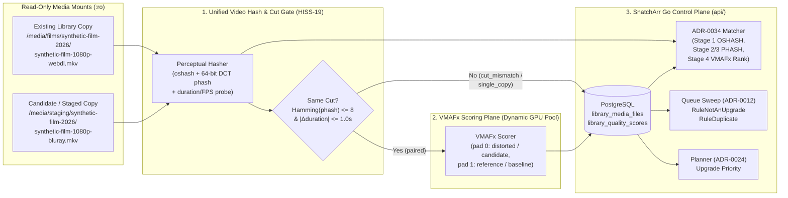

<!--
SPDX-FileCopyrightText: 2026 lusoris <lusoris@pm.me>

SPDX-License-Identifier: CC-BY-SA-4.0
-->
<!-- markdownlint-disable MD013 -->

# ADR-0038: VMAFx Perceptual Video Quality Scoring and Unified Video Hashing Across Media Libraries

- **Status:** Proposed
- **Date:** 2026-10-26
- **Deciders:** lusoris

## Context

### Scope: Every Video Library SnatchArr Touches

**SnatchArr** (meaning: automated media-snatching and queue-governance control plane for the `*arr` ecosystem; origin: English *snatch* + the `*arr` suffix of companion media managers; pronunciation: `/ˈsnætʃ.ɑːr/`, "snatch-ar") coordinates search dispatch, queue hygiene, and library upgrade policy across **every video library kind** an adopter runs:

- Feature films managed by **Radarr** (meaning: automated feature-film collection manager forked from Sonarr; origin: *radar* + `*arr`; pronunciation: `/ˈreɪ.dɑːr/`, "ray-dar").
- Television series, miniseries, and anime managed by **Sonarr** (meaning: automated episodic television and anime collection manager; origin: *sonar* + `*arr`; pronunciation: `/ˈsoʊ.nɑːr/`, "soh-nar").
- Music videos and concert films managed alongside **Lidarr** (meaning: automated music collection manager in the `*arr` family; origin: *lidar* + `*arr`; pronunciation: `/ˈlaɪ.dɑːr/`, "lye-dar") or general video libraries, alongside non-video book libraries in **Readarr** (meaning: automated book and audiobook collection manager; origin: *reader* + `*arr`; pronunciation: `/ˈriː.dɑːr/`, "ree-dar").
- Adult studio scenes, films, and independent creator videos managed by **Whisparr** (meaning: automated adult-video collection manager supporting studio scenes in v2 and movie/JAV items in v3; origin: *whisper* + `*arr`; pronunciation: `/ˈwɪs.pɑːr/`, "wis-par") and **Stash** (meaning: self-hosted organiser, perceptual-hash indexer, and GraphQL server for local video scenes and galleries; origin: English *stash*, a private collection or store; pronunciation: `/stæʃ/`, "stash").
- Playback libraries served by **Jellyfin** (meaning: community-governed free-software media server for streaming and tracking library playback; origin: *jellyfish* + *fin*, forked from Emby in 2018; pronunciation: `/ˈdʒɛl.i.fɪn/`, "jel-ee-fin"), **Emby** (meaning: client-server personal media server platform; origin: coined from the initials of *Media Browser*; pronunciation: `/ˈɛm.bi/`, "em-bee"), and **Plex** (meaning: commercial client-server media server and playback ecosystem; origin: Latin *plexus*, an interwoven network; pronunciation: `/plɛks/`, "pleks").

Adult scene identity ([ADR-0033](0033-adult-identity-and-model.md), [ADR-0034](0034-matching-engine-and-model-connection.md)) is **one downstream consumer** of perceptual video hashing and quality comparison, not the reason for this architecture. Every video library shares the same underlying problem: release names, container bitrates, and integer custom-format scores do not measure the visual fidelity of the decoded video stream.

### What SnatchArr Decides Today on Keep, Replace, and Upgrade

Today, SnatchArr's Go control plane (`api/`, built on **golusoris** — meaning: shared Go service chassis providing lifecycle, leader election, clock, cryptography, and observability primitives; origin: `Go` + Latin *lusor*, player/craftsman; pronunciation: `/ˌɡoʊ.luːˈsɔː.rɪs/`, "goh-loo-sor-is") and Rust data plane (`worker/`, per [ADR-0010](0010-keep-api-worker-split.md)) make keep, replace, and upgrade decisions exclusively from metadata labels and integer profile scores:

1. **Scheduled upgrade and missing dispatch (`api/internal/snatch/planner.go`)**:
   - `Planner.Tick` (`api/internal/snatch/planner.go:78-102`) runs every `60s` (`defaultTickInterval` at `api/internal/snatch/planner.go:24-27`) on the elected leader replica.
   - For each enabled instance ordered by `Priority` ([ADR-0022](0022-instance-priority.md), `api/internal/snatch/planner.go:85-97`), `planInstance` (`api/internal/snatch/planner.go:118-174`) enqueues a `SnatchMissing` run when `policy.MissingPerCycle > 0` (`planner.go:138-149`, default `2` in `api/internal/domain/policy.go:72`, [ADR-0020](0020-snatch-policy-defaults-and-presets.md)) and a `SnatchUpgrade` run when `policy.UpgradePerCycle > 0` (`planner.go:151-162`, default `1` in `api/internal/domain/policy.go:73`).
   - Watch-aware policy modes ([ADR-0024](0024-watch-aware-modes.md)) and request sync via **Seerr** (meaning: media request and discovery portal unifying Overseerr and Jellyseerr; origin: *seer* + `*arr`; pronunciation: `/ˈsɪər/`, "seer") narrow *which* episodes or films are searched via indexers in **Prowlarr** (meaning: indexer manager and proxy for `*arr` applications; origin: *prowl* + `*arr`; pronunciation: `/ˈpraʊ.lɑːr/`, "prow-lar"), and **Configarr** (meaning: declarative configuration synchroniser that reconciles custom formats and quality profiles into `*arr` instances; origin: *config* + `*arr`; pronunciation: `/kənˈfɪɡ.ɑːr/`, "kuhn-fig-ar") populates the target profile cutoffs, but neither inspects the existing file on disk.

2. **Worker candidate selection (`worker/crates/snatch-worker` and `worker/crates/snatch-core`)**:
   - During a leased run (`worker/crates/snatch-worker/src/executor.rs:223-231`), `fetch_candidates` (`executor.rs:527-588`) pages `/wanted/missing` for `SnatchMissing` or `/wanted/cutoff` for `SnatchUpgrade`.
   - `snatch_core::filter` (`worker/crates/snatch-core/src/lib.rs:212-224`) checks monitoring flags and air-date / release-date age (`min_release_age_hours`).
   - `FilterCandidates` (`executor.rs:699-753`) removes entities still inside the Go API's processed-memory cooldown window, and `snatch_core::select_prioritised` (`worker/crates/snatch-core/src/lib.rs:274-294`) sorts the survivors by `PriorityMode::NewestFirst` or `OldestFirst` (`snatch-core/src/lib.rs:26-34`) up to the granted hourly cap (`AcquireBudget`).

3. **Queue keep, replace, and upgrade rules (`api/internal/queue` and `api/internal/arrclient`)**:
   - `Sweep` (`api/internal/queue/sweep.go:118-246`, per [ADR-0012](0012-queue-management-replaces-cleanuparr-link.md)) evaluates active queue items across the seven rules in `api/internal/queue/rules.go:18-62` (`stalled`, `slow`, `failed`, `import_blocked`, `unwanted`, `not_an_upgrade`, `duplicate`).
   - To evaluate upgrades, `GoenvoyProber.withFileScores` (`api/internal/arrclient/queue.go:88-103`, built on **goenvoy** — meaning: typed Go client SDK for `*arr` services; origin: `Go` + English *envoy*, a diplomatic messenger; pronunciation: `/ɡoʊˈɛn.vɔɪ/`, "goh-en-voy") fetches `ExistingScore` for at most `maxFileLookups = 50` queued items per sweep (`api/internal/arrclient/queue.go:30`):
     - On Sonarr, `sonarrFileScore` calls `GetEpisodeFile` (`api/internal/arrclient/queue.go:175-181`).
     - On Radarr, `radarrFileScore` calls `GetMovieFile` (`api/internal/arrclient/queue.go:204-213`).
     - On Lidarr, Readarr, Whisparr v2, and Whisparr v3, the prober unconditionally returns `errNoFileScore` (`api/internal/arrclient/queue.go:230-232,255-257,280-282,305-307`), leaving `HasExistingScore = false`.
   - `checkUnwantedScore` (`api/internal/queue/sweep.go:630-635`, `RuleUnwanted` at `api/internal/queue/rules.go:31`) flags an item when `CustomFormatScore < MinCustomFormatScore`.
   - `checkNotAnUpgrade` (`api/internal/queue/sweep.go:639-644`, `RuleNotAnUpgrade` at `api/internal/queue/rules.go:35`) flags a replacement only when `HasExistingFile && HasExistingScore && CustomFormatScore <= ExistingScore`.
   - `duplicateLosers` and `beats` (`api/internal/queue/sweep.go:51-99`, `RuleDuplicate` at `api/internal/queue/rules.go:37`) pick a single winner among multiple queued downloads for the same `EntityKey` by comparing integer `CustomFormatScore`, then `QualityRank`, then earliest `Added` timestamp, then lowest `ID`.
   - `forceImportItem` (`api/internal/queue/forceimport.go:23-90` and `api/internal/arrclient/forceimport.go:118-174`, per [ADR-0013](0013-force-import-id-matched-releases.md)) force-imports ID-matched releases once `*arr` manual-import candidates have `AudioTracks > 0` and no non-title rejections, without inspecting video quality.

### Why a Measured Perceptual Quality Score Helps

Relying solely on release-name tokens and `*arr` integer custom-format scores leaves three concrete blind spots across every video library:

1. **Comparing two copies of the same item**: A release labelled `1080p BluRay x265` or `2160p WEB-DL` can be a bit-starved transcode, a generational re-encode, or a poorly tuned hardware encode that exhibits severe banding, mosquito noise, or detail loss compared to an existing `1080p WEB-DL H.264` copy on disk.
2. **Detecting bad upgrades before they overwrite a good library file**:
   - On Sonarr and Radarr, `checkNotAnUpgrade` (`api/internal/queue/sweep.go:639-644`) approves any replacement whose filename earns a higher `CustomFormatScore`, even when perceptual visual quality drops sharply.
   - On Whisparr v2/v3 and Lidarr, `GoenvoyProber` returns `errNoFileScore` (`api/internal/arrclient/queue.go:230-307`), so `checkNotAnUpgrade` cannot evaluate `ExistingScore` at all.
   - In multi-source libraries ([ADR-0031](0031-creator-content-fansdb.md), [ADR-0033](0033-adult-identity-and-model.md)), the same scene or episode often arrives from multiple feeds at identical nominal resolution (`1080p`) but vastly different encoding quality.
3. **Ranking candidate copies deterministically**: When `duplicateLosers` (`api/internal/queue/sweep.go:51-99`) or library deduplication ([ADR-0034](0034-matching-engine-and-model-connection.md)) holds two or more files for the same entity, a measured perceptual score ranks them by human-perceived visual quality rather than release-group naming conventions.

### Verified Interface Baseline: `VMAFx/vmafx@v1.0.0-rc.3`

This ADR is grounded in the pinned upstream source of **VMAFx** (meaning: extended multi-backend and server-capable fork of `Netflix/vmaf` adding multi-vendor GPU acceleration, tiny-AI neural models, an embedded and standalone Model Context Protocol server, and a distributed gRPC/REST scoring control plane; origin: `VMAF` + `x` for extended, maintained by Lusoris at `github.com/VMAFx/vmafx`; pronunciation: `/ˈviː.mæf.ɛks/`, "vee-maf-ex"), which extends **VMAF** (meaning: Video Multi-Method Assessment Fusion, a perceptual full-reference video quality metric combining visual information fidelity, detail loss, and temporal motion; origin: developed by Netflix with the University of Southern California, Nantes Université IPI, and UT Austin LIVE; pronunciation: `/ˈviː.mæf/`, "vee-maf"). All citations below refer to tag `v1.0.0-rc.3` (commit `40e87b159d37d312066fef83047ae7c64d4ac3b4`).

| Surface / Topic | Verified Behaviour at `VMAFx/vmafx@v1.0.0-rc.3` (`40e87b159d37d312066fef83047ae7c64d4ac3b4`) | Source Citations (`file:line`) |
| :--- | :--- | :--- |
| **Provenance & Licence** | Fork of `Netflix/vmaf`. Mixed per-file SPDX licensing: fork-authored files (`cmd/**`, `pkg/**`, `proto/**`, `bindings/rust/**`, `tools/vmaf-tune/**`, `core/src/{sycl,hip,metal,dnn,mcp,pelorus}/**`, new C headers) are licensed under `EUPL-1.2`; inherited `Netflix/vmaf` files (`core/**`, `model/**`, `python/**`, `libvmaf.h`, `model.h`, `picture.h`, `feature.h`, `libvmaf_cuda.h`) remain `BSD-2-Clause-Patent`. Linking `libvmaf` creates no viral copyleft obligation on the linking program; distributing VMAFx binaries/images or providing network access to modified EUPL-1.2 components requires an `EUPL-1.2` Article 5 source pointer. | `README.md:12,142-164`, `LICENSE:1-190` (Art. 5 at `LICENSE:31-33,74-88`), `NOTICE:1-42`, `REUSE.toml:1-36,283-295`, `docs/licensing.md:3-84` |
| **C API Lifecycle** | Opaque `VmafContext` (`one context per driver thread`): `vmaf_init(&ctx, cfg)` -> `vmaf_model_load(&model, &mcfg, version)` / `vmaf_model_load_from_path` -> `vmaf_use_features_from_model(ctx, model)` -> per-frame `vmaf_read_pictures(ctx, &ref, &dist, index)` (indices `0, 1, 2, ...` strictly increasing) -> flush via `vmaf_read_pictures(ctx, NULL, NULL, 0)` -> `vmaf_score_at_index` / `vmaf_score_pooled` / `vmaf_write_output` -> `vmaf_close(ctx)` (retains teardown-only state if nonzero; caller must retry before freeing GPU state). | `core/include/libvmaf/libvmaf.h:233-283,309,405-433,520,591,722-799`, `core/include/libvmaf/model.h:37-182`, `docs/api/index.md:19-226`, `docs/api/lifecycle.md:18-290` |
| **Rust Bindings** | Safe RAII wrapper crate `vmafx` over `vmafx-sys`: `Model::from_path`, `Context::new`, `ctx.use_features_from_model(&model)`, `Picture::new_yuv420p_8bit(w, h)`, `ctx.read_pictures(r, d, idx)`, `ctx.flush()`, `ctx.score_pooled(&model, PoolingMethod::Mean, low, high)`. Denies `unsafe_op_in_unsafe_fn` and warns on `unwrap_used` / `expect_used`. | `bindings/rust/vmafx/src/lib.rs:1-98`, `README.md:31`, `docs/licensing.md:208-210` |
| **CLI (`vmaf` / `vmafx`) & Exit Codes** | Accepts `.y4m` (geometry auto-read from header) or raw planar `.yuv` (`--width`, `--height`, `--pixel_format 420\|422\|444`, `--bitdepth 8\|10\|12\|16`). Supports `--threads`, `--subsample N` (odd values recommended; even `N` biases temporal motion per `libvmaf.h:200-203`), `--frame_skip_ref`, `--frame_skip_dist`, `--frame_cnt`, `--json`, `--output`. Exit codes: `0` success, `100` explicit GPU backend init failure (`ADR-0498`/`ADR-0543` — never silently falls back to CPU when `--backend` or `--cuda`/`--sycl`/`--hip`/`--metal` is requested), `101` no frames decoded, `102` input read error, `255` other error. | `docs/getting-started/first-score.md:23-44`, `docs/usage/cli.md:27-66,267-354`, `docs/api/index.md:298-307`, `docs/backends/index.md:133-140` |
| **FFmpeg Filter & Pad-Order Contract** | **FFmpeg** (meaning: cross-platform multimedia demuxing, decoding, filtering, and encoding framework; origin: *Fast Forward* + *Moving Picture Experts Group*; pronunciation: `/ˈɛf.ɛf.ɛm.pɛɡ/`, "ef-ef-em-peg") `libvmaf` filter (plus `libvmaf_cuda`, `libvmaf_sycl`, `libvmaf_metal`, `libvmaf_tune`, `vmaf_pre`) takes **distorted on pad 0 (`[0:v]`) and reference on pad 1 (`[1:v]`)**. Reversing the two inputs produces no warning and silently inflates the score (`76.667830` -> `83.782079` on the Netflix golden pair). | `docs/usage/ffmpeg.md:18-49,158-233` |
| **Server Surfaces (gRPC, REST, Controller, K8s)** | `vmafx-server` serves unary gRPC `vmafx.v1.VmafxScoring/Score` (`ScoreRequest{reference, distorted, model}` -> `ScoreResponse{score, features}`), `Health`, bidirectional `ScoreStream` (Phase 1 schema + `Unimplemented` server stub), and REST `POST /v1/score` (`200`, `400`, `413` >1 MiB, `429` at `VMAFX_MAX_CONCURRENT_SCORES`, `500`). `vmafx-controller` + `vmafx-node` add a pull-based job queue (`SubmitJob`, `GetJob`, `CancelJob`, `StreamJobs`, `RegisterNode`, `Heartbeat`, `PullWork`, `ReportResult`) with tenant path confinement via `VMAFX_SCORING_ROOTS` (`ADR-1577`). `vmafx-operator` reconciles Kubernetes CRD `vmafx.io/v1alpha1` `VmafxJob`. | `proto/vmafx.proto:27-165`, `api/openapi/vmafx-server-v1.yaml:34-200`, `cmd/vmafx-controller/proto/controller.proto:31-200`, `docs/server/grpc.md:4-161`, `docs/server/rest.md:3-108`, `docs/server/controller.md:4-236`, `docs/server/node.md:4-228`, `docs/server/operator.md:4-146`, `docs/k8s/integration-tests.md:3-106` |
| **MCP Servers (`vmafx-mcp`, `libvmaf_mcp.h`)** | Go `cmd/vmafx-mcp` (recommended static binary; stdio or streamable HTTP via `VMAFX_MCP_TRANSPORT=http`, optional in-process `cgo` scoring via `VMAFX_MCP_DIRECT=1`, path confinement via `VMAF_MCP_ALLOW`) exposes 24 tools across 8 categories, including `vmaf_score`, `vmaf_score_encoded` (auto-probes and decodes MP4/MKV/WebM/Y4M via `ffprobe` + `ffmpeg`), `list_models`, `describe_model`, `compare_models`, `list_backends`, `probe_backend` (1-frame `64x64` synthetic health check), `describe_worst_frames`, `run_ladder`, `vmaf_per_shot`, and 5 controller gRPC tools (`submit_job`, `get_job`, `cancel_job`, `list_jobs`, `vmaf_score_remote`). Python `vmaf-mcp` (19 tools) is deprecated (`ADR-1229`). Embedded C MCP (`libvmaf_mcp.h`) exposes `list_features` and `compute_vmaf` over loopback SSE (`127.0.0.1`), UDS (`0700`), or stdio. | `cmd/vmafx-mcp/tools.go:4-150`, `core/include/libvmaf/libvmaf_mcp.h:80-200`, `docs/api/mcp.md:1-150`, `docs/mcp/index.md:13-96,261-354`, `docs/mcp/tools.md:1-799`, `docs/mcp/backends.md:74-118` |
| **Models & Minimum Geometry** | Default model: `VMAF_DEFAULT_MODEL_VERSION = "vmaf_v1.0.16_3d0h"` (`ADR-1169`), requiring frame dimensions $\ge 216 \times 160$ (`cambi` needs $\ge 216$ on one side; `speed_chroma` needs $\ge 80$ chroma / $\ge 160$ luma on both sides). Upstream Netflix-compatible model: `VMAF_NETFLIX_COMPAT_MODEL_VERSION = "vmaf_v0.6.1"` (`--netflix-compat`, no `216x160` floor). Other built-in models: `vmaf_v1.0.16_1d5h_2160`, `vmaf_4k_v0.6.1`, `vmaf_v0.6.1neg`, `vmaf_b_v0.6.3`. | `core/include/libvmaf/model.h:37-45`, `docs/api/models-and-features.md:94-154`, `docs/usage/cli.md:107-119`, `docs/k8s/integration-tests.md:88-93` |
| **Output Schema (Per Frame, Pooled & Pelorus Weighting)** | JSON output (`VMAF_OUTPUT_FORMAT_JSON`) contains `version`, `fps`, `frames[]` (`frameNum` + `metrics` map of per-frame `vmaf` and feature scores), `pooled_metrics` (`min`, `max`, `mean`, `harmonic_mean` per metric), `aggregate_metrics`, `backend_used` (`cpu`, `cuda`, `sycl`, `hip`, `metal`), and `feature_backends[]` (`{"extractor": ..., "backend": ...}`). C API (`enum VmafPoolingMethod`) and FFmpeg filter also compute order-statistic percentiles (`MEDIAN`, `PERC5`, `PERC10`, `PERC20`). **Pelorus** (meaning: Lusoris GPU pre-encode analysis and debanding pipeline emitting per-frame spatial banding-risk and variance maps as unregistered SEI side-data; origin: Latin *Pelorus*, a marine navigational sighting instrument; pronunciation: `/pəˈlɔː.rəs/`, "puh-lor-uhs") perceptual weighting (`vmaf_set_perceptual_weight_enabled`, default `OFF`) re-weights `MEAN` and `HARMONIC_MEAN` by `1 + strength * salience` when SEI side-data is registered. | `core/include/libvmaf/libvmaf.h:106-188,591-593`, `core/include/libvmaf/perceptual_weight.h:21-118`, `docs/getting-started/first-score.md:61-86`, `docs/usage/cli.md:322-354`, `docs/api/lifecycle.md:198-226`, `docs/api/perceptual-weight.md:1-164` |
| **GPU/CPU Backends & Runtime Cost** | Backends: CPU (AVX2, AVX-512, NEON, SVE2), NVIDIA CUDA (`libvmaf_cuda.h`), Intel SYCL Level Zero (`libvmaf_sycl.h`), AMD ROCm HIP (`libvmaf_hip.h`), Apple Silicon Metal (`libvmaf_metal.h`); `VMAF_BACKEND_VULKAN = 5` is reserved/removed (`ADR-0726`). Measured on `ryzen-4090-arc` (Ryzen 9 9950X3D + RTX 4090 + Arc A380, `--threads 1`): on `576x324` (48f), CPU runs at `613.71 fps` (`vmaf_v0.6.1`) and `379.15 fps` (`vmaf_v1.0.16_3d0h`, `0.62x`); on `3840x2160` (200f), CPU runs at `14.37 fps` (`vmaf_v0.6.1`) and `17.52 fps` (`vmaf_v1.0.16_3d0h`). With local multi-batch flush fix (`T-GPU-MOTION-FLUSH-DOUBLE-EMIT-2026-09-06`), 4K CUDA reaches `167.16 fps` on `vmaf_v0.6.1` (`11.6x` CPU) but drops to `9.00 fps` on `vmaf_v1.0.16_3d0h` (`0.05x`) due to host-device fallback for features lacking option parity (`ADR-1183`). | `core/include/libvmaf/libvmaf.h:75-82,814-888`, `core/include/libvmaf/libvmaf_{cuda,sycl,hip,metal}.h`, `docs/api/gpu.md:18-92`, `docs/backends/index.md:15-140`, `docs/benchmarks.md:15-22,152-285` |
| **Full-Reference vs. No-Reference & Predictor** | Standard SVM VMAF (`VMAF_MODEL_KIND_SVM`) is strictly **full-reference** and requires a frame-synchronised `(reference, distorted)` pair. At `v1.0.0-rc.3`, VMAFx also ships three single-file paths: (1) classic CPU-only blind spatial features `brisque` and `niqe`; (2) **ONNX** (meaning: Open Neural Network Exchange, an open intermediate representation and runtime format for machine-learning models; origin: acronym co-created by Microsoft and Meta; pronunciation: `/ˈɒn.ɪks/`, "on-iks") tiny-AI no-reference models (`VMAF_MODEL_KIND_DNN_NR`, `--no-reference --tiny-model`, MCP `no_reference: true`) including `model/tiny/nr_metric_v1.onnx` (`224x224` single-luma-frame MobileNet, ~200 ms CPU / <50 ms GPU, $\delta_{\text{fast}} = 8.0$ VMAF pre-filter) and `konvid_mos_head_v1.onnx`; and (3) `vmaftune.predictor` (`ShotFeatures` -> estimated VMAF, though shipped `model/predictor_<codec>.onnx` weights at `v1.0.0-rc.3` are marked synthetic stubs with `is_stub = True`) plus `vmaftune.fr_from_nr_adapter` (decodes a single file as a pseudo-reference and re-encodes across a CRF sweep to measure remaining compression headroom). | `core/include/libvmaf/model.h:50-74`, `core/include/libvmaf/dnn.h:35-244`, `docs/usage/cli.md:148-167,655-676`, `docs/metrics/features.md:100-138`, `docs/usage/vmaf-tune-fast-nr.md:4-14,187-196`, `docs/ai/overview.md:17,98-99`, `docs/ai/fr-from-nr-adapter.md:12-40`, `tools/vmaf-tune/src/vmaftune/predictor.py:53-200`, `docs/api/predictor.md:1-154`, `tools/vmaf-tune/src/vmaftune/ladder.py:90-191`, `docs/api/ladder.md:1-242` |
| **Perceptual Video Hash (Confirmed Gap)** | **Gap verified at `v1.0.0-rc.3`**: `VMAFx` contains **zero** perceptual video hash (`phash`), byte-sample hash (`oshash`), or content-fingerprinting extractors. All VMAFx extractors measure quality/distortion (`vmaf`, `psnr`, `ssim`, `ms_ssim`, `ssimulacra2`, `ciede`, `cambi`, `lpips`, `dists_sq`) or shot boundaries (`transnet_v2`). | Verified across full tree at `40e87b159d37d312066fef83047ae7c64d4ac3b4`; `docs/metrics/features.md:1-145` |

## Decision

SnatchArr adopts an optional, local-only perceptual video quality and content-verification pipeline built on **VMAFx** (`v1.0.0-rc.3` contract) and a single shared video-hashing implementation (`HISS-19`) across all video libraries. The architecture is divided into five parts, with the remaining design choices recorded as explicit open questions (`OQ-0038-1` through `OQ-0038-9`).



### a) Score per Library File: Pair Selection, Schema Sketch, and Keep / Replace / Upgrade Consumption

#### 1. What Is Scored Against What

Because classic SVM VMAF (`VMAF_MODEL_KIND_SVM` in `core/include/libvmaf/model.h:69`) is a **full-reference** metric (`docs/usage/cli.md:667-669`), `vmaf_read_pictures` (`core/include/libvmaf/libvmaf.h:432`) requires a frame-synchronised `(reference, distorted)` pair of identical geometry (`core/include/libvmaf/picture.h:87-97`). SnatchArr distinguishes three cases:

- **Case 1 — Higher-tier reference / mezzanine vs. compressed encode (two copies exist)**:
  - Example (invented paths): `/media/films/synthetic-film-2026/synthetic-film-1080p-remux.mkv` (`reference`, passed on FFmpeg pad 1 `[1:v]`) vs. `/media/films/synthetic-film-2026/synthetic-film-1080p-webdl.mkv` (`distorted`, passed on FFmpeg pad 0 `[0:v]`, per `docs/usage/ffmpeg.md:26-31`).
  - When resolutions differ (for example, a `3840x2160` candidate vs. a `1920x1080` incumbent), both streams are resampled to the higher shared target geometry using bicubic or Lanczos scaling (`enum VmafResampleFilter` in `core/include/libvmaf/picture.h:230-235`) before `vmaf_read_pictures`.
- **Case 2 — Incumbent library copy vs. incoming upgrade candidate (two lossy copies, no true master)**:
  - When a queued replacement `/media/staging/synthetic-series-s01e01-1080p-hevc.mkv` arrives to replace an incumbent `/media/series/synthetic-series/s01e01-1080p-h264.mkv`, neither file is an uncompressed studio mezzanine.
  - SnatchArr designates the higher-bitrate / higher-profile copy as the baseline reference (`[1:v]`) and measures the lower-bitrate copy (`[0:v]`), or optionally runs `vmaftune.fr_from_nr_adapter` (`docs/ai/fr-from-nr-adapter.md:12-40`) — decoding each copy as its own pseudo-reference and running a short probe encode — to compare each file's remaining compression headroom alongside single-file blind features (`brisque` at `docs/usage/cli.md:164-167`, `niqe` at `docs/metrics/features.md:100,132`, or `model/tiny/nr_metric_v1.onnx` at `docs/usage/vmaf-tune-fast-nr.md:4-14`).
- **Case 3 — Only one copy exists in the library (no pair exists)**:
  - When an item has only a single file on disk (for example, `/media/anime/synthetic-ova-2026/synthetic-ova-1080p.mkv`) and no queued candidate or second edition exists, **full-reference VMAF cannot run**.
  - The file is recorded with `score_kind = 'unscored_single_copy'` (no synthetic full-reference VMAF number is ever fabricated). Whether SnatchArr leaves single-copy files unscored until a second copy arrives or records an advisory no-reference metric (`nr_metric_v1.onnx` / `brisque` / `niqe` / `fr_from_nr_adapter` CRF probe) in a separate column is tracked in `OQ-0038-4`.

#### 2. Where Results Live (Schema Sketch Only — Follow-Up Slice)

Durable state lives in PostgreSQL owned by `api/internal/store` ([ADR-0010](0010-keep-api-worker-split.md)). A follow-up migration slice will introduce two tables (sketch only):

```sql
-- Per-file structural probe and unified perceptual hashes (one row per physical video file).
CREATE TABLE library_media_files (
    id                 UUID PRIMARY KEY,
    instance_id        UUID NOT NULL REFERENCES arr_instances(id) ON DELETE CASCADE,
    entity_kind        TEXT NOT NULL, -- 'movie' | 'episode' | 'music_video' | 'scene'
    external_entity_id TEXT NOT NULL,
    file_path          TEXT NOT NULL,
    file_size_bytes    BIGINT NOT NULL,
    duration_ms        BIGINT NOT NULL,
    width              INT NOT NULL,
    height             INT NOT NULL,
    pixel_format       TEXT NOT NULL,
    bit_depth          INT NOT NULL,
    codec_name         TEXT NOT NULL,
    oshash             TEXT,          -- 16-hex-char 64-bit OpenSubtitles byte-sample hash
    phash              BIGINT,        -- 64-bit DCT sprite-grid perceptual video hash
    probed_at          TIMESTAMPTZ NOT NULL,
    UNIQUE (instance_id, file_path)
);

-- Perceptual quality measurements (full-reference pairs have reference_file_id != NULL;
-- single-file NR measurements have reference_file_id IS NULL and a distinct score_kind).
CREATE TABLE library_quality_scores (
    id                 UUID PRIMARY KEY,
    reference_file_id  UUID REFERENCES library_media_files(id) ON DELETE CASCADE,
    distorted_file_id  UUID NOT NULL REFERENCES library_media_files(id) ON DELETE CASCADE,
    score_kind         TEXT NOT NULL, -- 'fr_vmaf' | 'nr_tiny' | 'nr_brisque' | 'nr_niqe' | 'fr_from_nr_probe'
    model_version      TEXT NOT NULL, -- e.g. 'vmaf_v0.6.1' or 'vmaf_v1.0.16_3d0h'
    vmaf_mean          DOUBLE PRECISION,
    vmaf_harmonic_mean DOUBLE PRECISION,
    vmaf_perc10        DOUBLE PRECISION,
    vmaf_min           DOUBLE PRECISION,
    features_json      JSONB NOT NULL DEFAULT '{}'::jsonb,
    backend_used       TEXT NOT NULL, -- 'cpu' | 'cuda' | 'sycl' | 'hip' | 'metal'
    window_spec        TEXT NOT NULL, -- e.g. 'windows:3x20s:subsample=3' or 'full'
    scored_at          TIMESTAMPTZ NOT NULL
);
```

#### 3. How Keep, Replace, and Upgrade Read It

- **`RuleNotAnUpgrade` (`api/internal/queue/sweep.go:639-644`, `api/internal/queue/rules.go:35`)**:
  - When a queued download completes to a readable staging path (before `*arr` overwrites the incumbent library file) and quality scoring is enabled, SnatchArr verifies that the candidate's pooled VMAFx score (using `vmaf_harmonic_mean` or `vmaf_perc10`, see `OQ-0038-5`) does not regress against the incumbent copy and clears the policy minimum.
  - On Lidarr and Whisparr v2/v3 — where `GoenvoyProber` currently returns `errNoFileScore` (`api/internal/arrclient/queue.go:230-307`) — VMAFx provides the first objective upgrade guard.
  - Consistent with [ADR-0012](0012-queue-management-replaces-cleanuparr-link.md), quality-based strikes start in `observe` mode by default, emitting an audit event before any operator opts into automatic queue removal.
- **`RuleDuplicate` (`api/internal/queue/sweep.go:51-99`) and Library Deduplication ([ADR-0033](0033-adult-identity-and-model.md), [ADR-0034](0034-matching-engine-and-model-connection.md))**:
  - When `duplicateLosers` (`sweep.go:51-99`) or the library matcher evaluates two files for the same entity whose perceptual hashes confirm they are the same visual cut, the file with the higher pooled VMAFx score (or higher compression-headroom score) is retained as the keeper.
- **Watch-Aware Upgrade Prioritisation ([ADR-0024](0024-watch-aware-modes.md), `api/internal/snatch/planner.go:151-162`)**:
  - Items whose existing copy already meets the high-fidelity threshold are deprioritised during `SnatchUpgrade` selection, concentrating hourly indexer caps (`AcquireBudget`) on items with degraded encodes.
- **UI Quality Badges ([ADR-0015](0015-ui-design-system-and-layout.md))**:
  - The SvelteKit SPA (`web/`, built on **sveltesentio** — meaning: accessible Svelte 5 design system and component library enforcing WCAG 2.2 AA and oklch colour tokens; origin: `Svelte` + Latin *sentio*, to perceive or feel; pronunciation: `/ˌsvɛlt.sɛnˈti.oʊ/`, "svelt-sen-tee-oh") surfaces the pooled score (`vmaf_harmonic_mean`), `model_version`, `backend_used`, and worst-frame timestamps (`describe_worst_frames` in `cmd/vmafx-mcp/tools.go:8`) on queue and library detail drawers.

### b) One Perceptual Video Hash Implementation (`HISS-19`: One Behavior = One Implementation)

Under `HISS-19` (*reuse before writing; one behavior = one implementation*), SnatchArr must not maintain one video-hashing implementation for films/series/anime and a second video-hashing implementation for adult scenes. Every consumer — pre-VMAFx cut verification across Radarr/Sonarr/Lidarr libraries, cross-instance duplicate detection, and adult scene matching against **stash-box** (meaning: open-source GraphQL community metadata and perceptual-fingerprint index server engine paired with Stash; origin: `Stash` + *box*; pronunciation: `/ˈstæʃ.bɒks/`, "stash-boks") instances such as **ThePornDB** (meaning: community REST and GraphQL metadata database for studio and creator scenes; origin: *The* + *Porn* + *Database*, abbreviated `TPDB`; pronunciation: `/ðə ˈpɔːrn.diː.biː/`, "thuh porn-dee-bee") and **FansDB** (meaning: community `stash-box` instance indexing independent creator video scenes by perceptual hash; origin: *fans* + *database*; pronunciation: `/ˈfænz.diː.biː/`, "fanz-dee-bee") — must consume the same 64-bit perceptual video hash (`phash`) and 64-bit byte-sample hash (`oshash`).

Three candidate owners were evaluated (`OQ-0038-1`):

| Candidate Owner | Verified State | Strengths | Risks & Limitations |
| :--- | :--- | :--- | :--- |
| **1. `VMAFx` (`github.com/VMAFx/vmafx`)** | **Confirmed gap at `v1.0.0-rc.3`**: zero `phash` or `oshash` code exists anywhere in `VMAFx/vmafx@v1.0.0-rc.3` (`docs/metrics/features.md:1-145`). | Single C/Rust media-inspection engine could compute `phash` during the same decode pass that feeds `vmaf_read_pictures`. | Requires upstreaming a `stash-box`-compatible sprite-grid DCT `phash` + `oshash` extractor into `VMAFx` and cutting a new release before SnatchArr can call it. |
| **2. `Stash` GraphQL (`phash` + `oshash`, [ADR-0032](0032-stash-own-or-integrate.md))** | Stash computes 64-bit `oshash` and 64-bit sprite-grid DCT `phash` natively and exposes them over GraphQL ([ADR-0033](0033-adult-identity-and-model.md)). Stash is licensed under `AGPL-3.0-or-later`, which ADR-0032 isolated via the `Link` boundary. | Zero new hashing code for folders already indexed by a linked Stash instance; bit-exact with `stash-box` fingerprints. | Fails for every adopter who runs only Radarr/Sonarr/Lidarr/Jellyfin with the adult module disabled ([ADR-0025](0025-module-switches.md), [ADR-0027](0027-adult-module.md)); copying Stash's `AGPL-3.0-or-later` source into SnatchArr is forbidden by ADR-0032. |
| **3. `SnatchArr`-owned clean-room Rust crate (`worker/crates/snatch-vhash`) + optional Stash import** | Implemented once in Rust under SnatchArr's `EUPL-1.2` licence (`#![forbid(unsafe_code)]`) following the public `oshash` spec (head/tail 64 KiB + file size) and the public 64-bit DCT sprite-grid `phash` algorithm; imports pre-computed hashes from Stash GraphQL when Stash already scanned the path. | Serves **all** video libraries (films, series, anime, music videos, adult) without requiring Stash; respects ADR-0032 `AGPL-3.0` isolation; satisfies `HISS-19` with a single internal implementation. | Must maintain clean-room parity fixtures against the `stash-box` 64-bit DCT sprite-grid specification so Hamming distances stay within `d <= 4` ([ADR-0033](0033-adult-identity-and-model.md)). |

The choice of hash source is recorded as open decision `OQ-0038-1`.

### c) Video Hash as Identity Evidence and Pre-VMAFx Cut Gate

#### 1. Scene / Cut Match Beats Filename Across All Libraries

Release and file names frequently lie or omit edition boundaries:

- In film, series, and anime libraries (Radarr/Sonarr), two files for the same entity may be different cuts (theatrical vs. extended/director's cut, broadcast vs. home-video master with an extra cold open, or multi-episode anthology splits).
- In adult and creator libraries ([ADR-0031](0031-creator-content-fansdb.md), [ADR-0033](0033-adult-identity-and-model.md), and the upcoming ADR-0037 draft), the identical scene is routinely distributed under completely different titles, studio vs. creator labels, and release dates; visual scene identity (`phash`) is far more reliable than text metadata.

#### 2. Pre-Scoring Cut Gate for Full-Reference VMAFx

`vmaf_read_pictures` (`core/include/libvmaf/libvmaf.h:414-433`) pairs frame `index = 0, 1, 2, ...` of `reference` directly with frame `index = 0, 1, 2, ...` of `distorted`. Scoring two files that represent different cuts or have an unaligned leader offset produces meaningless VMAF scores (typically `10–35` VMAF) because every frame is compared against a temporally shifted scene.

Therefore, before running full-reference VMAFx on any `(reference, distorted)` file pair, SnatchArr enforces a **Pre-Scoring Cut Gate**:

1. **Exact byte match (`oshash` + `file_size_bytes`)**: If both files have identical `oshash` and `file_size_bytes`, they are bit-identical streams; VMAFx scoring is skipped and `vmaf_mean = 100.0` is recorded by identity.
2. **Perceptual hash & duration gate**: Both files must satisfy:
   $$\operatorname{Hamming}(\text{phash}_{\text{ref}}, \text{phash}_{\text{dist}}) \le 8 \quad \text{and} \quad |\text{duration}_{\text{ref}} - \text{duration}_{\text{dist}}| \le 1.0\text{ s}$$
   (using the ADR-0033 plausible-match ceiling $d \le 8$). If $\operatorname{Hamming} > 8$ or durations diverge by more than $1.0\text{ s}$, SnatchArr aborts full-reference scoring, records `cut_mismatch`, and routes the pair to operator review rather than emitting a false quality regression strike.

#### 3. Feeding the ADR-0034 Four-Stage Matching Ladder

Hashes and VMAFx scores integrate directly into the four-stage Fellegi-Sunter matching engine defined in [ADR-0034](0034-matching-engine-and-model-connection.md) (`api/internal/matcher`):

- **Stage 1 (Deterministic Exact-Key Lookup)**: `OSHASH` (`oshash` + `file_size_bytes`) resolves exact file matches in $O(1)$ time with confidence $1.00$.
- **Stage 2 (Multi-Pass Blocking)**: The 64-bit `PHASH` is partitioned into four 16-bit bands (`phash_b0..b3`). By the pigeonhole principle, any candidate within Hamming distance $d \le 3$ shares at least one exact 16-bit band, bounding the candidate set to $|B(r)| \le 500$ ([ADR-0034](0034-matching-engine-and-model-connection.md)).
- **Stage 3 (Composite Log-Odds Scoring)**: The pairwise comparator vector $\gamma(r, c)$ evaluates $\operatorname{Hamming}(\text{phash}_r, \text{phash}_c)$:
  - $d \le 4$ (auto-merge tier in [ADR-0033](0033-adult-identity-and-model.md)) contributes a dominant positive log-odds weight $w_k = \log_2(m_k / u_k)$ to $S(r, c) = w_0 + \sum_k w_k(\gamma_k)$, allowing a verified visual scene match to outweigh a mismatched or generic release title ([ADR-0033](0033-adult-identity-and-model.md), ADR-0037 draft).
  - $5 \le d \le 8$ contributes a moderate positive weight that lands in the review band ($T_{\text{lower}} \le S < T_{\text{upper}}$) unless corroborated by duration and studio/performer tokens.
  - $d > 8$ contributes a negative log-odds penalty.
- **Stage 4 (Post-Match Duplicate Copy Ranking)**: When Stage 1 or Stage 3 links two or more local video files to the same canonical entity with $d \le 4$, VMAFx scores the pair and ranks the copies so the highest-quality file is marked primary and lower-quality duplicates are surfaced for replacement or cleanup.

### d) Where Scoring Runs: Placement Options and Operational Invariants

SnatchArr's Go control plane (`api/`) never downloads media ([ADR-0006](0006-download-client-backpressure.md)) and remains a lightweight stateless/PostgreSQL control service ([ADR-0010](0010-keep-api-worker-split.md)). Video quality scoring requires reading mounted library or staging files and decoding raw YUV frames. Four execution placements remain open (`OQ-0038-2`):

| Option | Mechanism | Pros | Risks & Trade-offs |
| :--- | :--- | :--- | :--- |
| **a) Dedicated `vmafx` Service (`vmafx-server` / `vmafx-controller` + `vmafx-node` or `vmafx-mcp`)** | SnatchArr calls an optional sidecar/service container running `vmafx-server` (`POST /v1/score` at `api/openapi/vmafx-server-v1.yaml:34` or gRPC `vmafx.v1.VmafxScoring/Score` at `proto/vmafx.proto:31`), `vmafx-controller` (`SubmitJob` at `cmd/vmafx-controller/proto/controller.proto:112`), or `vmafx-mcp` (`vmaf_score_encoded` over streamable HTTP at `cmd/vmafx-mcp/tools.go:6,25-27`, `docs/mcp/index.md:261-354`). | Keeps `snatcharr-api` and `snatcharr-worker` images small and free of C/FFmpeg/GPU drivers; reuses `VMAFx`'s built-in `VMAFX_MAX_CONCURRENT_SCORES` HTTP `429` backpressure (`docs/server/rest.md:45`), `VMAFX_SCORING_ROOTS` (`controller.proto:90-93`) / `VMAF_MCP_ALLOW` (`docs/mcp/backends.md:74-118`) path confinement, and `probe_backend` health checks (`docs/mcp/tools.md:620-665`). | Adds one optional container to `deploy/compose` and `deploy/helm/snatcharr` when quality scoring is enabled. |
| **b) Inside `snatch-worker` (Rust Subprocess or `bindings/rust/vmafx`)** | `snatch-worker` leases a scoring task from `api/` via `snatcharr.v1.WorkerService`, decodes frames via `ffmpeg`, and invokes `vmaf` CLI or links `bindings/rust/vmafx` (`bindings/rust/vmafx/src/lib.rs:46-72`). | Single worker binary and deployment unit; reuses existing `snatcharr.v1.WorkerService` gRPC lease and heartbeat channel. | Couples `snatch-worker`'s distroless Rust container to `FFmpeg`, `libvmaf`, ONNX Runtime, and vendor GPU runtimes (`CUDA`/`SYCL`/`HIP`), bloating image size and memory footprint for all worker replicas. |
| **c) `Jellyfin` Server-Side Plugin ([ADR-0028](0028-jellyfin-plugin.md))** | Run VMAFx scoring inside the Jellyfin server container/host where media is already mounted. | Reuses Jellyfin's media mount and GPU access on single-host setups. | Violates [ADR-0028](0028-jellyfin-plugin.md)'s thin C# playback-webhook boundary; leaves Plex, Emby, Stash, and headless `*arr` adopters without scoring; risks starving live user playback transcodes. |
| **d) Ephemeral Batch Job / Kubernetes `VmafxJob` (`vmafx-operator`)** | Create Kubernetes `vmafx.io/v1alpha1` `VmafxJob` custom resources (`docs/server/operator.md:27-76`, `docs/k8s/integration-tests.md:83-105`) or scheduled CLI batch containers. | Zero idle memory footprint; clean per-job pod resource limits on Kubernetes clusters. | Kubernetes `VmafxJob` CRDs do not run on Docker Compose homelabs, forcing a second execution path unless abstracted behind `vmafx-controller`. |

#### Binding Operational Invariants (Applicable to Every Placement Option)

1. **Dynamic Shared GPU Pool Rule (Zero Per-Device Pinning)**:
   - Any scoring worker or service must draw compute capacity from **one dynamic shared GPU pool** and **must never hard-pin a specific physical GPU ordinal** in application logic or static config (no hardcoded `device_index = 0`, `--cuda_device 0`, or static per-device worker splits).
   - Hardware selection uses dynamic capability matching (`NodeCapability` in `cmd/vmafx-controller/proto/controller.proto:97-104`, `VMAF_DNN_DEVICE_AUTO` in `core/include/libvmaf/dnn.h:36`, `list_backends` and `probe_backend` in `cmd/vmafx-mcp/tools.go:7` / `docs/mcp/tools.md:575-665`, or container runtime device allocation).
   - If an explicitly requested GPU backend fails initialisation and exits with code `100` (`ADR-0498`/`ADR-0543`, `docs/api/index.md:298-307`, `docs/backends/index.md:133-140`), the adapter must record a structured `backend_unavailable` diagnostic event rather than silently treating the run as a `0.0` VMAF score.
2. **Bounded Concurrency (`HISS-06`) and Explicit I/O Deadlines (`HISS-02`)**:
   - Concurrent scoring jobs are bounded by an explicit scalar cap (`VMAFX_MAX_CONCURRENT_SCORES`, default `1` per scoring worker node, `docs/server/rest.md:45`); excess requests receive HTTP `429` or wait in a bounded queue.
   - Every scoring RPC, HTTP request, or subprocess invocation carries an explicit `context.Context` deadline (`HISS-02`).
3. **Read-Only Media Mounts (`:ro`) and Path Allowlisting**:
   - Media library and download-staging volumes are mounted strictly read-only (`:ro`) into the scoring process.
   - The scoring service enforces `VMAFX_SCORING_ROOTS` (`cmd/vmafx-controller/proto/controller.proto:34-35,90-93`, `docs/server/controller.md:36-38,65`) or `VMAF_MCP_ALLOW` (`docs/mcp/backends.md:74-118`), rejecting any path outside the declared roots (`path traversal`, symlinks escaping root, or non-regular files).

### e) Privacy and Local-Only Execution

- **Zero external media transmission**: All library files, decoded video frames, file paths, release titles, perceptual hashes (`phash`, `oshash`), and VMAFx scores stay strictly on the adopter's own hardware.
- **No hosted scoring service**: SnatchArr never uploads video frames, clips, filenames, or paths to any external or cloud-hosted scoring API.
- **Loopback / internal transport confinement**: Embedded MCP transports bind to `127.0.0.1` for SSE or `0700` Unix domain sockets (`core/include/libvmaf/libvmaf_mcp.h:33-36,167-191`), and standalone `vmafx-server` / `vmafx-controller` / `vmafx-mcp` endpoints run on the internal container/cluster network with mTLS or bearer-token authentication (`docs/server/controller.md:196-236`).

## Open Questions

Each open architectural fork is recorded below in canonical option-and-risk format for operator resolution before implementation slices land:

- `OQ-0038-1 | Which component owns perceptual video hashing (64-bit DCT phash and 64-bit oshash) across all SnatchArr video libraries under HISS-19? | a) Implement a clean-room Rust crate (snatch-vhash) in worker/ compatible with the stash-box sprite-grid DCT phash and oshash spec, while importing pre-computed hashes from Stash GraphQL when Stash is linked (risk: requires maintaining golden parity test vectors against stash-box's FFmpeg sprite-grid DCT pipeline) b) Upstream a perceptual video hash extractor into VMAFx/vmafx first and consume it from VMAFx alongside quality scoring (risk: blocks SnatchArr hash consumers until a new VMAFx release ships the feature; VMAFx v1.0.0-rc.3 has zero hash code) c) Delegate video hashing exclusively to an external Stash instance over GraphQL per ADR-0032 (risk: leaves films, series, anime, and music-video libraries without hashing whenever the adult module or Stash is not deployed) | recommended: a, satisfies HISS-19 across all video libraries immediately without requiring Stash or blocking on an upstream VMAFx release, while still reusing Stash hashes when present`

- `OQ-0038-2 | Where does VMAFx video decoding and perceptual quality scoring run? | a) Dedicated optional vmafx service container (vmafx-server / vmafx-controller + vmafx-node or vmafx-mcp with VMAFX_MCP_DIRECT=1) called by SnatchArr over gRPC/HTTP with read-only media mounts (risk: adds one optional container to Compose and Helm deployments when quality scoring is enabled) b) Inside snatch-worker via subprocess or bindings/rust/vmafx (risk: adds FFmpeg, libvmaf, ONNX Runtime, and GPU runtime libraries to the worker image and shares memory with wanted-list polling) c) Inside the Jellyfin server plugin per ADR-0028 (risk: breaks ADR-0028's thin event-sink boundary, fails for Plex/Emby/Stash-only adopters, and competes with live playback transcoding) d) Ephemeral Kubernetes VmafxJob CRs via vmafx-operator or batch CLI jobs (risk: VmafxJob CRDs require Kubernetes and cannot serve Docker Compose adopters without a second codepath) | recommended: a, isolates native C/FFmpeg/GPU dependencies and memory limits in an optional service while reusing VMAFx's built-in VMAFX_SCORING_ROOTS confinement and VMAFX_MAX_CONCURRENT_SCORES backpressure`

- `OQ-0038-3 | When is VMAFx quality scoring triggered? | a) Event-driven on queue upgrade/duplicate evaluation (when a replacement or duplicate finishes staging) plus on-demand operator trigger in UI/API (risk: requires SnatchArr and the vmafx service to see the staged download path before *arr overwrites the incumbent library file) b) Scheduled low-priority background sweep during off-peak hours over multi-copy entities (risk: cannot block a bad upgrade in-flight if *arr already replaced the incumbent copy on disk before the scheduled run) c) On-demand operator trigger only in the first release (risk: provides manual diagnostics and comparison but no automated RuleNotAnUpgrade protection until event-driven triggers are enabled) | recommended: a, with on-demand trigger available immediately and queue upgrade interception starting in observe mode per ADR-0012`

- `OQ-0038-4 | What policy applies when only one copy of a library item exists on disk (no reference pair for full-reference VMAF)? | a) Record the file's structural probe and perceptual hashes (oshash, phash) with score_kind = 'unscored_single_copy' and run full-reference VMAFx only when a second candidate copy arrives (risk: single-copy items have no perceptual quality badge until an upgrade candidate or duplicate appears) b) Compute an advisory single-file no-reference score using VMAFx's tiny-AI ONNX model (nr_metric_v1.onnx via --no-reference) or classic blind extractors (brisque, niqe) stored in a separate NR column (risk: NR scores correlate weakly with full-reference VMAF across diverse genres/grain and could mislead operators if mistaken for full-reference VMAF) c) Run vmaftune.fr_from_nr_adapter (decode single copy as pseudo-reference and run a short CRF-sweep probe encode) to estimate remaining compression headroom (risk: pays both decode and probe-encode CPU/GPU cost on single files) | recommended: a, keep full-reference VMAF strictly pairwise and allow optional on-demand NR/CRF-probe inspection in a separate diagnostic field never mixed with fr_vmaf`

- `OQ-0038-5 | Which pooled VMAF statistic and threshold govern keep/replace/upgrade decisions? | a) Gate upgrades on vmaf_harmonic_mean (or vmaf_perc10) requiring candidate >= 85.0 against a high-tier reference and Δvmaf_harmonic_mean >= -1.0 (no regression > 1 VMAF point), starting in observe mode (risk: fixed default thresholds may need per-library tuning for heavy-grain film or stylized anime) b) Gate upgrades on arithmetic vmaf_mean only (risk: arithmetic mean hides short catastrophic encoding drops—such as 5 seconds of severe macroblocking—that harmonic_mean and perc10 catch) c) Expose scores for ranking and UI badges only without automated queue strikes (risk: operators must manually inspect upgrade candidates unless they configure a custom rule) | recommended: a, harmonic_mean and perc10 penalise localized compression collapses (core/include/libvmaf/libvmaf.h:127-139) and observe-first mode per ADR-0012 prevents unintended deletions`

- `OQ-0038-6 | How is VMAFx quality scoring gated in SnatchArr's module switch hierarchy (ADR-0025)? | a) Dedicated top-level module switch APP_SNATCHARR_MODULES_QUALITY_SCORING_ENABLED defaulting to false (off until the adopter mounts media read-only and configures the vmafx endpoint) (risk: adopters must explicitly enable the module in config or setup wizard to get perceptual upgrade checks) b) Always on whenever a vmafx endpoint is reachable, with no module switch (risk: violates ADR-0025's explicit capability gating and surprises adopters who do not mount media paths into the scoring container) | recommended: a, matches ADR-0025 (off by default, hides quality-scoring UI controls and background jobs when disabled, zero overhead for metadata-only deployments)`

- `OQ-0038-7 | How should VMAFx scoring behave for adopters without a supported GPU (CPU-only hosts)? | a) Run CPU SIMD scoring (AVX2/AVX-512/NEON) over deterministic sampled windows (e.g. three 20-second windows with odd frame stride --subsample 5) at low worker thread count (--threads 2) (risk: sampled windows could miss an encoding glitch that occurs only in an unsampled scene) b) Require a GPU for automatic queue scoring and restrict CPU-only hosts to manual on-demand single-item scoring (risk: excludes CPU-only homelabs from automatic bad-upgrade detection) c) Run full-file every-frame CPU scoring on all candidates (risk: a 60-minute 4K file at ~14–17 fps CPU takes ~2–2.5 hours of sustained CPU load, starving other homelab services) | recommended: a, deterministic multi-window CPU sampling completes a 1080p/4K check in seconds on AVX2/NEON CPUs while preserving full-stream scoring as an opt-in profile`

- `OQ-0038-8 | What frame-sampling strategy should be used for routine library comparisons? | a) Deterministic multi-window sampling (e.g. three 20-second segments at 15%, 50%, and 85% of duration, scored with odd --subsample 3 or 5) with automatic escalation to full-stream when window variance is high (risk: localized defects outside the three windows are only caught if escalation triggers) b) Full-stream scoring with odd frame subsampling (--subsample 5) across the entire file (risk: still requires demuxing and decoding the entire multi-gigabyte file from disk/NAS over the network) c) Full-stream every-frame scoring (--subsample 1) for all comparisons (risk: highest I/O, CPU, and GPU cost per candidate) | recommended: a, bounds disk/NAS read I/O and scoring latency to a predictable window budget while respecting libvmaf.h:200-203's odd-subsample requirement`

- `OQ-0038-9 | Which built-in VMAFx model should SnatchArr select by default for full-reference scoring? | a) Pin vmaf_v0.6.1 (--netflix-compat, VMAF_NETFLIX_COMPAT_MODEL_VERSION in model.h:43-44) for 1080p/SDR and vmaf_4k_v0.6.1 for 4K until VMAFx closes the 4K GPU feature-twin fallback on vmaf_v1.0.16_3d0h (risk: uses the classic Netflix model rather than the newer v1.0.16_3d0h feature set unless the operator overrides model_version) b) Use VMAFx's library default vmaf_v1.0.16_3d0h (VMAF_DEFAULT_MODEL_VERSION in model.h:37) everywhere (risk: at v1.0.0-rc.3, docs/benchmarks.md:249,282-285 shows vmaf_v1.0.16_3d0h drops 4K CUDA throughput from 167.16 fps to 9.00 fps—slower than CPU's 17.52 fps—and rejects frames smaller than 216x160 per docs/k8s/integration-tests.md:88-93) | recommended: a, delivers predictable CPU and GPU throughput (613.71 fps at 576x324 CPU, 167.16 fps at 4K CUDA) and universal industry threshold compatibility while allowing per-policy override to vmaf_v1.0.16_3d0h`

## Consequences

### Positive

- **Objective upgrade protection across all video libraries**: SnatchArr can verify whether a candidate replacement actually preserves or improves visual fidelity before it replaces an incumbent file in Radarr, Sonarr, Lidarr, Whisparr, or Stash, closing the `errNoFileScore` gap on Whisparr and Lidarr (`api/internal/arrclient/queue.go:230-307`).
- **Single video-hashing implementation (`HISS-19`)**: Both mainstream edition/cut verification and adult/creator scene matching ([ADR-0033](0033-adult-identity-and-model.md), [ADR-0034](0034-matching-engine-and-model-connection.md)) share one `oshash` + 64-bit DCT `phash` pipeline.
- **No false cross-cut VMAF strikes**: The pre-scoring perceptual-hash (`Hamming <= 8`) and duration ($\le 1.0\text{ s}$) cut gate prevents full-reference VMAF from comparing mismatched cuts or desynchronised streams.
- **Dynamic hardware utilisation**: The dynamic GPU pool contract (`--backend auto`, `list_backends`, `probe_backend`, `NodeCapability`) uses available CUDA, SYCL, HIP, Metal, or SIMD CPU resources without brittle static per-device pinning.

### Negative

- **Media read-mount requirement**: When `APP_SNATCHARR_MODULES_QUALITY_SCORING_ENABLED=true`, the scoring worker/service must have read-only (`:ro`) filesystem access to the relevant library and download-staging paths; deployments that keep SnatchArr completely isolated from media storage cannot use bitstream scoring.
- **Compute and I/O cost during scoring windows**: Decoding pair segments consumes disk/NAS read bandwidth and CPU/GPU cycles, requiring strict concurrency caps (`VMAFX_MAX_CONCURRENT_SCORES = 1` default, `HISS-06`) and systemd/container memory limits.

### Neutral

- **Licence compliance (`REUSE` / `EUPL-1.2`)**: SnatchArr (`EUPL-1.2` in `Makefile:2`) and fork-authored `VMAFx` components (`EUPL-1.2` in `VMAFx/vmafx@v1.0.0-rc.3` `LICENSE:1-190`, `REUSE.toml:6-10`) share the same primary licence; inherited `Netflix/vmaf` files carry `BSD-2-Clause-Patent` (`NOTICE:1-42`). Any container image or licence manifest (`web/static/licences.json` via `make licences`) that bundles or links VMAFx carries both notices and the upstream source pointer required by `EUPL-1.2` Article 5 (`docs/licensing.md:52-60`).

## Alternatives Considered

1. **Rely solely on `*arr` `CustomFormatScore` and `QualityRank` (`api/internal/queue/sweep.go:630-644`)**:
   - *Rejected*: Release-name custom formats reflect naming conventions, not bitstream fidelity, and `GoenvoyProber` has no file-level custom-format score on Lidarr or Whisparr (`api/internal/arrclient/queue.go:230-307`).
2. **Use `ffprobe` bitrate-per-pixel (`bpp`) heuristics without perceptual scoring**:
   - *Rejected*: A high-bitrate hardware encode or multi-generation transcode has a high `bpp` while looking markedly worse than a clean lower-bitrate `x265` or `SVT-AV1` encode; `bpp` also cannot account for content complexity (flat animation vs. heavy film grain).
3. **Run full-reference VMAF unconditionally without a perceptual-hash cut gate**:
   - *Rejected*: Frame-index misalignment of even a few frames (different studio logo leader, broadcast trim, or director's cut) collapses `vmaf_read_pictures` scores into the `10–35` range, generating false `RuleNotAnUpgrade` strikes.
4. **Link `libvmaf` (`cgo`) directly into the Go `snatcharr-api` binary**:
   - *Rejected*: Violates [ADR-0010](0010-keep-api-worker-split.md) by pulling C/C++ media decoders, GPU driver runtimes, and heavy frame buffers into the Go control plane, risking control-plane OOM kills and breaking pure-Go build portability.

## Verification Plan (`HISS-15` & `HISS-20`)

All automated tests use **synthetic video streams generated at test time** and **invented file paths**; zero real library files, titles, paths, or frames are ever committed or read:

1. **Synthetic Reference vs. Degraded Pair (`ffmpeg testsrc`, `HISS-20`)**:
   - Generate a deterministic 2-second synthetic reference clip at `320x240` (`24 fps`, `yuv420p`) via:

     ```bash
     ffmpeg -hide_banner -loglevel error -f lavfi -i testsrc=duration=2:size=320x240:rate=24 \
       -pix_fmt yuv420p synthetic_ref_320x240.y4m
     ```

     (Dimensions `320x240` satisfy both `vmaf_v0.6.1` and `vmaf_v1.0.16_3d0h`'s `216x160` minimum frame floor documented at `docs/k8s/integration-tests.md:88-93`.)
   - Encode a high-fidelity copy (`synthetic_high_crf18.mkv`, `-c:v libx264 -crf 18 -preset veryfast`) and a deliberately degraded re-encode (`synthetic_degraded_crf45.mkv`, `-c:v libx264 -crf 45 -preset veryfast`).
   - **Positive assertion**: Both encodes pass the pre-scoring cut gate (`Hamming(phash_ref, phash_dist) <= 4`, $|\Delta\text{duration}| = 0$), and VMAFx scores `synthetic_degraded_crf45.mkv` strictly lower (`vmaf_harmonic_mean < 60.0`) than `synthetic_high_crf18.mkv` (`vmaf_harmonic_mean > 90.0`).
2. **Planted Negative Case — FFmpeg Pad-Order Inversion Trap (`docs/usage/ffmpeg.md:26-31`)**:
   - Plant a mutation in the adapter test that swaps pad 0 (`distorted`) and pad 1 (`reference`); verify the asymmetry guard catches the swapped command construction and fails the test before any score is persisted.
3. **Planted Negative Case — Paper Upgrade Blocked by `RuleNotAnUpgrade`**:
   - Feed `synthetic_degraded_crf45.mkv` into `api/internal/queue/sweep_test.go` with a synthetically higher `CustomFormatScore` than the incumbent `synthetic_high_crf18.mkv`; assert `checkNotAnUpgrade` flags the candidate as a quality regression.
4. **Boundary Cases (`HISS-15`)**:
   - **Sub-minimum resolution**: A `160x120` synthetic clip against `vmaf_v1.0.16_3d0h` (below the `216x160` floor in `docs/k8s/integration-tests.md:88-93`) returns a clean typed geometry error.
   - **Cut mismatch gate**: Pairing `testsrc=duration=2` against `smptebars=duration=2` yields `Hamming(phash_1, phash_2) > 8`; assert the pre-scoring gate aborts with `cut_mismatch` before invoking `VMAFx`.
   - **Explicit GPU backend failure (`exit 100`)**: Simulating `vmaf` exit code `100` (`docs/api/index.md:298-307`) records `backend_unavailable` and never writes a `0.0` VMAF row to `library_quality_scores`.

## Follow-Up Slices and Milestone Mapping

Aligned with `docs/roadmap.md` (`0.9` through `0.12`):

| Milestone | Slice | Deliverable Summary |
| :--- | :--- | :--- |
| **`0.9`** | **Slice 1 — Schema, Module Switch & Unified Video Hash (`HISS-19`)** | Add PostgreSQL tables `library_media_files` and `library_quality_scores` (`api/internal/store`), module switch `APP_SNATCHARR_MODULES_QUALITY_SCORING_ENABLED` (default `false`, [ADR-0025](0025-module-switches.md)), and the unified 64-bit `oshash` + DCT `phash` extractor (`OQ-0038-1`) with synthetic parity fixtures. |
| **`0.10`** | **Slice 2 — VMAFx Client Adapter, Dynamic GPU Pool & Synthetic Gate** | Implement the `VMAFx` client adapter (`OQ-0038-2`), deterministic multi-window sampler (`OQ-0038-8`), pre-scoring `phash` + duration cut gate, dynamic backend discovery (`list_backends` / `probe_backend` without per-device pinning), and the `ffmpeg testsrc` planted-pair test suite. |
| **`0.11`** | **Slice 3 — Queue `RuleNotAnUpgrade`, `RuleDuplicate` & ADR-0034 Matcher Integration** | Wire VMAFx scores into `api/internal/queue/sweep.go` (`checkNotAnUpgrade` and `duplicateLosers`) in `observe` mode first ([ADR-0012](0012-queue-management-replaces-cleanuparr-link.md)), closing the `errNoFileScore` gap on Whisparr and Lidarr (`api/internal/arrclient/queue.go:230-307`), and connect `oshash`/`phash`/VMAFx ranking to `api/internal/matcher` ([ADR-0034](0034-matching-engine-and-model-connection.md)). |
| **`0.12`** | **Slice 4 — Watch-Aware Planner Integration & UI Quality Diagnostics** | Feed low-VMAF library scores into `Planner.Tick` (`api/internal/snatch/planner.go`, [ADR-0024](0024-watch-aware-modes.md)) and surface pooled VMAFx badges (`harmonic_mean`, `perc10`, `mean`, `model_version`, `backend_used`) and worst-frame diagnostics in the SvelteKit SPA (`web/`, [ADR-0015](0015-ui-design-system-and-layout.md)). |
